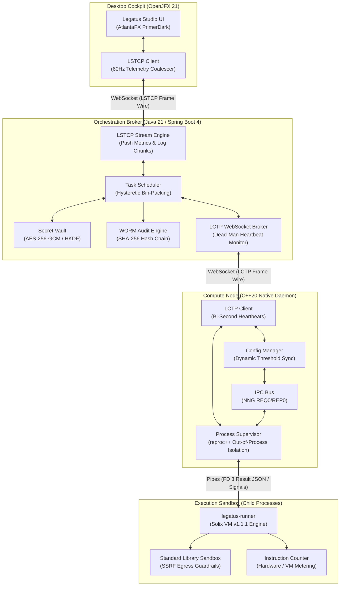

# Legatus: Distributed Serverless Runtime Platform

[](LICENSE)
[](https://github.com/Jehudme/legatus/releases)
[](https://openjdk.org/projects/jdk/21/)
[](https://en.cppreference.com/w/cpp/20)
[](https://openjfx.io/)
[](https://github.com/Jehudme/solix)
[](docs/specs/server-spec.md)

**Legatus** is an enterprise-grade, ultra-high-density distributed serverless runtime designed for deterministic, sandboxed execution of guest [Solix](https://github.com/Jehudme/solix) bytecode workloads. Engineered with high-throughput virtual threads (Java 21 / Project Loom), high-speed native execution daemons (C++20), and a modern desktop operations cockpit (JavaFX / AtlantaFX), Legatus delivers microsecond-level cold starts, discrete instruction budgeting, cryptographic zero-knowledge node attestation, and statutory WORM audit logging.

---

## Architecture & System Topology



---

## Core Subsystems

### 1. `legatus-server` (`server/`)
* **Technology:** Java 21 LTS, Spring Boot 4, Project Loom Virtual Threads, Hibernate 7, H2 disk database with AES-256 encryption.
* **Orchestration:** Multi-node task balancing via `ThresholdScheduler` using hysteretic Exponential Moving Average (EMA) smoothing over CPU/RAM telemetry, active session presence verification, and non-blocking queue draining.
* **Security & Attestation:** Ed25519 public-key node fingerprinting, 3-word visual attestation codes, single-use ticket brokers, PBKDF2/Argon2id operator authentication, and append-only tamper-evident WORM audit logs.
* **Dynamic Cron Engine:** Persisted Quartz/Cron-driven recurring task invocation.

### 2. `legatusd` & `legatus-runner` (`worker/`)
* **Technology:** C++20, `reproc++`, `nng` (nanomsg-next-gen), OpenSSL 3.0 `EVP_MAC`, IXWebSocket, `re2`, `fmt`, `spdlog`.
* **Process Isolation:** Clean isolation between supervisor daemon and guest execution. Task results transmit over a dedicated file descriptor (`--result-file`), completely immune to arbitrary guest `stdout`/`stderr` floods.
* **Signal Lifecycle:** Two-stage cooperative cancellation. Dispatches `SIGTERM` (breaking Solix loops, returning exit code 130/143 as `ABORTED`), escalating to `SIGKILL` at configured timeouts.
* **Sandboxed Standard Library:** Secure HTTP client with DNS-rebinding SSRF protection (`CURLOPT_RESOLVE`), high-performance JSON query engine, cryptographic AES-GCM/Ed25519 primitives, and memory scrubbers (`OPENSSL_cleanse`).

### 3. `legatus-studio` (`studio/`)
* **Technology:** Java 21, OpenJFX 21, AtlantaFX PrimerDark theme, Ikonli vector pack.
* **Telemetry Coalescing:** High-performance reactive property bindings receiving 60Hz LSTCP metric ticks without UI thread blocking.
* **Operator Cockpit:** Visual Quarantine Attestation approvals, 2-column Functions Workbench, Execution Profiles Inspector, Live Duration counters, and embedded live terminal logs.

---

## Quickstart & Installation

### Prerequisites

| Toolchain | Minimum Version | Required By |
| :--- | :--- | :--- |
| **Java JDK** | OpenJDK 21 LTS (Temurin recommended) | Server, Studio |
| **Maven** | 3.9.0+ | Server, Studio |
| **C++ Compiler** | GCC 13+ / Clang 18+ / MSVC v143 (C++20) | Worker Daemon & Runner |
| **CMake** | 3.28+ | Worker Daemon & Runner |
| **Ninja** | 1.11+ | Worker Build System |
| **Libraries** | `libssl-dev`, `libcurl4-openssl-dev`, `libre2-dev`, `zlib1g-dev` | Native Worker |

### 1. Build from Source

```bash
# Clone the repository with submodules
git clone https://github.com/Jehudme/legatus.git
cd legatus

# Build Worker Daemon & Runner (C++20)
cmake -B worker/build -S worker -G Ninja -DCMAKE_BUILD_TYPE=Release
cmake --build worker/build --config Release

# Build Orchestration Server (Java 21)
mvn -f server/pom.xml package -DskipTests

# Build Studio Desktop Cockpit (JavaFX 21)
mvn -f studio/pom.xml package -DskipTests
```

### 2. Start the Cluster

```bash
# Terminal 1: Launch Legatus Server (Port 8443)
java -jar server/target/legatus-server-1.0.0.jar --spring.profiles.active=dev

# Terminal 2: Start Compute Worker Daemon
./worker/build/legatusd -c ~/.config/legatus/worker.toml

# Terminal 3: Launch Studio Desktop Cockpit
mvn -f studio/pom.xml javafx:run
```

---

## Command-Line Interface (`legatus`)

The native operator CLI communicates with the running daemon over high-speed local IPC:

```bash
# Query compute node operational health and capacity
legatus status

# Submit a compiled Solix bytecode workload directly
legatus run --file fibonacci.solbc --entry main --budget 50000000

# Inspect active task execution telemetry
legatus tasks --active

# Gracefully drain worker node for maintenance
legatus drain --enable

# Abort a running or runaway task
legatus abort <task-id>
```

---

## Testing & Quality Matrix

Legatus is verified under a **Four-Layer Military-Grade Quality Pyramid** guaranteeing zero memory corruption, zero zombie processes, and deterministic lifecycle semantics:

```bash
# Run all verification suites in a single command
./scripts/run_all_military_tests.sh
```

| Layer | Subsystem | Framework | Scope & Invariants |
| :--- | :--- | :--- | :--- |
| **Layer 1** | Native Worker | Catch2 v3 / CTest | 32 suites: out-of-process isolation, stdout floods, SIGTERM escalation, SSRF DNS guardrails, memory zeroization. |
| **Layer 2** | Studio Cockpit | JUnit 5 / TestFX | 132 suites: headless UI workflows, multicast frame distribution, modal validation, memory leak prevention. |
| **Layer 3** | Server Platform | Spring Boot / JUnit 5 | 234 suites: bin-packing scheduler, referential integrity cascades, WORM audit verification, dead-man monitors. |
| **Layer 4** | End-to-End Cluster | Bash / JUnit 5 Harness | Real binary integration (`ClusterE2ETest.java` & `test_cluster_e2e.sh`), 1,000-task rapid soak test under ASan/UBSan. |

---

## Documentation Portal

Complete technical documentation is organized in [`docs/`](docs/README.md):

* **Architecture:**
  * [Master System Overview](docs/architecture/overview.md)
  * [Worker Subsystem Architecture](docs/architecture/worker.md)
  * [Server Subsystem Architecture](docs/architecture/server.md)
  * [Studio Cockpit Architecture](docs/architecture/studio.md)
* **Specifications:**
  * [Server Specification](docs/specs/server-spec.md)
  * [Worker Specification](docs/specs/worker-spec.md)
  * [Studio Cockpit Specification](docs/specs/studio-spec.md)
  * [Standard Library Sandbox](docs/specs/stdlib-spec.md)
* **Wire Protocols:**
  * [Worker Wire Protocol (LCTP v1.0)](docs/specs/protocols/worker-wire.md)
  * [Studio Wire Protocol (LSTCP v1.0)](docs/specs/protocols/studio-wire.md)
  * [REST Task & Control API](docs/specs/protocols/api-endpoint.md)
* **Engineering Standards & Guidelines:**
  * [GL-0001: Conventional Commits & SemVer](docs/dev/guidelines/authoring-commits.md)
  * [GL-0002: Trunk-Based Branching Topology](docs/dev/guidelines/branching-conventions.md)
  * [GL-0003: Engineering Lifecycle & Release SOP](docs/dev/guidelines/authoring-workflows.md)
  * [GL-0008: Milestone Delivery & Definition of Done](docs/dev/guidelines/authoring-milestones.md)
  * [GL-0009: Test Engineering & Verification Matrices](docs/dev/guidelines/authoring-test.md)

---

## License

This project is licensed under the **GNU Affero General Public License v3.0 (AGPL-3.0)**. See the [LICENSE](LICENSE) file for details.
