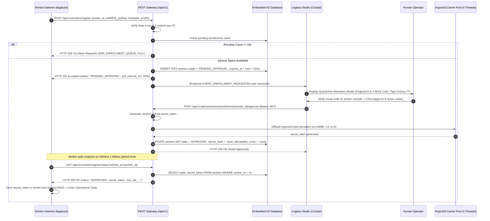
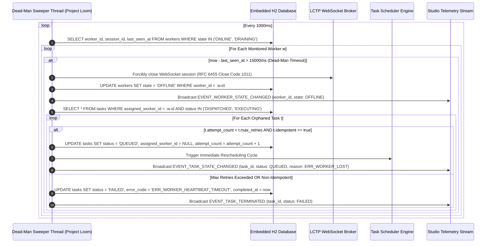

# Server Internal Operations & Brokerage Sequences

## Document Metadata
* **Scope:** Server Subsystem Internal Workflows (`docs/architecture/sequences/server-operations.md`)
* **Status:** Final Implementation Standard
* **Audience:** Backend Systems Engineers, Distributed Systems Architects, Security Engineers
* **Normative Conformance:** RFC 2119 / RFC 8174 (`MUST`, `MUST NOT`, `REQUIRED`, `SHALL`, `SHALL NOT`, `SHOULD`, `SHOULD NOT`, `RECOMMENDED`, `MAY`, `OPTIONAL`)
* **Related Specifications:**
  * [`docs/specs/server-spec.md`](../../specs/server-spec.md)
  * [`docs/specs/protocols/api-endpoint.md`](../../specs/protocols/api-endpoint.md)
  * [`docs/specs/protocols/worker-wire.md`](../../specs/protocols/worker-wire.md)
  * [`docs/specs/protocols/studio-wire.md`](../../specs/protocols/studio-wire.md)
  * [`docs/dev/decisions/0001-adopt-jhipster-for-server-backend.md`](../../dev/decisions/0001-adopt-jhipster-for-server-backend.md)
  * [`docs/dev/decisions/0005-node-enrollment-and-attestation.md`](../../dev/decisions/0005-node-enrollment-and-attestation.md)

---

## 1. Executive Summary & Purpose

The **Legatus Server** (`legatus-server`) operates as the centralized coordination broker of the cluster. It manages cryptographic master key initialization, worker node quarantine enrollment, single-use ephemeral ticket issuance, full-duplex WebSocket connection brokerage, and background dead-man's switch sweeping.

This document formally specifies the internal operational workflows and sequence interactions executed by `legatus-server`. Every operation is expressed via formal sequence diagrams detailing transport boundaries, security verifications, concurrency offloading to Project Loom Virtual Threads, and ACID database mutations.

---

## 2. Bootstrapping, Master Key Derivation & Database Initialization

During application startup, the server enforces cryptographic preconditions and verifies schema integrity prior to opening external network ports:

```mermaid
sequenceDiagram
    autonumber
    participant OS as Host Environment
    participant Boot as Spring Boot Context
    participant Vault as MasterKeyDeriver (HKDF)
    participant H2 as Encrypted H2 Engine
    participant Liquibase as Liquibase Migration Engine
    participant Loom as Virtual Thread Bus

    OS->>Boot: Launch legatus-server.jar (--spring.profiles.active=prod)
    Boot->>OS: Check LEGATUS_MASTER_KEY environment variable
    alt LEGATUS_MASTER_KEY is Missing in prod
        Boot-->>OS: Log CRITICAL: Master key missing -> System.exit(78 / EX_CONFIG)
    else LEGATUS_MASTER_KEY Present
        Boot->>Vault: Derive 256-bit Key via HKDF-SHA256 (Salt: cluster_id, Info: "legatus-vault-v1")
        Vault-->>Boot: Initialize AES-256-GCM Secret Engine
        Boot->>H2: Open JDBC Connection (CIPHER=AES;AUTO_SERVER=TRUE;FILE_LOCK=FS;LOCK_TIMEOUT=10000)
        H2-->>Boot: Database connection established & page decryption active
        Boot->>Liquibase: Execute db.changelog-master.xml
        Liquibase->>H2: Verify checksums in DATABASECHANGELOG table
        Liquibase->>H2: Apply pending SQL changesets (workers, tasks, secrets_vault, audit_logs)
        Liquibase-->>Boot: Migrations verified & up to date
        Boot->>Loom: Initialize Virtual Thread Executor (Executors.newVirtualThreadPerTaskExecutor())
        Boot->>OS: Bind TLS 1.3 HTTP/WS Port (8443) -> Server Ready
    end
```

### 2.1 Normative Invariants
1. **Exit Code 78 on Missing Key:** In production profile (`prod`), if `LEGATUS_MASTER_KEY` is undefined or contains fewer than 32 characters, the server **MUST** abort immediately with exit code `78` (`EX_CONFIG`).
2. **Lock Timeout Invariant:** The JDBC connection string **MUST** configure `LOCK_TIMEOUT=10000` ($10\text{ seconds}$) and `FILE_LOCK=FS` to prevent unrecoverable database deadlocks during burst concurrent transactions.

---

## 3. Worker Quarantine Enrollment & Visual Attestation Flow

Unconfigured workers contact the server's public registration endpoint and are held in quarantine until approved by an operator in `legatus-studio`:



---

## 4. Ephemeral Ticket Exchange & Burn-on-Read WebSocket Upgrade

Long-lived worker credentials (`secret_token`) are never passed in WebSocket upgrade URLs. Instead, workers exchange their credential for a short-lived, single-use ticket:

```mermaid
sequenceDiagram
    autonumber
    participant W as Worker Daemon (legatusd)
    participant REST as REST Gateway (/api/v1/auth)
    participant DB as Embedded H2 Database
    participant Argon as Argon2id Carrier Pool
    participant Cache as Caffeine In-Memory Cache
    participant WS as WebSocket Broker (/ws/worker)

    W->>REST: POST /api/v1/auth/worker (worker_id, secret_token)
    REST->>DB: SELECT secret_hash, state FROM workers WHERE worker_id = :id
    alt Worker State != 'APPROVED' AND Worker State != 'ONLINE'
        REST-->>W: HTTP 403 Forbidden (ERR_WORKER_REVOKED_OR_INACTIVE)
    else Worker Active
        REST->>Argon: Verify secret_token against Argon2id hash
        Argon-->>REST: Password verified (match)
        REST->>REST: Generate ws_tkt_<UUID> (30-Second TTL)
        REST->>Cache: PUT ws_tkt_<UUID> -> worker_id (ExpireAfterWrite: 30s)
        REST-->>W: HTTP 200 OK {"ticket": "ws_tkt_abc123", "ttl_seconds": 30}
        W->>WS: GET /ws/worker?ticket=ws_tkt_abc123 (Upgrade: websocket)
        WS->>Cache: GET ws_tkt_abc123 AND ATOMIC REMOVE
        alt Ticket Missing or Expired
            WS-->>W: HTTP 401 Unauthorized / WS 1008 Policy Violation
        else Ticket Valid & Burned
            WS-->>W: HTTP 101 Switching Protocols (Connection: Upgrade)
            WS->>WS: Bind Virtual Thread to WebSocket Frame Dispatcher
            Note over W,WS: Connection Established; Worker initiates LCTP SESSION_INIT
        end
    end
```

---

## 5. Heartbeat Dead-Man's Switch Sweeper & Orphaned Task Recovery

A background Virtual Thread runs continuously to detect silent worker node drops and automatically recover orphaned tasks:



---

## 6. Verification & Compliance Checklist

- [ ] **Zero Implementation Code:** Contains zero raw multi-line Java implementation blocks (`GL-0005`).
- [ ] **RFC 2119 Precision:** All invariants use bold, uppercase RFC 2119 keywords.
- [ ] **Cryptographic Invariants:** Details HKDF master key derivation, Argon2id 4-thread bounding, and burn-on-read ticket lifecycle.
- [ ] **Dead-Man's Switch Rigor:** Documents exact $15000\text{ ms}$ threshold and deterministic task re-queueing semantics.
- [ ] **Automated Test Coverage:** Flow verified by `MasterKeyBootstrapTest.java`, `WorkerEnrollmentControllerIT.java`, and `DeadManSweeperIT.java`.
