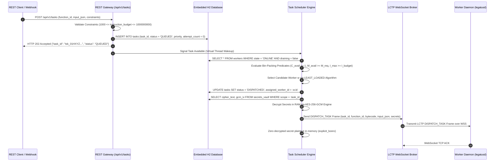
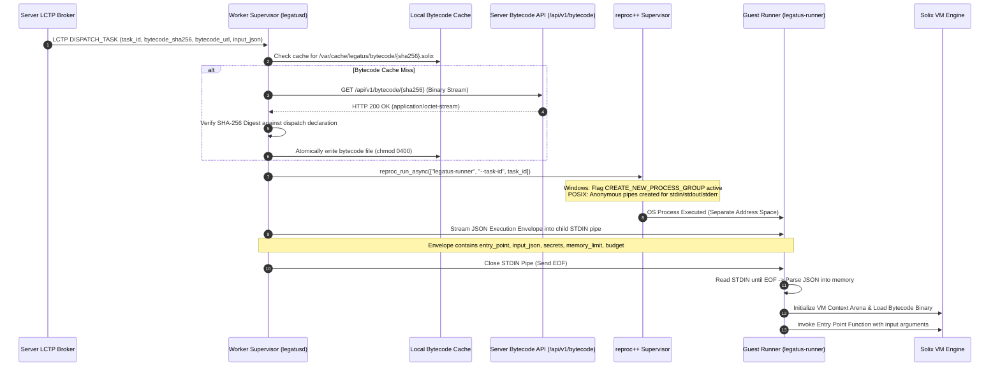
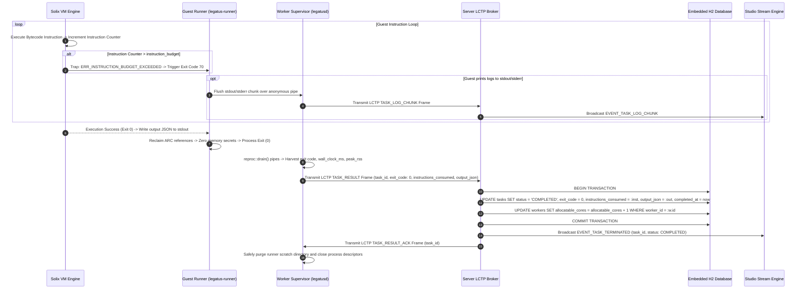
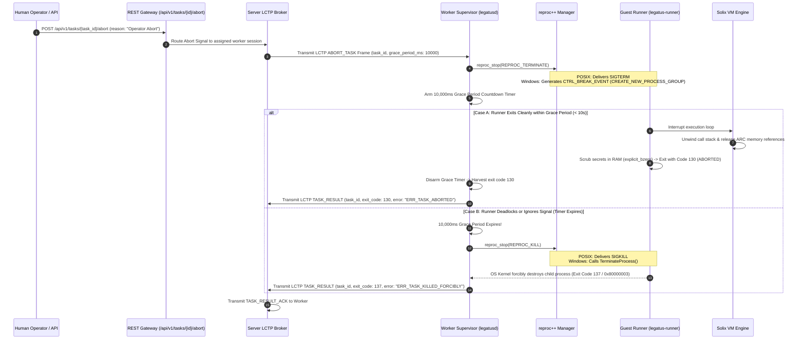

# Task Execution, Metering & Abort Sequences

## Document Metadata
* **Scope:** End-to-End Task Scheduling, Stdin Streaming, Sandboxing & Settlement (`docs/architecture/sequences/task-operations.md`)
* **Status:** Final Implementation Standard
* **Audience:** Core Systems Engineers, Distributed Systems Architects, Runtime Engineers
* **Normative Conformance:** RFC 2119 / RFC 8174 (`MUST`, `MUST NOT`, `REQUIRED`, `SHALL`, `SHALL NOT`, `SHOULD`, `SHOULD NOT`, `RECOMMENDED`, `MAY`, `OPTIONAL`)
* **Related Specifications:**
  * [`docs/specs/worker-spec.md`](../../specs/worker-spec.md)
  * [`docs/specs/server-spec.md`](../../specs/server-spec.md)
  * [`docs/specs/protocols/worker-wire.md`](../../specs/protocols/worker-wire.md)
  * [`docs/specs/protocols/api-endpoint.md`](../../specs/protocols/api-endpoint.md)
  * [`docs/dev/decisions/0004-adopt-solix-for-worker-runner.md`](../../dev/decisions/0004-adopt-solix-for-worker-runner.md)
  * [`docs/dev/decisions/0008-adopt-reproc-for-worker-task-isolation.md`](../../dev/decisions/0008-adopt-reproc-for-worker-task-isolation.md)

---

## 1. Executive Summary & Purpose

The execution of guest serverless workloads represents the core compute mandate of the Legatus platform. Tasks transition through a distributed lifecycle encompassing HTTP client submission, server capacity bin-packing, Layer 7 WebSocket dispatch, anonymous `stdin` stream injection (bypassing Windows command-line character ceilings), deterministic instruction metering inside the upstream **Solix Virtual Machine**, ledger-safe two-phase result acknowledgment (`TASK_RESULT` $\to$ `TASK_RESULT_ACK`), and two-stage cooperative kill escalation.

This document formally specifies the end-to-end task operational flows, sequence interactions, and failure-containment boundaries across `server`, `legatusd`, and `legatus-runner`.

---

## 2. Task Submission, Capacity Scheduling & WebSocket Dispatch

---

## 3. Worker Sandbox Spawning & Stdin Envelope Streaming

To guarantee cross-platform reliability on Windows (which caps command-line strings at 32,767 characters), `legatusd` never passes execution envelopes via CLI arguments. Envelopes are streamed into the child runner via an anonymous `stdin` pipe:

---

## 4. Execution, Metering, Result Commit & Ledger Acknowledgment

The worker and server enforce a two-phase ledger commit protocol to ensure task completion metrics are safely persisted before local runner artifacts are purged:

---

## 5. Two-Stage Abort & Cooperative Termination Escalation

When an operator clicks **[Abort Task]** in `legatus-studio` or issues `legatus tasks kill`, the platform executes a deterministic two-stage kill escalation protocol:

---

## 6. Verification & Compliance Checklist

- [ ] **Zero Implementation Code:** Contains zero raw C++ or Java implementation blocks (`GL-0005`).
- [ ] **Stdin Envelope Invariant:** Documents streaming execution envelopes via anonymous `stdin` pipes, eliminating Windows 32KB CLI limits.
- [ ] **Two-Phase Ledger Safety:** Details the mandatory `TASK_RESULT` $\to$ `TASK_RESULT_ACK` round-trip confirmation before worker artifact cleanup.
- [ ] **Escalation Rigor:** Specifies the 10,000ms grace period countdown transitioning from `terminate` (`130`) to unconditional `kill` (`137`).
- [ ] **Automated Test Coverage:** Verified via `test_runner_stdin_injection.cpp`, `test_runner_two_stage_kill.cpp`, and `TaskSchedulerIT.java`.
