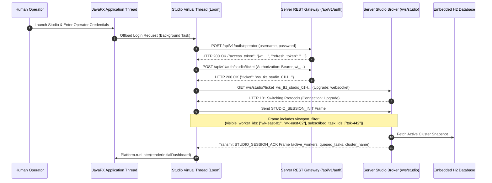
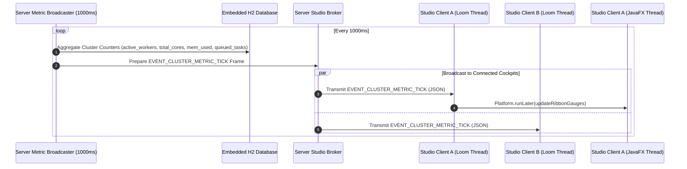
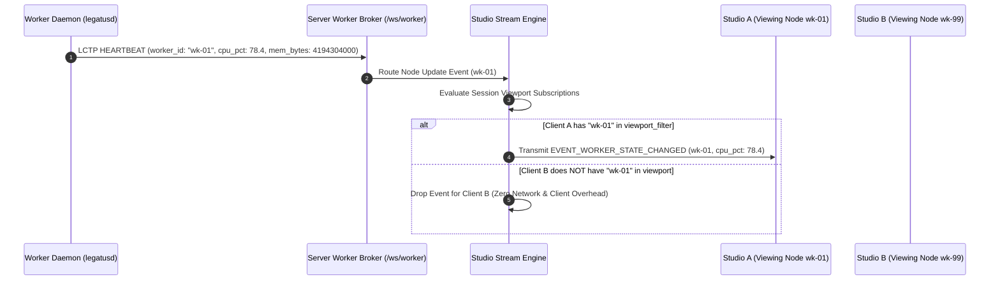

# Telemetry Streaming & Studio Coalescing Sequences

## Document Metadata
* **Scope:** Cluster Telemetry Broadcasting & Desktop UI Coalescing (`docs/architecture/sequences/telemetry-operations.md`)
* **Status:** Final Implementation Standard
* **Audience:** UI/UX Architects, Backend Systems Engineers, Telemetry Engineers
* **Normative Conformance:** RFC 2119 / RFC 8174 (`MUST`, `MUST NOT`, `REQUIRED`, `SHALL`, `SHALL NOT`, `SHOULD`, `SHOULD NOT`, `RECOMMENDED`, `MAY`, `OPTIONAL`)
* **Related Specifications:**
  * [`docs/specs/studio-spec.md`](../../specs/studio-spec.md)
  * [`docs/specs/server-spec.md`](../../specs/server-spec.md)
  * [`docs/specs/protocols/studio-wire.md`](../../specs/protocols/studio-wire.md)
  * [`docs/dev/decisions/0002-adopt-javafx-for-studio-ui.md`](../../dev/decisions/0002-adopt-javafx-for-studio-ui.md)

---

## 1. Executive Summary & Purpose

In a distributed serverless cluster, hundreds of compute nodes continuously generate operational metrics: CPU/RAM host utilization, task completion rates, queue depth oscillations, and bursty standard output logs. If every telemetry frame is broadcast indiscriminately or rendered directly upon arrival, two severe failure modes emerge:
1. **Desktop Main-Thread Starvation:** In UI architectures (such as JavaFX or WebViews), rendering each incoming packet individually overwhelms the application thread, causing frame rates to collapse below 10 FPS and locking up operator controls.
2. **Network & Deserialization Flooding:** In clusters with hundreds of nodes, broadcasting full worker status arrays every second consumes excessive client bandwidth and triggers garbage collection churn.

This document formally specifies the telemetry distribution architecture of Legatus: server-side **Viewport Subscription Scoping** (`viewport_filter`), 1000ms aggregate metric ticks, and client-side **60Hz Telemetry Coalescing** backed by bounded lock-free ring buffers.

---

## 2. Studio Session Handshake & Viewport Subscription Scoping

When `legatus-studio` connects to `legatus-server`, it scopes its telemetry interest using viewport filters to ensure it only receives detailed state frames for visible nodes:



---

## 3. Aggregate Cluster Metric Tick Broadcasting (1000ms Cadence)

To maintain the top telemetry ribbon without per-node stream saturation, the server publishes a synchronized metric tick once per second:



---

## 4. Worker State Mutation & Viewport Scoping Enforcement

When an individual worker experiences a capacity mutation or state transition, the server inspects client viewport subscriptions before serializing and transmitting updates:



---

## 5. Task Log Streaming, 60Hz UI Batching & Ring-Buffer Eviction

To display high-throughput task console output without freezing the desktop UI, `legatus-studio` decouples network frame reception from scene graph rendering:

```mermaid
sequenceDiagram
    autonumber
    participant Runner as Guest Runner (legatus-runner)
    participant Daemon as Worker Daemon (legatusd)
    participant Server as Server Studio Broker
    participant Loom as Studio Virtual Thread (Loom)
    participant Ring as Lock-Free Ring Buffer (ConcurrentLinkedQueue)
    participant Coalescer as 60Hz Telemetry Coalescer (16.6ms Timer)
    participant UI as JavaFX Application Thread

    Runner->>Daemon: stdout chunk emitted over anonymous pipe
    Daemon->>Server: Transmit LCTP TASK_LOG_CHUNK Frame (task_id, chunk_index, payload_b64)
    Server->>Loom: Transmit EVENT_TASK_LOG_CHUNK over /ws/studio
    Loom->>Loom: Base64 Decode Chunk into UTF-8 String lines
    Loom->>Ring: Enqueue lines into Task Console Ring Buffer
    Note over Ring: Virtual Thread terminates immediately; Zero UI contention
    loop Every 16.6ms (60 FPS Clock)
        Coalescer->>Ring: Poll all pending lines accumulated in interval
        alt Pending Lines > 0
            Coalescer->>UI: Platform.runLater(() -> appendBatch(lines))
            UI->>UI: Append lines to TextArea scene graph node
            UI->>UI: Check buffer bounds (lines <= 10,000 && memory <= 8 MB)
            opt Buffer Bound Exceeded
                UI->>UI: Evict oldest lines in FIFO order
            end
        end
    end
```

---

## 6. Verification & Compliance Checklist

- [ ] **Zero Implementation Code:** Contains zero raw Java or FXML implementation code blocks (`GL-0005`).
- [ ] **Viewport Filtering Invariant:** Documents server-side filtering of `EVENT_WORKER_STATE_CHANGED` based on `viewport_filter`.
- [ ] **60Hz Telemetry Coalescing:** Details the 16.6ms UI frame batching decoupling network reception from scene graph rendering.
- [ ] **Memory Bounded Console:** Specifies the 10,000-line / 8 MB FIFO eviction ceiling to prevent desktop client memory leaks.
- [ ] **Automated Test Coverage:** Verified via `StudioTelemetryStreamIT.java` and `TelemetryCoalescerTest.java`.
