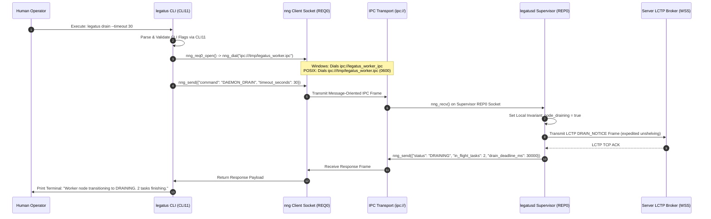
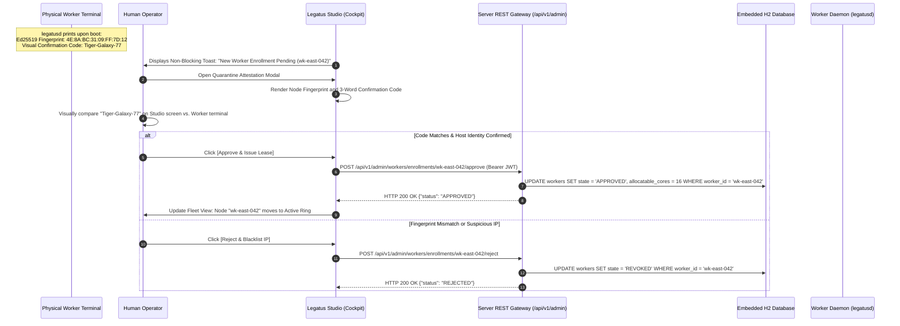
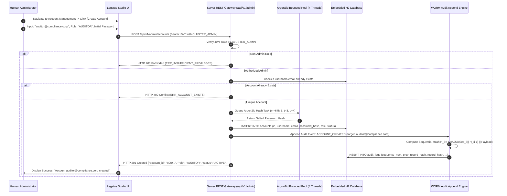
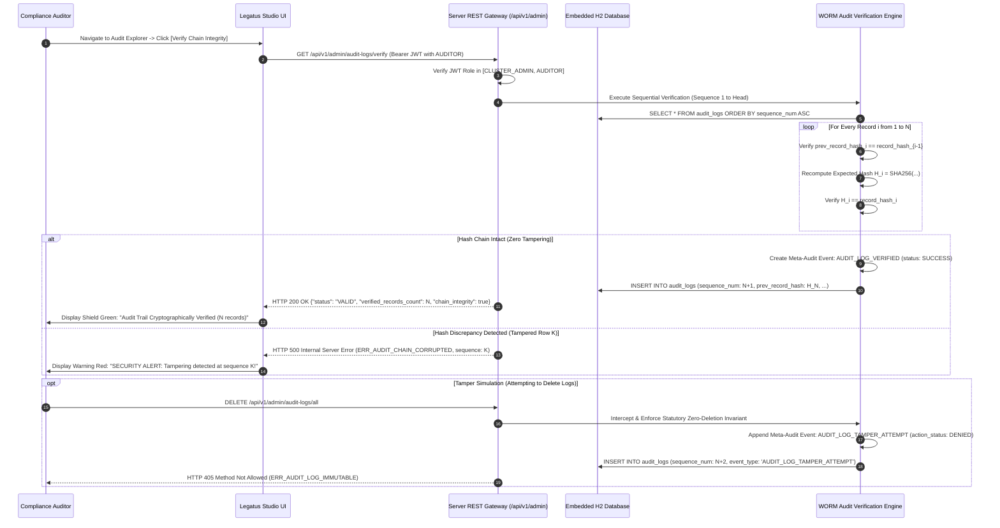

# Operator Administrative & User Operations Sequences

## Document Metadata
* **Scope:** Operator CLI Local IPC, Studio Cockpit Attestation & Function Cataloging (`docs/architecture/sequences/user-operations.md`)
* **Status:** Final Implementation Standard
* **Audience:** Core Systems Engineers, Platform Operators, UI/UX Architects, Security Engineers
* **Normative Conformance:** RFC 2119 / RFC 8174 (`MUST`, `MUST NOT`, `REQUIRED`, `SHALL`, `SHALL NOT`, `SHOULD`, `SHOULD NOT`, `RECOMMENDED`, `MAY`, `OPTIONAL`)
* **Related Specifications:**
  * [`docs/specs/worker-spec.md`](../../specs/worker-spec.md)
  * [`docs/specs/studio-spec.md`](../../specs/studio-spec.md)
  * [`docs/specs/protocols/api-endpoint.md`](../../specs/protocols/api-endpoint.md)
  * [`docs/dev/decisions/0002-adopt-javafx-for-studio-ui.md`](../../dev/decisions/0002-adopt-javafx-for-studio-ui.md)
  * [`docs/dev/decisions/0005-node-enrollment-and-attestation.md`](../../dev/decisions/0005-node-enrollment-and-attestation.md)
  * [`docs/dev/decisions/0007-adopt-nng-for-local-daemon-ipc.md`](../../dev/decisions/0007-adopt-nng-for-local-daemon-ipc.md)

---

## 1. Executive Summary & Purpose

Platform operations within the Legatus ecosystem divide into two administrative channels:
1. **Interactive Node Control via Operator CLI (`legatus`):** High-speed, local-only inter-process communication with the local supervisor daemon (`legatusd`) over `nng` IPC sockets, guaranteeing zero direct network coupling to the remote server.
2. **Visual Cluster Management via Desktop Cockpit (`legatus-studio`):** Secure operator attestation of quarantined compute nodes, Solix function bytecode deployment, live task log observation, and cluster-wide emergency drainage.

This document formally specifies the operator workflows, communication framing, IPC protocols, and security attestations executed during user-initiated administrative actions.

---

## 2. Local Operator CLI & Daemon IPC (`nng` over `ipc://`)

The `legatus` CLI utility manages the local node daemon strictly over local IPC, abstracting Unix Domain Sockets and Windows Named Pipes via `nng` Request/Reply (`REQ0`/`REP0`):



---

## 3. Visual Quarantine Attestation & Node Lease Approval via Studio

When a newly installed worker contacts `legatus-server`, it is quarantined until an operator visually confirms its cryptographic identity in `legatus-studio`:



---

## 4. Solix Function Deployment & Bytecode Cataloging Flow

Developers and operators publish serverless compute functions to the centralized catalog via the Studio UI or REST API:

```mermaid
sequenceDiagram
    autonumber
    participant Dev as Developer / Operator
    participant Studio as Legatus Studio UI
    participant REST as Server REST Gateway (/api/v1/functions)
    participant DB as Embedded H2 Database
    participant Cache as Server Bytecode Cache

    Dev->>Studio: Drag & Drop 'image_resizer.solix' + Configure Entry Point
    Studio->>Studio: Compute Local SHA-256 Digest of Bytecode Binary
    Studio->>REST: POST /api/v1/functions (Multipart Form: metadata JSON + binary stream)
    REST->>REST: Stream Binary Stream -> Calculate Server SHA-256 Digest
    alt Computed Digest != Declared Digest
        REST-->>Studio: HTTP 400 Bad Request (ERR_BYTECODE_DIGEST_MISMATCH)
    else Digest Valid
        REST->>DB: Check if bytecode_sha256 already exists in database
        alt Bytecode Deduplicated (Cache Hit)
            REST->>DB: INSERT INTO functions (name, semver, entry_point, bytecode_sha256, default_budget)
            Note over REST,DB: References existing BLOB record; Zero redundant storage
        else New Bytecode Binary
            REST->>DB: INSERT INTO bytecode_blobs (sha256, binary_blob, size_bytes)
            REST->>DB: INSERT INTO functions (name, semver, entry_point, bytecode_sha256, default_budget)
            REST->>Cache: Cache raw binary in server byte arena
        end
        REST-->>Studio: HTTP 201 Created {"function_id": "fnc_01H...", "bytecode_sha256": "4a7b..."}
        Studio->>Dev: Display Success: "Function 'image_resizer:v1.0.0' registered and ready for dispatch."
    end
```

---

## 5. Operator Account Provisioning & RBAC Lifecycle Sequence

The cluster administrator provisions and manages multi-tier operator and auditor accounts through Legatus Studio or the REST API:



---

## 6. Statutory Audit Trail Verification & Meta-Auditing Sequence

Compliance auditors inspect and verify the tamper-evident WORM audit trail. Every audit action is itself recorded to ensure zero unmonitored access ("Auditing the Auditors"):



---

## 7. Verification & Compliance Checklist

- [ ] **Zero Implementation Code:** Contains zero raw C++ or Java implementation code blocks (`GL-0005`).
- [ ] **Local IPC Architecture:** Enforces `nng` Request/Reply (`REQ0`/`REP0`) without binding to TCP loopback interfaces (`ADR-0007`).
- [ ] **Visual Attestation Protocol:** Formally details the human-in-the-loop 3-word visual confirmation workflow (`Tiger-Galaxy-77`).
- [ ] **Bytecode Deduplication:** Specifies SHA-256 content-addressable storage for Solix binaries in the central catalog.
- [ ] **RBAC Provisioning Sequence:** Formally details multi-operator provisioning and privilege boundaries (`CLUSTER_ADMIN`, `OPERATOR`, `AUDITOR`).
- [ ] **Statutory WORM Verification:** Sequences cryptographic hash-chain verification and meta-audit logging ("Auditing the Auditors").
- [ ] **Automated Test Coverage:** Verified via `test_cli_ipc.cpp`, `FunctionCatalogIT.java`, `StudioEnrollmentViewTest.java`, and `AuditLogVerificationIT.java`.
