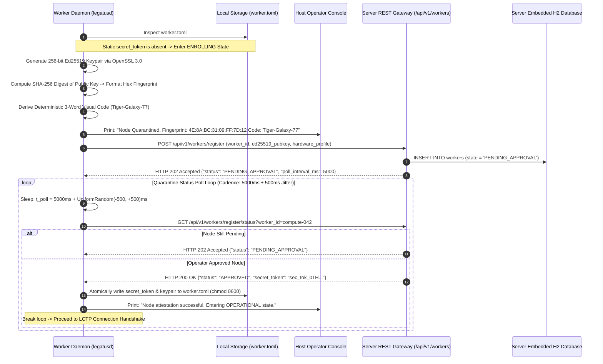
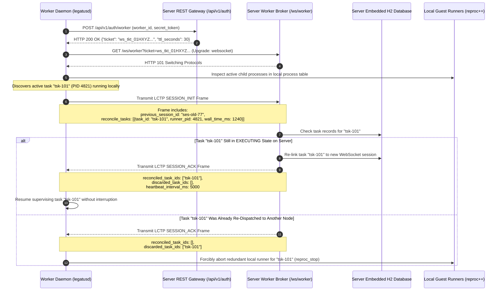
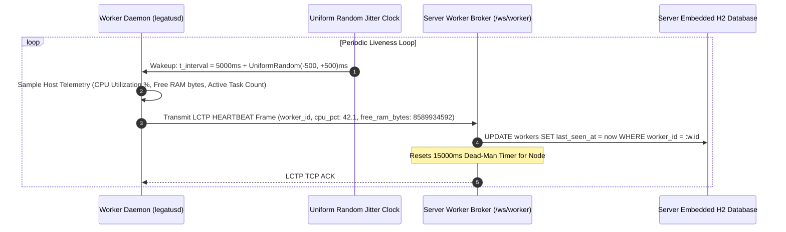
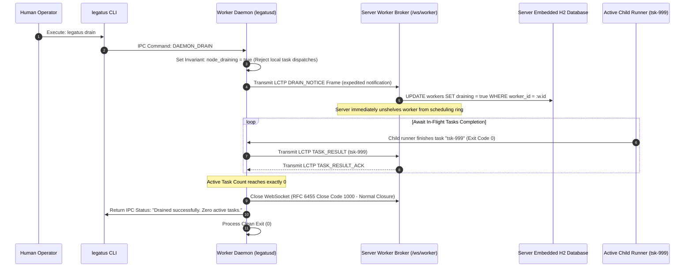

# Worker Daemon Lifecycle & LCTP Connection Sequences

## Document Metadata
* **Scope:** Worker Daemon Bootstrapping, LCTP Handshake, Heartbeat & Fault Recovery (`docs/architecture/sequences/worker-operations.md`)
* **Status:** Final Implementation Standard
* **Audience:** Core Systems Engineers, Worker Daemon Implementers, Distributed Protocol Architects
* **Normative Conformance:** RFC 2119 / RFC 8174 (`MUST`, `MUST NOT`, `REQUIRED`, `SHALL`, `SHALL NOT`, `SHOULD`, `SHOULD NOT`, `RECOMMENDED`, `MAY`, `OPTIONAL`)
* **Related Specifications:**
  * [`docs/specs/worker-spec.md`](../../specs/worker-spec.md)
  * [`docs/specs/protocols/worker-wire.md`](../../specs/protocols/worker-wire.md)
  * [`docs/specs/server-spec.md`](../../specs/server-spec.md)
  * [`docs/dev/decisions/0005-node-enrollment-and-attestation.md`](../../dev/decisions/0005-node-enrollment-and-attestation.md)
  * [`docs/dev/decisions/0006-worker-reconnect-and-polling-cadence.md`](../../dev/decisions/0006-worker-reconnect-and-polling-cadence.md)
  * [`docs/dev/decisions/0008-adopt-reproc-for-worker-task-isolation.md`](../../dev/decisions/0008-adopt-reproc-for-worker-task-isolation.md)

---

## 1. Executive Summary & Purpose

The **Legatus Worker Supervisor Daemon** (`legatusd`) manages local compute capacity, supervises sandboxed child task processes (`legatus-runner`), and maintains a persistent, full-duplex WebSocket connection (`LCTP`) to the centralized cluster broker (`legatus-server`).

Operating compute nodes across heterogeneous, untrusted network environments demands robust fault recovery invariants:
1. **Zero-Configuration Bootstrapping:** Initial node onboarding requires zero pre-shared static credentials.
2. **Session Reconciliation:** Transient network partitions must not trigger split-brain task duplication or terminate long-running guest jobs.
3. **Thundering Herd Mitigation:** All periodic transmissions (quarantine polling, heartbeats, and reconnect loops) must incorporate uniform randomized jitter ($t \pm \Delta$).
4. **Graceful Node Evacuation:** When hosts require scheduled kernel patches or reboots, nodes must withdraw from scheduling immediately via expedited drain notifications.

This document formally specifies the autonomous operational sequences, handshakes, and failure-recovery protocols executed by `legatusd`.

---

## 2. First Boot, Quarantine Registration & Polling Loop

When `legatusd` launches on a newly provisioned host with an unconfigured `worker.toml`, it automatically generates a local cryptographic identity and submits a registration request:

---

## 3. LCTP Connection Handshake & In-Flight Session Reconciliation

When establishing a WebSocket connection to `legatus-server`, `legatusd` submits active local runner processes in `SESSION_INIT` to seamlessly reconcile state after network drops:

---

## 4. Heartbeat Dead-Man's Switch & Randomized Jitter Cadence

Compute nodes continuously transmit liveness telemetry to reset the server's 15-second dead-man's switch:

---

## 5. Graceful Node Evacuation & Expedited Drain Notice

When an administrator marks a node for maintenance or triggers `legatus drain`, `legatusd` immediately unshelves itself from the server's scheduling candidate pool:

---

## 6. Verification & Compliance Checklist

- [ ] **Zero Implementation Code:** Contains zero raw C++ implementation code blocks (`GL-0005`).
- [ ] **In-Flight Session Reconciliation:** Formally specifies the `reconcile_tasks` handshake preventing duplicate execution across network drops (`ADR-0006`).
- [ ] **Uniform Randomized Jitter:** Mandates uniform jitter ($5000\text{ ms} \pm 500\text{ ms}$) on polling and heartbeats to eliminate thundering herd storms.
- [ ] **Expedited Drain Notice:** Details immediate scheduling unshelving via `DRAIN_NOTICE` frames.
- [ ] **Automated Test Coverage:** Verified via `test_worker_fsm.cpp`, `test_heartbeat_jitter.cpp`, and `WorkerReconciliationIT.java`.
