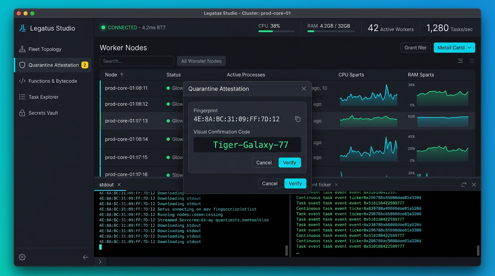

# Legatus Studio Cockpit Wireframe Specification

## Document Metadata
* **Scope:** Desktop UI/UX Layout & View Hierarchy (`docs/architecture/wireframes/studio/`)
* **Status:** Final Implementation Standard
* **Audience:** Desktop UI Engineers, UI/UX Designers, Platform Operators
* **Host Toolkit:** Java 21 LTS + OpenJFX 21 + AtlantaFX CSS Design System
* **Normative Conformance:** RFC 2119 / RFC 8174 (`MUST`, `MUST NOT`, `REQUIRED`, `SHALL`, `SHALL NOT`, `SHOULD`, `SHOULD NOT`, `RECOMMENDED`, `MAY`, `OPTIONAL`)
* **Related Specifications:**
  * [`docs/specs/studio-spec.md`](../../../specs/studio-spec.md)
  * [`docs/specs/protocols/studio-wire.md`](../../../specs/protocols/studio-wire.md)
  * [`docs/dev/decisions/0002-adopt-javafx-for-studio-ui.md`](../../../dev/decisions/0002-adopt-javafx-for-studio-ui.md)
  * [`docs/dev/decisions/0005-node-enrollment-and-attestation.md`](../../../dev/decisions/0005-node-enrollment-and-attestation.md)

---

## 1. Executive Summary & Design Principles

**Legatus Studio** (`legatus-studio`) is a native desktop systems administration cockpit designed for high-density cluster observability, cryptographic worker attestation, and real-time execution monitoring. The interface adheres to four core design principles:

1. **Persistent 4-Zone Cockpit Layout:** Critical telemetry and navigation remain anchored and visible at all times regardless of deep nested views.
2. **60Hz Telemetry Coalescing:** High-frequency WebSocket metrics and task log chunks are batched into $16.6\text{ ms}$ scene graph updates, guaranteeing smooth 60 FPS performance without UI thread stutter.
3. **High-Contrast Dark Theme Aesthetics:** Standardizes on AtlantaFX's `PrimerDark` and `NordDark` themes optimized for Network Operations Centers (NOCs) and low-light environments.
4. **Visual Cryptographic Safety:** High-risk actions (quarantine approvals, node revocations, task kills) feature prominent, color-coded visual confirmation codes (`Tiger-Galaxy-77`) and multi-stage escalation controls.

---

## 2. Persistent 4-Zone Cockpit Topology

The desktop application window maintains a strict, four-zone visual partitioning:

```
+---------------------------------------------------------------------------------------------------+
|  [ZONE 2: TOP TELEMETRY RIBBON]                                                                   |
|  * Legatus Core (8443)  [CONNECTED]  RTT: 3.4ms | CPU: [||||||||  ] 38% | RAM: [||||||    ] 42%   |
|  Active Workers: 42 | In-Flight Tasks: 128 | Queue Depth: 0 | Quarantine: [2 PENDING]             |
+-------------------+-------------------------------------------------------------------------------+
| [ZONE 1: NAV RAIL]| [ZONE 3: PRIMARY WORKSPACE]                                                   |
|                   |                                                                               |
| [*] Overview      | +-- WORKER FLEET TOPOLOGY -------------------------------------------------+  |
| [ ] Fleet (42)    | | Worker ID        Hostname       OS/Arch   Cores   RAM (Free)   State   Load  |  |
| [!] Quarantined 2 | | wk-east-01       compute-01     Linux/x64 16/16   28.4 GB      ONLINE  14%   |  |
| [ ] Functions (8) | | wk-east-02       compute-02     Linux/x64 16/16   31.1 GB      ONLINE   8%   |  |
| [ ] Tasks (128)   | | wk-win-01        win-node-01    Win/x64   32/32   58.2 GB      ONLINE  22%   |  |
| [ ] Secrets Vault | | wk-edge-09       edge-arm-09    Linux/arm 4/4     6.8 GB       DRAINING 80%  |  |
|                   | +--------------------------------------------------------------------------+  |
|                   |                                                                               |
|                   | +-- QUARANTINE ATTESTATION MODAL (POPUP) ----------------------------------+  |
|                   | | Node: compute-linux-east-042 (10.0.4.12) | Linux 6.8.0 x86_64            |  |
|                   | | Hardware: 16 Physical Cores / 32 GB RAM  | Declared Quota: 16 Cores      |  |
|                   | | Ed25519 Fingerprint: 4E:8A:BC:31:09:FF:7D:12                             |  |
|                   | | Visual Confirmation Code: [ TIGER - GALAXY - 77 ]                        |  |
|                   | |                                                                          |  |
|                   | |  [ Reject & Blacklist ]                  [ Approve & Issue Lease ]       |  |
|                   | +--------------------------------------------------------------------------+  |
+-------------------+-------------------------------------------------------------------------------+
| [ZONE 4: BOTTOM COLLAPSIBLE DRAWER]                                                               |
| Tabs: [Live Task Console (tsk-01HXYZ)]  [Cluster Event Log]  [Security Audit Trail]               |
| 17:30:01.102 [tsk-01HXYZ] [STDOUT] Initializing Solix VM Context arena: 64MB reserved.            |
| 17:30:01.105 [tsk-01HXYZ] [STDOUT] Executing entry point 'process_payload' with 4 input args.     |
| 17:30:01.142 [tsk-01HXYZ] [STDOUT] Instruction counter: 142,890 cycles consumed.                  |
| 17:30:01.150 [tsk-01HXYZ] [STDOUT] Result output JSON generated (248 bytes). Task complete.       |
+---------------------------------------------------------------------------------------------------+
```

---

## 3. Primary Workspace View Specifications

### 3.1 Zone 1: Navigation Rail
* Width: Fixed $72\text{ px}$ (collapsed icon rail) or $220\text{ px}$ (expanded text rail).
* Icons: Vector Feather icons via `Ikonli` (`ikonli-javafx`).
* Modules:
  * **Overview:** Aggregate cluster health, sparklines, and recent task throughput.
  * **Worker Fleet:** Filterable, sortable tabular fleet manager with status badges (`ONLINE`, `DRAINING`, `OFFLINE`).
  * **Quarantine Attestation:** Highlighted badge showing pending approval count.
  * **Functions & Bytecode:** Catalog browser, upload dropzone, SHA-256 digest viewer.
  * **Task Explorer:** Searchable task ledger with live metering gauges and abort controls.
  * **Secrets Vault:** Key-value store for AES-256-GCM encrypted guest secrets.

### 3.2 Zone 2: Top Telemetry Ribbon
* Height: Fixed $48\text{ px}$.
* Connection Indicator: Pulsing green dot when WebSocket is connected, amber when reconnecting with jitter, red when offline.
* Round-Trip Latency: Displays live $RTT\text{ ms}$ calculated from heartbeat ping/pong timestamps.
* Gauges: AtlantaFX micro-progress bars displaying aggregate cluster CPU and RAM percentages.

### 3.3 Zone 3: Primary Workspace & Quarantine Attestation Modal
* Master-Detail Layout: Left side lists entities; right side displays contextual details, real-time graphs, and action buttons.
* **Quarantine Attestation Modal (`ADR-0005`):**
  * Displays host identity (`worker_id`, OS, CPU architecture, source IP).
  * Prominently highlights the colon-separated SHA-256 fingerprint (`4E:8A:BC:31:09:FF:7D:12`).
  * Displays the **3-Word Visual Confirmation Code** (`Tiger-Galaxy-77`) in a high-contrast amber card with large bold typography (`18pt`).
  * Operator actions: **[Approve & Issue Lease]** (`accent` green button) or **[Reject & Block IP]** (`danger` red button).

### 3.4 Zone 4: Bottom Collapsible Drawer
* Height: Default $220\text{ px}$, resizable via drag splitter, collapsible to $32\text{ px}$.
* Log Console: Monospace font (`JetBrains Mono`, `11pt`) with ANSI color highlighting.
* Ring Buffer Bound: Fixed circular buffer capped at **10,000 lines** (or **8 MB** of UTF-8 text). Evicts oldest lines in FIFO order when exceeded (`studio-spec.md` Section 5.2).

---

## 4. Visual Mockup Reference

A high-fidelity graphical mockup of the Legatus Studio cockpit is available at:
* Visual File: [`docs/architecture/wireframes/studio/studio-wireframe.png`](studio-wireframe.png)

```markdown

```

---

## 5. Verification & TestFX Conformance Checklist

- [ ] **Thread Confinement:** All UI scene graph operations are invoked via `Platform.runLater()` (`GL-0011`).
- [ ] **Coalesced Updates:** Telemetry updates are buffered and executed at $\le 60\text{ Hz}$.
- [ ] **Attestation Modal Elements:** Modal exposes accessible test IDs (`#btn-approve`, `#btn-reject`, `#lbl-confirmation-code`).
- [ ] **Console Memory Bound:** Verified that pushing 50,000 log lines results in exactly 10,000 retained lines.
- [ ] **Headless Test Pass:** Tested with OpenJFX Monocle under `TestFX` in CI.
