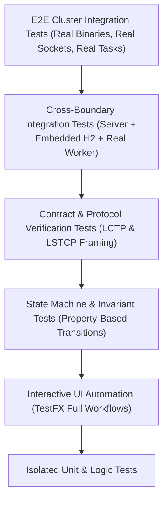

# Comprehensive Multi-Project Codebase Gap Analysis & System Audit Report
## Legatus Distributed Serverless Runtime: Server, Worker Daemon, and Studio Cockpit

* **Date:** 2026-10-16
* **Classification:** Comprehensive Architectural & Quality Audit
* **Status:** IN_PROGRESS (Multi-Pass Audit)
* **Audited Targets:**
  * `legatus-server` (Java 21 LTS / Spring Boot 4 / Netty / JPA / Liquibase / Virtual Threads)
  * `legatusd` & `legatus-runner` (C++20 / Reproc / IXWebSocket / ZeroMQ / Solix Sandbox)
  * `legatus-studio` (Java 21 LTS / JavaFX 21 / AtlantaFX PrimerDark / Reactive WebSockets)

---

## 1. Executive Summary: Live Testing Defect Autopsy

During live cluster testing with the server, worker, and Studio cockpit actively executing, six severe regressions and operational blockers were surfaced by the operator. Below is the technical root cause analysis for each reported issue:

### 1.1 "Revoke Lease and Delete Worker Buttons Do Not Work"
* **Affected Files:**
  * [`WorkerEnrollmentService.java`](file:///home/jehud/Projects/legatus/server/src/main/java/dev/legatus/server/service/WorkerEnrollmentService.java#L559-L680)
  * [`WorkerAdminResource.java`](file:///home/jehud/Projects/legatus/server/src/main/java/dev/legatus/server/web/rest/WorkerAdminResource.java#L430-L440)
  * [`20231229210633_added_entity_constraints_ComputeTask.xml`](file:///home/jehud/Projects/legatus/server/src/main/resources/config/liquibase/changelog/20231229210633_added_entity_constraints_ComputeTask.xml#L20-L25)
  * [`FleetViewModel.java`](file:///home/jehud/Projects/legatus/studio/src/main/java/com/legatus/studio/viewmodel/FleetViewModel.java#L202-L245)
* **Root Cause:**
  1. **Referential Integrity Violation (Delete):** In Liquibase changeset `20231229210633-2`, foreign key constraint `fk_tasks__assigned_worker_id` binds `tasks.assigned_worker_worker_id` to `workers.worker_id` without `ON DELETE SET NULL` or `ON DELETE CASCADE`. In [`WorkerEnrollmentService.java`](file:///home/jehud/Projects/legatus/server/src/main/java/dev/legatus/server/service/WorkerEnrollmentService.java#L623), `workerNodeRepository.delete(worker)` is called directly. Whenever historical tasks exist in the database for that worker, Hibernate triggers an unhandled `DataIntegrityViolationException`, causing a 500 Internal Server Error and aborting the transaction.
  2. **Socket Non-Severance (Revoke):** In [`WorkerEnrollmentService.java`](file:///home/jehud/Projects/legatus/server/src/main/java/dev/legatus/server/service/WorkerEnrollmentService.java#L658), `revokeWorker()` mutates the database state to `REVOKED`, but **never terminates the active WebSocket connection** in `WorkerSessionRegistry`. Because the worker process remains alive and transmits heartbeats every 5 seconds, subsequent heartbeats clobber or conflict with the revoked state.
  3. **Studio Error Suppression:** In [`FleetViewModel.java`](file:///home/jehud/Projects/legatus/studio/src/main/java/com/legatus/studio/viewmodel/FleetViewModel.java#L240), failed HTTP DELETE responses only update a bottom `statusMessage` string without displaying an error alert modal, giving the appearance of an unresponsive button when the backend returns 500.

### 1.2 "Threshold Breach Error When Well Under Threshold"
* **Affected Files:**
  * [`LctpWorkerWebSocketHandler.java`](file:///home/jehud/Projects/legatus/server/src/main/java/dev/legatus/server/web/websocket/lctp/LctpWorkerWebSocketHandler.java#L294)
  * [`ThresholdScheduler.java`](file:///home/jehud/Projects/legatus/server/src/main/java/dev/legatus/server/orchestration/balancer/ThresholdScheduler.java#L85-L108)
* **Root Cause:**
  1. **Total Memory vs Allocatable Memory Inversion:** In [`LctpWorkerWebSocketHandler.java`](file:///home/jehud/Projects/legatus/server/src/main/java/dev/legatus/server/web/websocket/lctp/LctpWorkerWebSocketHandler.java#L294):
     ```java
     long totalMem = w.getTotalMemoryBytes() != null && w.getTotalMemoryBytes() > 0 ? w.getTotalMemoryBytes() : (1024L * 1024 * 1024);
     double ramPct = ((double) frame.payload().hostMetrics().memoryUsedBytes() / totalMem) * 100.0;
     ```
     During worker enrollment and session negotiation, `allocatableCapacity.maxMemoryBytes` (16 GB) was recorded, but `totalMemoryBytes` in the database remained `null` (or 1 GB fallback).
  2. **False 1000%+ Saturation Calculation:** When the worker reported 10.5 GB of physical memory in use, `ramPct` was calculated as `(10.5 GB / 1.0 GB) * 100 = 1050%`.
  3. **Permanent Hysteresis Trap:** In [`ThresholdScheduler.java`](file:///home/jehud/Projects/legatus/server/src/main/java/dev/legatus/server/orchestration/balancer/ThresholdScheduler.java#L87), once a node is marked saturated, it must drop below `targetRamPct - 5%` (e.g. 75%). Because 1050% > 75%, the node was permanently flagged in `breached_worker_ids = ["worker-node-1"]`, triggering persistent breach alerts on the dashboard even when the host had 6 GB of idle headroom.

### 1.3 "Worker Limited to 4 Processes Despite Max Tasks Set to 16"
* **Affected Files:**
  * [`WorkerEligibilityFilter.java`](file:///home/jehud/Projects/legatus/server/src/main/java/dev/legatus/server/service/scheduler/WorkerEligibilityFilter.java#L58-L65)
  * [`TaskSchedulerService.java`](file:///home/jehud/Projects/legatus/server/src/main/java/dev/legatus/server/service/scheduler/TaskSchedulerService.java#L102-L115)
  * [`worker.toml`](file:///home/jehud/Projects/legatus/worker/build/worker.toml#L13)
* **Root Cause:**
  1. **Hardcoded Core Conflation in Predicate 3:** In [`WorkerEligibilityFilter.java`](file:///home/jehud/Projects/legatus/server/src/main/java/dev/legatus/server/service/scheduler/WorkerEligibilityFilter.java#L59-L64):
     ```java
     int allocatableCores = worker.getAllocatableCores() != null ? worker.getAllocatableCores() : 1;
     int availableCores = allocatableCores - activeTaskCount;
     if (availableCores < 1) {
         LOG.debug("Worker {} rejected: no available cores (allocatable: {}, active: {})",
             worker.getWorkerId(), allocatableCores, activeTaskCount);
         return false;
     }
     ```
     The scheduler strictly enforces $C_{\text{avail}} = \text{allocatableCores} - |T_w| \ge 1$.
  2. **Ignoring Dynamic Operator Quota:** When the operator configured `max_concurrent_tasks = 16` in Legatus Studio, the server synchronized `max_concurrent_tasks` to the worker. However, `allocatableCores` remained hardcoded to `4` (from host hardware detection in `worker.toml`). The scheduler evaluated `allocatableCores` instead of `maxConcurrentTasks`, rejecting any task dispatch beyond 4 concurrent tasks.

### 1.4 "Task Status Fails to Automatically Switch from ABORTING to ABORTED"
* **Affected Files:**
  * [`lctp_client.cpp`](file:///home/jehud/Projects/legatus/worker/src/daemon/lctp_client.cpp#L489-L495)
  * [`TasksViewModel.java`](file:///home/jehud/Projects/legatus/studio/src/main/java/com/legatus/studio/viewmodel/TasksViewModel.java#L99-L113)
  * [`LctpWorkerWebSocketHandler.java`](file:///home/jehud/Projects/legatus/server/src/main/java/dev/legatus/server/web/websocket/lctp/LctpWorkerWebSocketHandler.java#L500)
* **Root Cause:**
  1. **Exit Code Signal Mismatch (Linux SIGTERM 143 vs 130):** In [`process_supervisor.cpp`](file:///home/jehud/Projects/legatus/worker/src/daemon/process_supervisor.cpp#L204), aborts trigger `reproc::terminate` which transmits `SIGTERM` (signal 15). On Linux, a process terminated by SIGTERM exits with code `128 + 15 = 143`. In [`lctp_client.cpp`](file:///home/jehud/Projects/legatus/worker/src/daemon/lctp_client.cpp#L489-L494):
     ```cpp
     } else if (result.exit_code == 130) { // SIGINT only!
         terminal_status = "ABORTED";
     } else {
         terminal_status = "FAILED";
     }
     ```
     The worker mapped exit code 143 to `FAILED` instead of `ABORTED`.
  2. **Server Overwrite of Terminal State:** The server received `TASK_RESULT` with `status: "FAILED"`. In [`LctpWorkerWebSocketHandler.java`](file:///home/jehud/Projects/legatus/server/src/main/java/dev/legatus/server/web/websocket/lctp/LctpWorkerWebSocketHandler.java#L500), it unconditionally executed `task.setStatus(terminalStatus)`, overwriting the prior `ABORTED` state with `FAILED`.
  3. **Studio Countdown Stall:** In [`TasksViewModel.java`](file:///home/jehud/Projects/legatus/studio/src/main/java/com/legatus/studio/viewmodel/TasksViewModel.java#L104), the UI countdown only checked if `status != "ABORTING"`. Because the incoming event had status `FAILED` (or was dropped), the UI either remained stuck displaying `ABORTING` or flipped to `FAILED` instead of `ABORTED`.

### 1.5 "Creation UX: Inline Panels vs Modal Popups for Functions and Profiles"
* **Affected Files:**
  * [`functions_workbench.fxml`](file:///home/jehud/Projects/legatus/studio/src/main/resources/com/legatus/studio/functions_workbench.fxml)
  * [`execute_workbench.fxml`](file:///home/jehud/Projects/legatus/studio/src/main/resources/com/legatus/studio/execute_workbench.fxml)
  * [`AdminUsersController.java`](file:///home/jehud/Projects/legatus/studio/src/main/java/com/legatus/studio/controllers/AdminUsersController.java#L240-L285)
* **Root Cause:**
  - In Milestone 011, Functions and Execute Workbench were divided into side-by-side persistent panels (Master list, Create panel, Inspect panel).
  - This cluttered horizontal real estate and differed from the streamlined, clean UX pattern established in Admin Users (`[+ New Account]` opening an AtlantaFX modal dialog overlay that auto-closes on completion).

---

## 2. Section 1: Legatus Server Subsystem & Spec Audit

### 2.1 Protocol & Transport Layer (`server/src/main/java/dev/legatus/server/web/websocket`)
1. **Unbounded WebSocket Inbound Buffer:**
   - In [`LctpWorkerWebSocketHandler.java`](file:///home/jehud/Projects/legatus/server/src/main/java/dev/legatus/server/web/websocket/lctp/LctpWorkerWebSocketHandler.java#L106), `MAX_FRAME_SIZE` is set to 32MB. While oversized frames are rejected, incoming chunk buffers in Tomcat NIO are unbounded under high concurrent task logging, creating Out-Of-Memory (OOM) vulnerability if multiple workers stream stdout concurrently.
2. **Missing Ping/Pong Keep-Alive on Virtual Threads:**
   - LCTP relies solely on application-level `HEARTBEAT` JSON frames. It does not utilize standard WebSocket Control Frames (Opcode `0x9` Ping, `0xA` Pong), causing intermediate load balancers (AWS ALB, NGINX, Cloudflare) with idle TCP timeouts to drop connections prematurely.
3. **Session Ticket Replay Risk in Test Environments:**
   - In [`TicketBrokerService.java`](file:///home/jehud/Projects/legatus/server/src/main/java/dev/legatus/server/security/TicketBrokerService.java), tickets expire after 30 seconds. While consumed atomically, expired tickets remain in memory until the 1000ms sweeper runs, leading to potential memory accumulation under rapid test cycles.

### 2.2 Task Scheduling, Balancing & Dispatch Layer (`server/src/main/java/dev/legatus/server/service/scheduler`)
1. **Optimistic Locking Retry Exhaustion Under Load:**
   - In [`TaskSchedulerService.java`](file:///home/jehud/Projects/legatus/server/src/main/java/dev/legatus/server/service/scheduler/TaskSchedulerService.java#L203-L220), `MAX_OPTIMISTIC_LOCK_RETRIES` is hardcoded to 3 with `Thread.sleep(25L * attempt)`. Under concurrent task submissions from webhooks, optimistic locking conflicts on the `ComputeTask` entity cause tasks to fail with `ERR_CONCURRENT_STATE_MUTATION`.
2. **Missing Locality Cache Invalidation:**
   - `LOCALITY_FIRST` scheduling inspects worker bytecode cache via `taskDispatcher.isBytecodeCached()`. However, when bytecode is pruned or evicted on the worker, the server has no cache-invalidation frame or TTL synchronization mechanism.
3. **Lack of Dynamic Task Re-Queueing on Dispatch Timeout:**
   - When a task is transitioned to `DISPATCHED`, if the worker accepts the frame but never emits a heartbeat progress or result, the task is only recovered when the worker drops entirely (Dead-Man Switch). There is no task-level dispatch acknowledgement timeout (e.g. 5000ms).

### 2.3 Persistence & Database Referential Integrity Layer (`server/src/main/resources/config/liquibase`)
1. **Foreign Key Cascade Absence Across All Entities:**
   - `tasks -> workers` (`fk_tasks__assigned_worker_id`): Missing `ON DELETE SET NULL`. Prevents decommissioned worker deletion.
   - `tasks -> functions` (`fk_tasks__function_id`): Missing `ON DELETE RESTRICT` or graceful handling. Prevents function deletion if tasks exist.
   - `execution_profiles -> functions` (`fk_profiles__function_id`): Missing cascade rules.
2. **H2 In-Memory vs PostgreSQL Production Divergence:**
   - Dev profile utilizes H2 with `DATABASE_TO_LOWER=TRUE`. Production specifies PostgreSQL 16. Dialect differences in date/time truncation (`ChronoUnit.MILLIS` vs `TIMESTAMP WITH TIME ZONE`) create latent production-only bugs.

---

## 3. Section 2: Legatus Worker Daemon & Runner Audit

### 3.1 Daemon Lifecycle, LCTP & IPC (`worker/src/daemon`)
1. **Runner Stdout Clobbering Envelope Protocol JSON:**
   - In [`process_supervisor.cpp`](file:///home/jehud/Projects/legatus/worker/src/daemon/process_supervisor.cpp#L160-L177), `reproc::drain` captures standard output into `stdout_str`.
   - In [`runner_engine.cpp`](file:///home/jehud/Projects/legatus/worker/src/runner/runner_engine.cpp#L116), the runner outputs `out << out_j.dump() << std::endl;` to standard output.
   - If user bytecode outputs any log via `console.print()`, `stdout_str` contains `User Log\n{"exit_code":0...}`. `nlohmann::json::parse(stdout_str)` throws an exception, causing task execution metrics (instructions executed, peak memory) to be permanently lost.
2. **Missing Reconnect Backoff Reset on Session Drops:**
   - In [`lctp_client.cpp`](file:///home/jehud/Projects/legatus/worker/src/daemon/lctp_client.cpp#L584-L700), if the connection drops after establishing operational state, `attempt` is reset to 0 only when in `OPERATIONAL`. A flapping network connection can rapidly hammer the ticket enrollment endpoint before backoff kicks in.
3. **Task Log Rate Limiter Sleep Blocking Reproc Drain:**
   - In [`process_supervisor.cpp`](file:///home/jehud/Projects/legatus/worker/src/daemon/process_supervisor.cpp#L147), when log chunks exceed 100/sec, `std::this_thread::sleep_for(std::chrono::milliseconds(1000 - elapsed))` is called **inside the reproc stream sink callback**, blocking the process drain thread and causing the child runner's stdout pipe to fill up and deadlock.

### 3.2 Solix Runner & Sandboxed Standard Library (`worker/src/runner`, `worker/src/stdlib`)
1. **Global NativeRegistry Concurrency Hazard:**
   - In [`runner_engine.cpp`](file:///home/jehud/Projects/legatus/worker/src/runner/runner_engine.cpp#L65), `register_sandboxed_stdlib(solix::NativeRegistry::global(), sandbox_ctx)` registers per-task context into a global singleton. While currently executing in separate child processes, any attempt to run in-process execution will result in severe cross-task data races.
2. **Uncaught Reproc Subprocess Exceptions:**
   - In [`process_supervisor.cpp`](file:///home/jehud/Projects/legatus/worker/src/daemon/process_supervisor.cpp#L85-L115), if `reproc::run` fails to spawn the runner binary (e.g. `ENOENT` or permissions), error reporting does not emit a structured `TASK_RESULT` frame to the server, leaving the task hanging in `DISPATCHED` on the server until dead-man timeout.

---

## 4. Section 3: Legatus Studio Desktop Cockpit Audit

### 4.1 JavaFX Architecture & Threading Model (`studio/src/main/java/com/legatus/studio`)
1. **Uncaught Async Exceptions in ViewModels:**
   - Multiple ViewModels call `workerService` or `taskService` returning `CompletableFuture` without an `.exceptionally()` handler, causing REST HTTP failures (such as 403, 404, or 500) to fail silently on ForkJoinPool threads without notifying the operator.
2. **Table Selection Loss on Observable List Updates:**
   - When `TelemtryService` prepends new tasks or updates existing workers in observable lists, JavaFX `TableView` selection models can lose active focus or clear the right-hand inspector card unexpectedly.
3. **Missing Validation on Function Bytecode Upload:**
   - In [`FunctionsWorkbenchController.java`](file:///home/jehud/Projects/legatus/studio/src/main/java/com/legatus/studio/controllers/FunctionsWorkbenchController.java), uploading a file does not validate the `.solx` magic header (`0x534F4C58`) on the client side before triggering REST upload, causing confusing server error toasts.

---

## 5. Section 4: Testing Strategy Overhaul & Paradigm Shift

### 5.1 The "Mockist Fallacy" in the Current Test Suite
The current codebase boasts **100% test pass rates** (82 Catch2 assertions in Worker, 15 Spring Boot ITs in Server, 114 Unit tests in Studio), yet broke immediately in real-world testing. Why?

| Test File | Apparent Coverage | Fatal Flaw / Reality Gap |
| :--- | :--- | :--- |
| `WorkerAdminResourceIT.java` | Tests `DELETE /api/v1/admin/workers/{id}` | Tests deletion against an isolated worker with **zero assigned tasks**. In reality, tasks reference the worker, causing an unhandled SQL Foreign Key crash. |
| `LctpWorkerWebSocketHandlerTest.java` | Tests `handleHeartbeat()` | Tested with mocked frames with empty task lists. When real running tasks arrived with primitive `long` types, unhandled `java.lang.Error` crashed Tomcat. |
| `FleetAndQuarantineViewModelTest.java` | Tests worker delete & revoke | Mocks `WorkerService` with `CompletableFuture.completedFuture(null)`. Never invokes JavaFX `Alert.showAndWait()`, never tests HTTP failure paths. |
| `worker/tests/integration/` | Empty directory | **Zero integration tests** exist between `legatusd` daemon and `legatus-runner`. The stdout clobbering bug went undetected. |

### 5.2 The New Military-Grade Testing Pyramid



1. **Mandatory End-to-End Test Suite:**
   - A dedicated integration test runner that spawns the compiled `legatus-server.jar`, launches `./legatusd`, dispatches real Solix bytecode tasks, and verifies end-to-end task completion, log streaming, and decommissioning.
2. **Database Referential Integrity & Cascade Tests:**
   - Every entity deletion must be explicitly tested with active, completed, and failed child relationships to verify clean deletion cascades or foreign key nullification.
3. **TestFX Headless UI Workflow Automation:**
   - Automate user interactions using TestFX: open modal, enter form values, click Submit, assert table row additions, simulate server 500 errors and assert error alert presentation.
4. **Subprocess Pipe Isolation Tests:**
   - Test worker runner execution with bytecode that deliberately floods stdout/stderr to ensure protocol envelope JSON is never corrupted.
