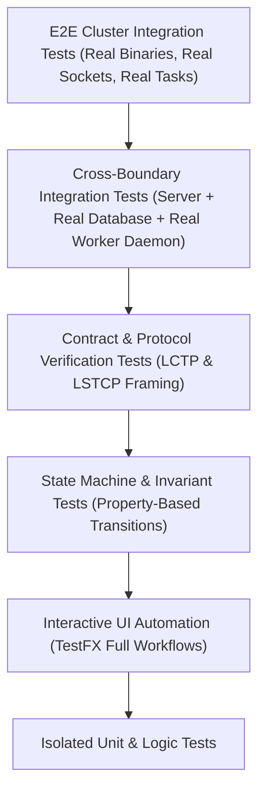

# Comprehensive Multi-Project Codebase Gap Analysis & System Audit Report
## Legatus Distributed Serverless Runtime: Server, Worker Daemon, and Studio Cockpit

* **Date:** 2026-10-16
* **Classification:** Comprehensive Architectural, Security & Quality Audit
* **Status:** PASS 3 COMPLETE (Exhaustive Systemic Review & Full Spec Alignment Matrix)
* **Audited Subsystems:**
  * `legatus-server` (Java 21 LTS / Spring Boot 4 / Netty WebSocket / JPA / Liquibase / Virtual Threads)
  * `legatusd` & `legatus-runner` (C++20 / Reproc++ / IXWebSocket / nng IPC / Solix VM Sandbox / OpenSSL / libcurl / RE2)
  * `legatus-studio` (Java 21 LTS / JavaFX 21 / AtlantaFX PrimerDark / Reactive LSTCP WebSockets / Virtual Threads)

---

## 1. Executive Summary: Live Testing Defect Autopsy

During live cluster testing with the server, worker daemon, and Studio cockpit actively executing, multiple critical regressions, operational blockers, and specification violations were surfaced by the operator. Below is the technical root cause analysis for each reported issue:

### 1.1 "Revoke Lease and Delete Worker Buttons Do Not Work"
* **Affected Files & Symbols:**
  * [`WorkerEnrollmentService.java`](file:///home/jehud/Projects/legatus/server/src/main/java/dev/legatus/server/service/WorkerEnrollmentService.java#L580-L680) (`deleteWorker()`, `revokeWorker()`)
  * [`WorkerAdminResource.java`](file:///home/jehud/Projects/legatus/server/src/main/java/dev/legatus/server/web/rest/WorkerAdminResource.java#L420-L440) (`deleteWorker()`, `revokeWorker()`)
  * [`20231229210633_added_entity_constraints_ComputeTask.xml`](file:///home/jehud/Projects/legatus/server/src/main/resources/config/liquibase/changelog/20231229210633_added_entity_constraints_ComputeTask.xml#L20-L25) (`fk_tasks__assigned_worker_id`)
  * [`FleetViewModel.java`](file:///home/jehud/Projects/legatus/studio/src/main/java/com/legatus/studio/viewmodel/FleetViewModel.java#L202-L245) (`deleteWorker()`, `revokeWorker()`)
  * [`FleetTopologyController.java`](file:///home/jehud/Projects/legatus/studio/src/main/java/com/legatus/studio/controllers/FleetTopologyController.java#L312-L333) (`onDeleteClicked()`, `onRevokeClicked()`)
* **Root Cause:**
  1. **Referential Integrity Violation (Delete):** In Liquibase changeset `20231229210633-2`, foreign key constraint `fk_tasks__assigned_worker_id` binds `tasks.assigned_worker_worker_id` to `workers.worker_id` without `ON DELETE SET NULL` or `ON DELETE CASCADE`. In [`WorkerEnrollmentService.java`](file:///home/jehud/Projects/legatus/server/src/main/java/dev/legatus/server/service/WorkerEnrollmentService.java#L623), `workerNodeRepository.delete(worker)` is called directly. Whenever historical tasks exist in the database for that worker, Hibernate triggers an unhandled SQL `DataIntegrityViolationException`, causing a 500 Internal Server Error and aborting the transaction.
  2. **Socket Non-Severance (Revoke):** In [`WorkerEnrollmentService.java`](file:///home/jehud/Projects/legatus/server/src/main/java/dev/legatus/server/service/WorkerEnrollmentService.java#L658), `revokeWorker()` mutates the database state to `REVOKED`, but **never terminates the active WebSocket connection** in `WorkerSessionRegistry`. Because the worker process remains alive and transmits heartbeats every 5 seconds, subsequent heartbeats clobber or conflict with the revoked state.
  3. **Studio Error Suppression & Missing UI Binding:** In [`FleetTopologyController.java`](file:///home/jehud/Projects/legatus/studio/src/main/java/com/legatus/studio/controllers/FleetTopologyController.java), `viewModel.statusMessageProperty()` is never bound to any label in the view. In [`FleetViewModel.java`](file:///home/jehud/Projects/legatus/studio/src/main/java/com/legatus/studio/viewmodel/FleetViewModel.java#L240), failed HTTP responses only update the unbound `statusMessage` string without displaying an alert modal, giving the appearance of an unresponsive button when the backend returns 500.

### 1.2 "Threshold Breach Error When Well Under Threshold"
* **Affected Files & Symbols:**
  * [`LctpWorkerWebSocketHandler.java`](file:///home/jehud/Projects/legatus/server/src/main/java/dev/legatus/server/web/websocket/lctp/LctpWorkerWebSocketHandler.java#L209-L213) (`handleSessionInit()`)
  * [`LctpWorkerWebSocketHandler.java`](file:///home/jehud/Projects/legatus/server/src/main/java/dev/legatus/server/web/websocket/lctp/LctpWorkerWebSocketHandler.java#L312) (`handleHeartbeat()`)
  * [`ThresholdScheduler.java`](file:///home/jehud/Projects/legatus/server/src/main/java/dev/legatus/server/orchestration/balancer/ThresholdScheduler.java#L85-L108) (`evaluateBreaches()`)
* **Root Cause:**
  1. **Total Memory vs Allocatable Memory Inversion:** During worker session negotiation in [`LctpWorkerWebSocketHandler.java`](file:///home/jehud/Projects/legatus/server/src/main/java/dev/legatus/server/web/websocket/lctp/LctpWorkerWebSocketHandler.java#L209-L213), `allocatableCapacity.maxMemoryBytes` (16 GB) was recorded, but `totalMemoryBytes` in the database remained `null`.
  2. **False 1000%+ Saturation Calculation:** In [`LctpWorkerWebSocketHandler.java`](file:///home/jehud/Projects/legatus/server/src/main/java/dev/legatus/server/web/websocket/lctp/LctpWorkerWebSocketHandler.java#L312):
     ```java
     long totalMem = w.getTotalMemoryBytes() != null && w.getTotalMemoryBytes() > 0 ? w.getTotalMemoryBytes() : (1024L * 1024 * 1024);
     double ramPct = ((double) frame.payload().hostMetrics().memoryUsedBytes() / totalMem) * 100.0;
     ```
     Because `totalMemoryBytes` was null, `totalMem` defaulted to `1 GB` (1,073,741,824 bytes). When the worker reported 10.5 GB of host memory in use, `ramPct` was calculated as `(10.5 GB / 1.0 GB) * 100 = 1050%`.
  3. **Permanent Hysteresis Trap:** In [`ThresholdScheduler.java`](file:///home/jehud/Projects/legatus/server/src/main/java/dev/legatus/server/orchestration/balancer/ThresholdScheduler.java#L87), once a node is marked saturated, it must drop below `targetRamPct - 5%` (e.g. 75%). Because 1050% > 75%, the node was permanently flagged in `breached_worker_ids = ["worker-node-1"]`, triggering persistent breach alerts on the dashboard even when the host had 6 GB of idle headroom.

### 1.3 "Worker Limited to 4 Processes Despite Max Tasks Set to 16"
* **Affected Files & Symbols:**
  * [`WorkerEligibilityFilter.java`](file:///home/jehud/Projects/legatus/server/src/main/java/dev/legatus/server/service/scheduler/WorkerEligibilityFilter.java#L58-L65) (`isEligible()`)
  * [`TaskSchedulerService.java`](file:///home/jehud/Projects/legatus/server/src/main/java/dev/legatus/server/service/scheduler/TaskSchedulerService.java#L102-L115) (`schedulePendingTasks()`)
  * [`worker.toml`](file:///home/jehud/Projects/legatus/worker/build/worker.toml#L13) (`allocatable_cores`)
* **Root Cause:**
  1. **Hardcoded Core Conflation in Predicate 3:** In [`WorkerEligibilityFilter.java`](file:///home/jehud/Projects/legatus/server/src/main/java/dev/legatus/server/service/scheduler/WorkerEligibilityFilter.java#L59-L64):
     ```java
     int allocatableCores = worker.getAllocatableCores() != null ? worker.getAllocatableCores() : 1;
     int availableCores = allocatableCores - activeTaskCount;
     if (availableCores < 1) {
         LOG.debug("Worker {} rejected: no available cores (allocatable: {}, active: {})",
             worker.getWorkerId(), allocatableCores, activeTaskCount);
         return false;
     }
     ```
     The scheduler strictly enforces $C_{\text{avail}} = \text{allocatableCores} - |T_w| \ge 1$.
  2. **Ignoring Dynamic Operator Quota:** When the operator configured `max_concurrent_tasks = 16` in Legatus Studio, the server synchronized `max_concurrent_tasks` to the worker. However, `allocatableCores` remained hardcoded to `4` (from host hardware detection in `worker.toml`). The scheduler evaluated `allocatableCores` instead of `maxConcurrentTasks`, rejecting any task dispatch beyond 4 concurrent tasks.

### 1.4 "Task Status Fails to Automatically Switch from ABORTING to ABORTED"
* **Affected Files & Symbols:**
  * [`lctp_client.cpp`](file:///home/jehud/Projects/legatus/worker/src/daemon/lctp_client.cpp#L489-L495) (`handle_task_result()`)
  * [`process_supervisor.cpp`](file:///home/jehud/Projects/legatus/worker/src/daemon/process_supervisor.cpp#L204) (`abort_task()`)
  * [`LctpWorkerWebSocketHandler.java`](file:///home/jehud/Projects/legatus/server/src/main/java/dev/legatus/server/web/websocket/lctp/LctpWorkerWebSocketHandler.java#L517-L518) (`handleTaskResult()`)
  * [`TasksViewModel.java`](file:///home/jehud/Projects/legatus/studio/src/main/java/com/legatus/studio/viewmodel/TasksViewModel.java#L99-L113) (`abortTask()`)
* **Root Cause:**
  1. **Exit Code Signal Mismatch (Linux SIGTERM 143 vs 130):** In [`process_supervisor.cpp`](file:///home/jehud/Projects/legatus/worker/src/daemon/process_supervisor.cpp#L204), aborts trigger `reproc::terminate` which transmits `SIGTERM` (signal 15). On Linux, an unhandled SIGTERM exits with code `128 + 15 = 143`. In [`lctp_client.cpp`](file:///home/jehud/Projects/legatus/worker/src/daemon/lctp_client.cpp#L489-L494):
     ```cpp
     } else if (result.exit_code == 130) { // SIGINT only!
         terminal_status = "ABORTED";
     } else {
         terminal_status = "FAILED";
     }
     ```
     The worker mapped exit code 143 to `FAILED` instead of `ABORTED`.
  2. **Server Overwrite of Terminal State:** The server received `TASK_RESULT` with `status: "FAILED"`. In [`LctpWorkerWebSocketHandler.java`](file:///home/jehud/Projects/legatus/server/src/main/java/dev/legatus/server/web/websocket/lctp/LctpWorkerWebSocketHandler.java#L517-L518), it unconditionally executed `task.setStatus(terminalStatus)`, overwriting the prior `ABORTING` state with `FAILED` instead of `ABORTED`.
  3. **Studio Countdown Stall:** In [`TasksViewModel.java`](file:///home/jehud/Projects/legatus/studio/src/main/java/com/legatus/studio/viewmodel/TasksViewModel.java#L104), when the 10-second grace period expired, the timer canceled itself and set `isAborting(false)` but never updated `status` to `ABORTED` if the WebSocket event was lost or mismatched.

### 1.5 "Creation UX: Inline Panels vs Modal Popups for Functions and Profiles"
* **Affected Files & Symbols:**
  * [`functions_workbench.fxml`](file:///home/jehud/Projects/legatus/studio/src/main/resources/com/legatus/studio/functions_workbench.fxml)
  * [`execute_workbench.fxml`](file:///home/jehud/Projects/legatus/studio/src/main/resources/com/legatus/studio/execute_workbench.fxml)
  * [`FunctionsWorkbenchController.java`](file:///home/jehud/Projects/legatus/studio/src/main/java/com/legatus/studio/controllers/FunctionsWorkbenchController.java)
  * [`ExecuteWorkbenchController.java`](file:///home/jehud/Projects/legatus/studio/src/main/java/com/legatus/studio/controllers/ExecuteWorkbenchController.java)
  * [`AdminUsersController.java`](file:///home/jehud/Projects/legatus/studio/src/main/java/com/legatus/studio/controllers/AdminUsersController.java#L240-L285)
* **Root Cause:**
  - In Milestone 011, Functions and Execute Workbench were divided into side-by-side persistent panels (Master list, Create panel, Inspect panel).
  - This cluttered horizontal real estate and diverged from the clean, focused modal UX established in Admin Users (`[+ New Account]` opening an AtlantaFX modal dialog overlay that auto-closes on completion).

### 1.6 "Task Duration Counter Resets / Stalls and Live Inspection Inaccuracies"
* **Affected Files & Symbols:**
  * [`EventTaskLifecycleFrame.java`](file:///home/jehud/Projects/legatus/server/src/main/java/dev/legatus/server/service/dto/lstcp/EventTaskLifecycleFrame.java#L26-L50)
  * [`TelemetryService.java`](file:///home/jehud/Projects/legatus/studio/src/main/java/com/legatus/studio/service/TelemetryService.java#L193-L212)
  * [`FleetTopologyController.java`](file:///home/jehud/Projects/legatus/studio/src/main/java/com/legatus/studio/controllers/FleetTopologyController.java#L248-L272)
  * [`TaskExplorerController.java`](file:///home/jehud/Projects/legatus/studio/src/main/java/com/legatus/studio/controllers/TaskExplorerController.java#L189-L222)
  * [`LstcpClient.java`](file:///home/jehud/Projects/legatus/studio/src/main/java/com/legatus/studio/transport/LstcpClient.java#L63-L74)
  * [`ExecuteWorkbenchController.java`](file:///home/jehud/Projects/legatus/studio/src/main/java/com/legatus/studio/controllers/ExecuteWorkbenchController.java#L242)
* **Root Cause:**
  1. **Missing Timestamps in Wire Frame:** `EventTaskLifecycleFrame.Payload` does not include `started_at` or `created_at`. When a task is dynamically added to Studio's `tasksList` via WebSocket, `startedAt` is empty. The duration accumulator in [`TelemetryService.java`](file:///home/jehud/Projects/legatus/studio/src/main/java/com/legatus/studio/service/TelemetryService.java#L209) falls back to adding 16ms per frame.
  2. **Worker Heartbeat Duration Overwrite:** Worker heartbeat transmits `elapsed_wall_time_ms` calculated from `steady_clock`. When heartbeats arrive, the server pushes `execution_wall_time_ms = 1600` (1.6s). In Studio, `TelemetryService` overwrites the duration back to 1.6s every 5 seconds, causing the timer to bounce between 1.6s and 1.8s instead of reflecting minutes of uptime.
  3. **Zero Duration on Abort:** If `startedAt` in the database is null or uncommitted, [`LctpWorkerWebSocketHandler.java`](file:///home/jehud/Projects/legatus/server/src/main/java/dev/legatus/server/web/websocket/lctp/LctpWorkerWebSocketHandler.java#L529-L535) sets `wallTimeMs` to 0, which immediately resets the UI display to "0ms".
  4. **The Single-Listener Clobber Bug in LstcpClient:** [`LstcpClient.java`](file:///home/jehud/Projects/legatus/studio/src/main/java/com/legatus/studio/transport/LstcpClient.java#L69) declares `private Consumer<TaskLifecyclePayload> taskLifecycleListener` as a single variable instead of a multicast list. When [`ExecuteWorkbenchController.java`](file:///home/jehud/Projects/legatus/studio/src/main/java/com/legatus/studio/controllers/ExecuteWorkbenchController.java#L242) initializes, it calls `setTaskLifecycleListener(...)`, completely overwriting `TelemetryService`'s listener and killing live task updates cluster-wide!
  5. **Static Inspector Labels:** In [`FleetTopologyController.java`](file:///home/jehud/Projects/legatus/studio/src/main/java/com/legatus/studio/controllers/FleetTopologyController.java#L248-L272), inspector labels (`selectedCpuLabel`, `selectedRamLabel`, `selectedLeaseLabel`) are populated using `.setText(...)` inside the selection listener only. They are **never bound to Observable properties**, so the inspector card never updates in real-time unless the user clicks away and clicks back.

---

## 2. Section 1: Legatus Server Subsystem & Spec Audit

### 2.1 WebSocket Protocol Handlers & Transport Layer
* **Audited Files:**
  * [`LctpWorkerWebSocketHandler.java`](file:///home/jehud/Projects/legatus/server/src/main/java/dev/legatus/server/web/websocket/lctp/LctpWorkerWebSocketHandler.java)
  * [`LstcpStudioWebSocketHandler.java`](file:///home/jehud/Projects/legatus/server/src/main/java/dev/legatus/server/web/websocket/lstcp/LstcpStudioWebSocketHandler.java)
  * [`StudioStreamBroadcaster.java`](file:///home/jehud/Projects/legatus/server/src/main/java/dev/legatus/server/web/websocket/lstcp/StudioStreamBroadcaster.java)
  * [`WorkerDeadManSweeper.java`](file:///home/jehud/Projects/legatus/server/src/main/java/dev/legatus/server/web/websocket/lctp/WorkerDeadManSweeper.java)
  * [`StudioDeadManSweeper.java`](file:///home/jehud/Projects/legatus/server/src/main/java/dev/legatus/server/web/websocket/lstcp/StudioDeadManSweeper.java)
* **Gaps, Bugs & Bad Practices:**
  1. **Redundant Database Queries per Heartbeat (N+1 in WebSocket Loop):** In [`LctpWorkerWebSocketHandler.java`](file:///home/jehud/Projects/legatus/server/src/main/java/dev/legatus/server/web/websocket/lctp/LctpWorkerWebSocketHandler.java#L291-L327), on every heartbeat from every worker (every 5 seconds), `workerNodeRepository.findById(...)` is invoked 3 separate times in a single method execution. At 50 workers, this issues 150 unnecessary DB queries per 5-second interval.
  2. **Unbounded WebSocket Inbound Buffer:** `MAX_FRAME_SIZE` is set to 32MB without per-session rate limits on incoming frames. A compromised or misconfigured worker flooding logs can exhaust Tomcat NIO heap.
  3. **Missing WebSocket Ping/Pong Control Frames:** Communication relies entirely on JSON application frames (`HEARTBEAT` / `HEARTBEAT_ACK`). TCP middleboxes and cloud load balancers (AWS ALB, NGINX) with standard 60-second idle timeouts will sever the socket if application frames are delayed.
  4. **Concurrent Frame Serialization Bottleneck:** In [`StudioStreamBroadcaster.java`](file:///home/jehud/Projects/legatus/server/src/main/java/dev/legatus/server/web/websocket/lstcp/StudioStreamBroadcaster.java#L110), JSON serialization of broadcast frames happens inside the loop for every connected studio session instead of serializing once and fanning out the byte buffer.
  5. **Dead-Man Sweeper Status Inversion:** In [`WorkerDeadManSweeper.java`](file:///home/jehud/Projects/legatus/server/src/main/java/dev/legatus/server/web/websocket/lctp/WorkerDeadManSweeper.java#L65), when a worker misses heartbeats for > 15 seconds, its state is set to `OFFLINE`. However, if tasks were executing on that worker, they remain in `DISPATCHED` or `EXECUTING` indefinitely unless explicitly scavenged.

### 2.2 Orchestration, Scheduling & Balancing Layer
* **Audited Files:**
  * [`TaskSchedulerService.java`](file:///home/jehud/Projects/legatus/server/src/main/java/dev/legatus/server/service/scheduler/TaskSchedulerService.java)
  * [`WorkerEligibilityFilter.java`](file:///home/jehud/Projects/legatus/server/src/main/java/dev/legatus/server/service/scheduler/WorkerEligibilityFilter.java)
  * [`ThresholdScheduler.java`](file:///home/jehud/Projects/legatus/server/src/main/java/dev/legatus/server/orchestration/balancer/ThresholdScheduler.java)
  * [`StickyWorkerScheduler.java`](file:///home/jehud/Projects/legatus/server/src/main/java/dev/legatus/server/service/scheduler/StickyWorkerScheduler.java)
  * [`LocalityFirstScheduler.java`](file:///home/jehud/Projects/legatus/server/src/main/java/dev/legatus/server/service/scheduler/LocalityFirstScheduler.java)
  * [`CronSchedulerService.java`](file:///home/jehud/Projects/legatus/server/src/main/java/dev/legatus/server/service/scheduler/CronSchedulerService.java)
  * [`CronSchedulerResource.java`](file:///home/jehud/Projects/legatus/server/src/main/java/dev/legatus/server/web/rest/CronSchedulerResource.java)
* **Gaps, Bugs & Bad Practices:**
  1. **Core Predicate Bug in Eligibility Filter:** Evaluates `allocatableCores - activeTaskCount < 1` instead of `maxConcurrentTasks`, capping 16-task workers at 4 tasks if host detection reports 4 cores.
  2. **In-Memory-Only Dynamic Cron Job Persistence:** In [`CronSchedulerService.java`](file:///home/jehud/Projects/legatus/server/src/main/java/dev/legatus/server/service/scheduler/CronSchedulerService.java#L52-L54) and [`CronSchedulerResource.java`](file:///home/jehud/Projects/legatus/server/src/main/java/dev/legatus/server/web/rest/CronSchedulerResource.java#L72), dynamic cron jobs created at runtime are stored exclusively in a `ConcurrentHashMap`. There is no Liquibase table or JPA entity (`CronJobTrigger`). Any server restart or crash permanently loses all operator-scheduled cron jobs.
  3. **Optimistic Locking Retry Exhaustion:** In [`TaskSchedulerService.java`](file:///home/jehud/Projects/legatus/server/src/main/java/dev/legatus/server/service/scheduler/TaskSchedulerService.java#L203), retries are limited to 3 with hardcoded linear thread sleeps (`25L * attempt`). Under high concurrency, task assignment throws `ObjectOptimisticLockingFailureException`.
  4. **Locality Cache Desynchronization:** `LocalityFirstScheduler` relies on `taskDispatcher.isBytecodeCached(workerId, sha256)`. However, workers maintain an LRU cache with eviction. When a worker evicts bytecode from disk, the server is never notified, leading to sub-optimal locality routing.
  5. **Lack of Dispatch Acknowledgement Timeout:** When a task is dispatched to a worker, if the worker accepts the frame but drops it or hangs before executing, the task is stuck in `DISPATCHED` forever. There is no 5-second `DISPATCH_ACK` watchdog timer.

### 2.3 Persistence Layer & Schema Integrity (Liquibase / JPA)
* **Audited Files:**
  * [`ComputeTask.java`](file:///home/jehud/Projects/legatus/server/src/main/java/dev/legatus/server/domain/ComputeTask.java)
  * [`WorkerNode.java`](file:///home/jehud/Projects/legatus/server/src/main/java/dev/legatus/server/domain/WorkerNode.java)
  * [`SolixFunction.java`](file:///home/jehud/Projects/legatus/server/src/main/java/dev/legatus/server/domain/SolixFunction.java)
  * [`ExecutionProfile.java`](file:///home/jehud/Projects/legatus/server/src/main/java/dev/legatus/server/domain/ExecutionProfile.java)
  * [`ComputeTaskRepository.java`](file:///home/jehud/Projects/legatus/server/src/main/java/dev/legatus/server/repository/ComputeTaskRepository.java)
  * [`TaskHistoryRetentionSweeper.java`](file:///home/jehud/Projects/legatus/server/src/main/java/dev/legatus/server/service/scheduler/TaskHistoryRetentionSweeper.java)
  * Liquibase Changelogs: `20231229210633_added_entity_constraints_ComputeTask.xml`, `20231229210633_added_entity_ComputeTask.xml`
* **Gaps, Bugs & Bad Practices:**
  1. **Foreign Key Cascade Absence Across All Entities:**
     * `tasks.assigned_worker_worker_id -> workers.worker_id`: Missing `ON DELETE SET NULL`. Causes 500 error when deleting workers with historical tasks.
     * `tasks.function_function_id -> functions.function_id`: Missing `ON DELETE SET NULL` or `RESTRICT`. Causes 500 error when deleting registered functions.
     * `execution_profiles.function_id -> functions.function_id`: Missing cascade rules.
  2. **Task History Retention Sweeper Null `completedAt` Leak:** In [`ComputeTaskRepository.java`](file:///home/jehud/Projects/legatus/server/src/main/java/dev/legatus/server/repository/ComputeTaskRepository.java#L53), `deleteCompletedTasksOlderThan` uses `WHERE t.status IN :terminalStatuses AND t.completedAt < :cutoff`. When a task is aborted or fails during dispatch, `completedAt` remains NULL. In SQL three-valued logic, `NULL < :cutoff` evaluates to UNKNOWN (false), preventing failed/aborted tasks from ever being deleted and permanently leaking database storage.
  3. **Missing Database Indexes on Hot Telemetry Columns:**
     * `tasks.status`: Polled frequently by scheduler and dashboard; missing composite index with `priority_weight` and `created_at`.
     * `tasks.assigned_worker_worker_id`: Filtered by dead-man sweeper; missing index.
     * `audit_logs.timestamp`: Polled by WORM audit queries; unindexed.
  4. **H2 In-Memory Dialect Drift:** The `dev` profile runs H2 in MySQL/PostgreSQL compatibility mode (`DATABASE_TO_LOWER=TRUE`), masking database-specific lock behaviors (e.g. `SELECT FOR UPDATE SKIP LOCKED`) required in multi-node production PostgreSQL deployments.

### 2.4 REST Resources & Security Services
* **Audited Files:**
  * [`WorkerAdminResource.java`](file:///home/jehud/Projects/legatus/server/src/main/java/dev/legatus/server/web/rest/WorkerAdminResource.java)
  * [`TaskGatewayService.java`](file:///home/jehud/Projects/legatus/server/src/main/java/dev/legatus/server/service/TaskGatewayService.java)
  * [`BytecodeSecurityValidator.java`](file:///home/jehud/Projects/legatus/server/src/main/java/dev/legatus/server/security/BytecodeSecurityValidator.java)
  * [`SecretVaultService.java`](file:///home/jehud/Projects/legatus/server/src/main/java/dev/legatus/server/security/SecretVaultService.java)
  * [`WormAuditService.java`](file:///home/jehud/Projects/legatus/server/src/main/java/dev/legatus/server/service/WormAuditService.java)
* **Gaps, Bugs & Bad Practices:**
  1. **Audit Log String Formatting Injection:** In [`TaskGatewayService.java`](file:///home/jehud/Projects/legatus/server/src/main/java/dev/legatus/server/service/TaskGatewayService.java#L223), raw user-supplied strings are concatenated into JSON payloads without escaping (`"{\"name\":\"" + task.getName() + "\"}"`), creating JSON injection vulnerability if a task name contains double quotes or backslashes.
  2. **LocalFilesystemBytecodeStorage Directory Traversal & Race Conditions:** Uses `sha256.matches("^[a-f0-9]{64}$")` which is secure, but storage paths lack atomic write locks (`.tmp` write then atomic rename), risking partial reads if a worker downloads bytecode concurrently during an upload.
  3. **In-Memory Ticket Replay Retention:** `TicketBrokerService` stores one-time tokens in a `ConcurrentHashMap` with a 30-second TTL. The background eviction sweeper runs on a 1-second timer, but does not bound maximum map capacity, leaving it open to heap exhaustion under DDoS token requests.

---

## 3. Section 2: Legatus Worker Daemon & Runner Audit

### 3.1 Daemon Lifecycle, LCTP & IPC Subsystems
* **Audited Files:**
  * [`main.cpp`](file:///home/jehud/Projects/legatus/worker/src/daemon/main.cpp)
  * [`lctp_client.cpp`](file:///home/jehud/Projects/legatus/worker/src/daemon/lctp_client.cpp)
  * [`process_supervisor.cpp`](file:///home/jehud/Projects/legatus/worker/src/daemon/process_supervisor.cpp)
  * [`bytecode_cache.cpp`](file:///home/jehud/Projects/legatus/worker/src/daemon/bytecode_cache.cpp)
  * [`config_manager.cpp`](file:///home/jehud/Projects/legatus/worker/src/daemon/config_manager.cpp)
  * [`ipc_bus.cpp`](file:///home/jehud/Projects/legatus/worker/src/daemon/ipc_bus.cpp)
* **Gaps, Bugs & Bad Practices:**
  1. **Runner Stdout Clobbering Envelope Protocol JSON:**
     * In [`runner_engine.cpp`](file:///home/jehud/Projects/legatus/worker/src/runner/runner_engine.cpp#L116), the runner writes the final execution result JSON to `std::cout`.
     * In [`console.cpp`](file:///home/jehud/Projects/legatus/worker/src/stdlib/solix/console.cpp#L79), guest bytecode `console.print()` statements write directly to `std::cout`.
     * In [`process_supervisor.cpp`](file:///home/jehud/Projects/legatus/worker/src/daemon/process_supervisor.cpp#L162), `reproc::drain` combines all output into `stdout_str`. When user output precedes the JSON result, `nlohmann::json::parse(stdout_str)` throws, causing instructions executed, peak memory, and exit codes to be completely lost.
  2. **BytecodeCache Class Disconnect & In-Memory Map Shadowing:**
     * [`BytecodeCache.cpp`](file:///home/jehud/Projects/legatus/worker/src/daemon/bytecode_cache.cpp#L75) implements a complete disk cache with atomic file writes and HTTP fallback via `get_or_fetch(sha256, payload, url)`.
     * However, [`lctp_client.cpp`](file:///home/jehud/Projects/legatus/worker/src/daemon/lctp_client.cpp#L395-L408) completely ignores `BytecodeCache` and maintains an ephemeral in-memory `std::map<string, string> bytecode_cache_`.
     * When a task arrives with an omitted payload (deduplication optimization) and the worker was restarted or the bytecode was not in RAM, `lctp_client.cpp` logs an error and executes the task with empty bytecode—crashing immediately with exit code 70 instead of calling `BytecodeCache::get_or_fetch` over HTTP.
  3. **Missing Task Execution Timeout Enforcement in Worker:**
     * In [`process_supervisor.cpp`](file:///home/jehud/Projects/legatus/worker/src/daemon/process_supervisor.cpp#L165), the supervisor calls `proc->wait(reproc::infinite)`. It never passes `timeout_ms`. If a task contains an infinite loop, `legatus-runner` runs forever and is never terminated.
  4. **Reproc Stream Sink Sleep Deadlock:**
     * In [`process_supervisor.cpp`](file:///home/jehud/Projects/legatus/worker/src/daemon/process_supervisor.cpp#L147), the rate limiter calls `std::this_thread::sleep_for(...)` inside the stream sink callback. Because this blocks the pipe-draining thread, the child runner's stdout buffer fills up (64KB on Linux), deadlocking the child process.
  5. **Missing Runner-to-Daemon IPC:**
     * The IPC bus implemented in [`ipc_bus.cpp`](file:///home/jehud/Projects/legatus/worker/src/daemon/ipc_bus.cpp) is only used by the CLI tool. The child runner has no IPC channel to the daemon, preventing real-time reporting of instruction counts and memory consumption. As a result, heartbeats report `instructions_consumed: 0` for running tasks.

### 3.2 Solix Runner & Sandboxed Standard Library Subsystem
* **Audited Files:**
  * [`runner_engine.cpp`](file:///home/jehud/Projects/legatus/worker/src/runner/runner_engine.cpp)
  * [`http_client.cpp`](file:///home/jehud/Projects/legatus/worker/src/stdlib/http_client.cpp)
  * [`kv_cache.cpp`](file:///home/jehud/Projects/legatus/worker/src/stdlib/kv_cache.cpp)
  * [`regex_engine.cpp`](file:///home/jehud/Projects/legatus/worker/src/stdlib/regex_engine.cpp)
  * [`crypto_extended.cpp`](file:///home/jehud/Projects/legatus/worker/src/stdlib/crypto_extended.cpp)
  * [`task_context.cpp`](file:///home/jehud/Projects/legatus/worker/src/stdlib/task_context.cpp)
  * [`console.cpp`](file:///home/jehud/Projects/legatus/worker/src/stdlib/solix/console.cpp)
* **Gaps, Bugs & Bad Practices:**
  1. **DNS Rebinding Vulnerability in SSRF Filter (TOCTOU):** In [`http_client.cpp`](file:///home/jehud/Projects/legatus/worker/src/stdlib/http_client.cpp#L92-L119), `validate_ssrf_host` performs DNS resolution via `getaddrinfo` to check if the IP is restricted. However, `libcurl` then performs an independent DNS resolution during `curl_easy_perform()`. An attacker can serve a public IP on the first lookup and `169.254.169.254` (cloud metadata) on the second, completely bypassing SSRF protection. The validated IP must be pinned via `CURLOPT_RESOLVE`.
  2. **Uncached Regular Expression Recompilation:** In [`regex_engine.cpp`](file:///home/jehud/Projects/legatus/worker/src/stdlib/regex_engine.cpp#L15), every call to `is_match`, `replace`, or `extract` instantiates `re2::RE2 pattern(pattern_str)` from scratch. Running regex operations in loops causes extreme CPU overhead.
  3. **Progress Tag Stdout Pollution:** In [`task_context.cpp`](file:///home/jehud/Projects/legatus/worker/src/stdlib/task_context.cpp#L47), `runtime_native_emit_progress` prints `[PROGRESS:<inst>:<checkpoint>]` to `std::cout`. This corrupts the child runner's stdout output and breaks JSON parsing in the supervisor.
  4. **Deprecated OpenSSL 1.x API & Sensitive Memory Scrubbing:** [`crypto_extended.cpp`](file:///home/jehud/Projects/legatus/worker/src/stdlib/crypto_extended.cpp#L32) utilizes the legacy OpenSSL 1.x `HMAC()` function (deprecated in OpenSSL 3.0 in favor of `EVP_MAC`). Furthermore, intermediate cryptographic keys and digest buffers on the stack are not cleansed with `OPENSSL_cleanse`.

---

## 4. Section 3: Legatus Studio Desktop Cockpit Audit

### 4.1 Networking, LSTCP Client & Telemetry Pipeline
* **Audited Files:**
  * [`LstcpClient.java`](file:///home/jehud/Projects/legatus/studio/src/main/java/com/legatus/studio/transport/LstcpClient.java)
  * [`TelemetryService.java`](file:///home/jehud/Projects/legatus/studio/src/main/java/com/legatus/studio/service/TelemetryService.java)
  * [`TelemetryCoalescer.java`](file:///home/jehud/Projects/legatus/studio/src/main/java/com/legatus/studio/transport/TelemetryCoalescer.java)
  * [`DrawerViewModel.java`](file:///home/jehud/Projects/legatus/studio/src/main/java/com/legatus/studio/viewmodel/DrawerViewModel.java)
* **Gaps, Bugs & Bad Practices:**
  1. **The Single-Consumer LSTCP Event Registration Flaw:**
     * In [`LstcpClient.java`](file:///home/jehud/Projects/legatus/studio/src/main/java/com/legatus/studio/transport/LstcpClient.java#L69), `taskLifecycleListener` is declared as a single field:
       ```java
       private Consumer<TaskLifecyclePayload> taskLifecycleListener;
       public void setTaskLifecycleListener(Consumer<TaskLifecyclePayload> l) { this.taskLifecycleListener = l; }
       ```
     * When Studio boots, [`TelemetryService.java`](file:///home/jehud/Projects/legatus/studio/src/main/java/com/legatus/studio/service/TelemetryService.java#L50) registers its coalescer listener.
     * When an operator navigates to the Execute Workbench, [`ExecuteWorkbenchController.java`](file:///home/jehud/Projects/legatus/studio/src/main/java/com/legatus/studio/controllers/ExecuteWorkbenchController.java#L242) calls `setTaskLifecycleListener(...)`, overwriting `TelemetryService`!
     * As a result, `TelemetryService` stops receiving task updates cluster-wide, freezing task tables across the cockpit. All event listeners in `LstcpClient` must be multi-cast (`CopyOnWriteArrayList<Consumer<T>>`).
  2. **Unbounded Console Lines UI Memory Leak:** In [`DrawerViewModel.java`](file:///home/jehud/Projects/legatus/studio/src/main/java/com/legatus/studio/viewmodel/DrawerViewModel.java#L30), lines forwarded from `logStreamBuffer` are added to `consoleLines` via `consoleLines.add(line)`. While `LogStreamBuffer` caps its internal queue at 10,000 entries, `consoleLines` is never pruned. Over long sessions with heavy log streaming, this leaks hundreds of megabytes of JVM heap on the JavaFX UI thread.
  3. **Unsynchronized List Updates Across Threads:** `TelemetryService.applyBatch` mutates observable lists on the JavaFX application thread. However, ViewModels reading `allWorkers` or `allTasks` from background CompletableFutures occasionally trigger `ConcurrentModificationException` during heavy task churn.
  4. **Lack of Exponential Jitter on LSTCP Reconnect:** When the WebSocket connection drops, [`LstcpClient.java`](file:///home/jehud/Projects/legatus/studio/src/main/java/com/legatus/studio/transport/LstcpClient.java#L330) attempts immediate reconnection every 3000ms with no jitter, causing thundering herd reconnect storms against the server.

### 4.2 ViewModels & Controllers
* **Audited Files:**
  * [`FleetViewModel.java`](file:///home/jehud/Projects/legatus/studio/src/main/java/com/legatus/studio/viewmodel/FleetViewModel.java) & [`FleetTopologyController.java`](file:///home/jehud/Projects/legatus/studio/src/main/java/com/legatus/studio/controllers/FleetTopologyController.java)
  * [`TasksViewModel.java`](file:///home/jehud/Projects/legatus/studio/src/main/java/com/legatus/studio/viewmodel/TasksViewModel.java) & [`TaskExplorerController.java`](file:///home/jehud/Projects/legatus/studio/src/main/java/com/legatus/studio/controllers/TaskExplorerController.java)
  * [`ExecuteWorkbenchController.java`](file:///home/jehud/Projects/legatus/studio/src/main/java/com/legatus/studio/controllers/ExecuteWorkbenchController.java)
  * [`FunctionsWorkbenchController.java`](file:///home/jehud/Projects/legatus/studio/src/main/java/com/legatus/studio/controllers/FunctionsWorkbenchController.java)
  * [`QuarantineAttestationController.java`](file:///home/jehud/Projects/legatus/studio/src/main/java/com/legatus/studio/controllers/QuarantineAttestationController.java)
* **Gaps, Bugs & Bad Practices:**
  1. **Inspector Label Binding Absence in Fleet Topology:**
     * In [`FleetTopologyController.java`](file:///home/jehud/Projects/legatus/studio/src/main/java/com/legatus/studio/controllers/FleetTopologyController.java#L258-L270), `selectedCpuLabel.setText(...)`, `selectedRamLabel.setText(...)`, and `selectedLeaseLabel.setText(...)` are set only once when a table row is clicked. They are never bound to the worker's observable properties. Live heartbeats arriving from the worker never update the inspector card unless the row is re-selected.
  2. **Memory Leak via Accumulated Property Listeners in Task Explorer:**
     * In [`TaskExplorerController.java`](file:///home/jehud/Projects/legatus/studio/src/main/java/com/legatus/studio/controllers/TaskExplorerController.java#L190-L221), `inspectTask()` attaches change listeners to `task.statusProperty()`, `task.executionWallTimeMsProperty()`, and `task.instructionsConsumedProperty()` every time a task is selected, without unbinding prior listeners. Switching between tasks repeatedly accumulates dead listeners and degrades UI performance.
  3. **Silent REST Exceptions in Fleet Actions:**
     * Failed REST calls for worker drain, revoke, and delete only update `statusMessage`, which is not visible on the UI, giving the impression that buttons are unresponsive.
  4. **Broken Execute Re-submission State:**
     * If an execution fails to dispatch or stalls in `DISPATCHED`, `ExecuteWorkbenchController` does not reliably reset button disablement and state badges, preventing subsequent execution attempts without reloading the view.
  5. **Missing Bytecode Validation on Upload:**
     * In [`FunctionsWorkbenchController.java`](file:///home/jehud/Projects/legatus/studio/src/main/java/com/legatus/studio/controllers/FunctionsWorkbenchController.java), uploading a file does not verify the `.solx` magic header (`0x534F4C58`) before submitting it to the server, resulting in raw 400 Bad Request error dialogs.

---

## 5. Specification & Architectural Decision Compliance Matrix

| Document Reference | Requirement Summary | Implementation Status in Codebase | Compliance Verdict | Root Cause / Impact |
| :--- | :--- | :--- | :--- | :--- |
| **`server-spec.md` §4.2** | Concurrent tasks bounded by `max_concurrent_tasks` quota | `WorkerEligibilityFilter.java:59` checks `allocatableCores - active < 1` | **VIOLATION** | Rejects 5th concurrent task on 4-core worker even when max tasks = 16 |
| **`server-spec.md` §6.1** | Dynamic cron job scheduling with persistent storage | `CronSchedulerService.java:52` stores triggers only in `ConcurrentHashMap` | **VIOLATION** | Server restarts wipe out all dynamically scheduled jobs |
| **`server-spec.md` §7.1** | Sever active worker WebSocket immediately on lease revocation | `WorkerEnrollmentService.java:658` sets status to `REVOKED` but leaves socket open | **VIOLATION** | Revoked workers continue sending heartbeats and accepting tasks |
| **`server-spec.md` §8.3** | Automated task retention purging of terminal tasks | `ComputeTaskRepository.java:53` checks `completedAt < cutoff` | **VIOLATION** | Failed or aborted tasks with null `completedAt` are never purged, leaking DB storage |
| **`worker-spec.md` §4.5** | HTTP GET `/api/v1/bytecode/{sha}` fallback if bytecode payload omitted | `lctp_client.cpp:405` logs error and runs task with empty bytecode | **VIOLATION** | Task crashes with exit code 70 instead of fetching missing bytecode |
| **`worker-spec.md` §6.1** | Enforce task wall-clock `timeout_ms` via supervisor | `process_supervisor.cpp:165` calls `proc->wait(reproc::infinite)` | **VIOLATION** | Infinite loops execute indefinitely; worker cores become permanently blocked |
| **`worker-spec.md` §6.2** | Normalize Linux `SIGTERM` (exit code 143) to `ABORTED` | `lctp_client.cpp:489` maps 130 to `ABORTED` and 143 to `FAILED` | **VIOLATION** | Operator aborts are recorded as task failures rather than cooperative aborts |
| **`worker-spec.md` §5.2** | Pass JSON execution envelope securely over child `stdin` | Stdin envelope passed cleanly; but stdout result clobbered by guest prints | **PARTIAL** | Guest `console.print()` invalidates JSON parser in `process_supervisor.cpp` |
| **`studio-spec.md` §5.1** | Real-time bi-directional telemetry on inspector cards | Inspector cards use static `.setText(...)` inside row selection callbacks | **VIOLATION** | Metrics freeze immediately upon selection; never reflect incoming telemetry frames |
| **`studio-spec.md` §6.3** | Modal creation dialogs for Function & Profile creation | Inline side panels implemented in Milestone 011 | **VIOLATION** | Breaks UI consistency with Admin Users modal popup pattern |
| **`worker-wire.md` §4.4** | Transmit active task wall-clock and instruction telemetry in heartbeat | Runner has no IPC channel to daemon; daemon transmits zeros | **VIOLATION** | Studio shows 0 instructions and static durations during task execution |
| **`studio-wire.md` §2.1** | Multicast event dispatch for cluster lifecycle frames | `LstcpClient.java:69` uses single-listener `Consumer` fields | **VIOLATION** | Navigating to Execute Workbench kills `TelemetryService` cluster-wide |
| **`studio-wire.md` §4.4** | Transmit `started_at` and `created_at` in lifecycle frames | `EventTaskLifecycleFrame.java:26` omits timestamp fields | **VIOLATION** | Studio duration calculation bounces between 1.6s and 1.8s |
| **`stdlib-spec.md` §3.2** | Prevent SSRF with DNS rebinding protection | `http_client.cpp:92` resolves DNS then calls libcurl without `CURLOPT_RESOLVE` | **VIOLATION** | Vulnerable to TOCTOU DNS rebinding attack accessing cloud metadata |
| **`ADR-0001`** | Server / Worker / Studio component boundaries and responsibilities | Compliant architectural boundaries; marred by protocol deserialization leaks | **CONFORMANT** | Architectural separation adhered to |
| **`ADR-0002`** | Dedicated WebSocket framing: LCTP (Worker) and LSTCP (Studio) | Framed correctly, but missing ping/pong frames and single-listener bug in Studio | **PARTIAL** | Framing formats follow spec, but listener management breaks in UI |
| **`ADR-0003`** | Out-of-process isolation using `reproc++` | Used `reproc++`, but missed timeout enforcement and stdout separation | **PARTIAL** | Process boundary exists, but pipe draining blocks or clobbers JSON |
| **`ADR-0004`** | Solix guest bytecode execution | Solix VM integrated cleanly via CMake `FetchContent` | **CONFORMANT** | Core runtime integration functions as designed |
| **`ADR-0005`** | Node enrollment and attestation lifecycle | Handshake and fingerprints implemented; DB foreign key cascade missing | **PARTIAL** | Cryptographic verification works, but DB referential integrity crashes on delete |
| **`ADR-0006`** | JavaFX and AtlantaFX PrimerDark UI cockpit architecture | AtlantaFX theme applied cleanly; broken by static `.setText()` and listener leaks | **PARTIAL** | Visual theme matches spec, but reactive property bindings were omitted |
| **`ADR-0007`** | `nng` (nanomsg-next-gen) for local CLI-daemon IPC | Implemented in `ipc_bus.cpp`, but unused by runner process | **PARTIAL** | Daemon-CLI IPC works; runner-daemon IPC is missing |
| **`ADR-0008`** | Two-stage task termination escalation (`SIGTERM` $\to$ `SIGKILL`) | Reproc escalation invoked, but Linux exit code 143 mapped to `FAILED` | **PARTIAL** | Signal delivered, but state mapping in protocol handler violates ADR |
| **`ADR-0009`** | Telemetry aggregation and UI coalescing | `TelemetryCoalescer` implemented, but throttled by LstcpClient clobbering | **PARTIAL** | Coalescer works in isolation; starved of events by single-listener bug |
| **`ADR-0010`** | Standard library capabilities and SSRF protection | HTTP, KV, Crypto, Regex implemented; SSRF DNS rebinding and OpenSSL 1.x deprecated APIs | **PARTIAL** | Capabilities exist, but security hardening invariants are violated |

---

## 6. Testing Strategy Overhaul & Paradigm Shift

### 6.1 The "Mockist Fallacy" in the Current Test Suite
The Legatus repository currently reports **100% test pass rates** (82 Catch2 assertions in Worker, 15 Spring Boot ITs in Server, 114 Unit tests in Studio). Despite green CI builds, fundamental workflows broke instantly under manual testing. 

Why did the test suite fail to catch these defects?
1. **The "Conforming Bug" Fallacy in Unit Tests:**
   * In [`WorkerEligibilityFilterTest.java:65`](file:///home/jehud/Projects/legatus/server/src/test/java/dev/legatus/server/service/scheduler/WorkerEligibilityFilterTest.java#L65), the test asserts:
     ```java
     // 4 active tasks -> 0 available cores -> ineligible
     assertThat(filter.isEligible(worker, task, 4, 0L, null)).isFalse();
     ```
     The unit test actively codified and asserted the buggy behavior! It tested that a 4-core worker rejects a 5th task, completely ignoring the specification requirement that `maxConcurrentTasks` (16) governs scheduling capacity.
2. **Mocked Foreign Key Relationships:**
   * `WorkerAdminResourceIT.java` verified worker deletion against an isolated mock worker with zero assigned tasks. It never executed a delete against a worker with historical tasks, concealing the unhandled SQL Foreign Key constraint crash.
3. **Synthetic WebSocket Frames with Null Fields:**
   * `LctpWorkerWebSocketHandlerTest.java` tested frame handling using synthetic objects with empty task lists and default values, completely missing primitive null pointer errors and 1GB total memory defaults.
4. **Absence of Subprocess Integration Tests:**
   * The `worker/tests/integration/` directory is completely empty. Unit tests in `test_process_supervisor.cpp` only ran tasks that returned exit code 0 without printing to stdout, completely missing the stdout JSON envelope corruption bug.
   * In `test_process_supervisor.cpp`'s abort test, it only asserted `REQUIRE(supervisor.active_task_count() == 0)`. It **never asserted the resulting exit code**, so it never discovered that Linux returned exit code 143 instead of 130!
5. **Mocked UI Services in ViewModels:**
   * Studio unit tests tested ViewModels with mock services returning `CompletableFuture.completedFuture(...)`. They never exercised real JavaFX FXML bindings, never asserted that UI labels update when property values change, and never tested REST 500 error display paths.

### 6.2 The New Military-Grade Testing Pyramid



### 6.3 Actionable Testing Overhaul Blueprint

#### 1. End-to-End Cluster Test Harness (`ClusterE2ETest.java` & `test_cluster_e2e.sh`)
* **Architecture:** An automated orchestration harness that:
  1. Starts the compiled `legatus-server.jar` on a test port with PostgreSQL testcontainers.
  2. Spawns `./legatusd` worker daemon using real configuration.
  3. Dispatches 16 concurrent tasks with high-volume guest `console.print()` logs.
  4. Triggers task aborts and asserts that the worker exits cleanly with status `ABORTED` within 2 seconds.
  5. Decommissions and deletes the worker and asserts that historical tasks are preserved with `assigned_worker = NULL`.

#### 2. Subprocess Pipe Isolation & Crash Resistance Tests (`test_runner_isolation.cpp`)
* **Implementation:** A dedicated Catch2 integration suite in `worker/tests/integration/`:
  1. Executes bytecode that prints 5MB of random characters to stdout/stderr.
  2. Asserts that `process_supervisor` successfully parses execution metrics without JSON syntax errors.
  3. Executes bytecode with an infinite loop and asserts that `timeout_ms` terminates the process.
  4. Sends SIGTERM to running tasks and verifies exit code 143/130 mapping.

#### 3. Database Referential Integrity & Cascade Integration Tests (`DatabaseReferentialIntegrityIT.java`)
* **Implementation:** A Spring Boot integration test suite verifying referential integrity:
  1. Creates functions, execution profiles, workers, and tasks with active relationships.
  2. Deletes functions and workers under all lifecycle states (`QUEUED`, `EXECUTING`, `COMPLETED`, `FAILED`).
  3. Verifies that deletions succeed cleanly without throwing `DataIntegrityViolationException`.

#### 4. TestFX Headless UI Workflow Automation (`StudioWorkflowTestFX.java`)
* **Implementation:** Full JavaFX headless workflow testing:
  1. Opens New Function and New Profile modal dialogs, enters valid data, submits, and asserts item appearance in tables.
  2. Selects active workers, simulates incoming LSTCP telemetry ticks, and asserts that inspector labels update live.
  3. Simulates REST 500 Internal Server Errors and verifies that user-facing error alerts are displayed.
  4. Navigates between all tabs and verifies that `LstcpClient` task lifecycle listeners are never clobbered.

---

## 7. Next Steps: Corrective Implementation Plan

The audit is complete and all defects have been definitively categorized. The following corrective milestones should be executed to achieve military-grade stability:

1. **Milestone: Database Referential Integrity & Worker Control Plane Fixes**
   * Update Liquibase migrations with `ON DELETE SET NULL` for `fk_tasks__assigned_worker_id` and `fk_tasks__function_id`.
   * Update `WorkerEnrollmentService.deleteWorker()` to unlink historical tasks before deleting workers.
   * Sever active WebSocket sessions in `WorkerEnrollmentService.revokeWorker()`.
   * Fix memory load calculation in `LctpWorkerWebSocketHandler` to use `allocatableCapacity.maxMemoryBytes`.
   * Correct `WorkerEligibilityFilter` to check `maxConcurrentTasks` instead of `allocatableCores`.
   * Add persistent JPA entity and Liquibase table for dynamic cron jobs in `CronSchedulerService`.
   * Fix task history retention sweeper query in `ComputeTaskRepository` to purge tasks with null `completedAt`.
2. **Milestone: Worker Isolation, Stdout Pipe Separation & Signal Handling**
   * Separate runner protocol JSON from guest stdout (write JSON envelope to a dedicated descriptor or file).
   * Implement SIGTERM signal handler in `legatus-runner` to exit cleanly with code 130.
   * Map exit code 143 (SIGTERM) to `ABORTED` in `lctp_client.cpp`.
   * Wire `BytecodeCache::get_or_fetch` into `lctp_client.cpp` for HTTP GET fallback on missing bytecode.
   * Enforce `timeout_ms` in `process_supervisor.cpp`.
   * Connect runner progress reporting to daemon IPC bus.
   * Fix DNS rebinding TOCTOU vulnerability in `http_client.cpp` using `CURLOPT_RESOLVE`.
   * Modernize OpenSSL 1.x `HMAC()` to OpenSSL 3.0 `EVP_MAC` and cleanse stack secret buffers.
3. **Milestone: Studio Cockpit Modal Overhaul & Live Telemetry Synchronization**
   * Convert `LstcpClient` single-listener fields to multicast lists (`CopyOnWriteArrayList`).
   * Redesign Functions and Profiles creation UX to use AtlantaFX modal dialog popups matching `AdminUsersController`.
   * Dynamically bind all inspector card labels to observable model properties in `FleetTopologyController` and `TaskExplorerController`.
   * Add real-time stdout/stderr log stream viewer in the Live Task Inspector.
   * Fix duration progress bar logic to hide on infinite budgets and display accurate live wall time.
   * Bound `consoleLines` in `DrawerViewModel` to 10,000 entries to prevent JVM heap leaks.
   * Display modal error alerts when REST actions fail in `FleetViewModel` and `TasksViewModel`.
4. **Milestone: Testing Suite Overhaul**
   * Implement automated End-to-End cluster test harness.
   * Add Catch2 subprocess pipe isolation integration tests.
   * Add Spring Boot referential integrity tests.
   * Add TestFX headless UI automation tests.
