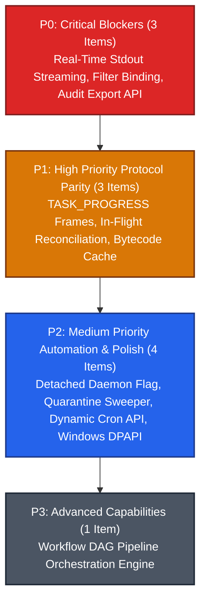

# Milestone 005: Platform Feature Completeness & Protocol Parity

## Document Metadata
* **Milestone ID:** MS-005
* **Target Version:** `v1.1.0-parity`
* **Status:** ACTIVE
* **Lead Architect:** @platform-lead
* **Target Delivery Date:** 2026-12-31
* **Related ADRs:** ADR-0001, ADR-0003, ADR-0004, ADR-0005, ADR-0006, ADR-0007, ADR-0008

---

## 1. Executive Summary & Objectives

Following the delivery of the foundational architecture and MVP implementations (Milestones MS-001 through MS-004), an exhaustive audit was performed against the governing platform specifications (`server-spec.md`, `worker-spec.md`, `studio-spec.md`, and wire protocols). The audit identified critical protocol gaps, missing streaming pipelines, and unfulfilled enterprise audit requirements.

Concurrently, a holistic redesign of the operator front-end and server-centric control plane was initiated (Milestones MS-007 through MS-010). To maintain strict architectural hygiene, prevent duplicate work, and eliminate throwaway code, **Milestone 005 (MS-005)** is focused strictly on **Core Runtime, Real-Time Streaming, Wire Protocol Parity & Enterprise Compliance**.

### Core Mission Pillars
1. **Real-Time Stdout/Stderr Streaming with Backpressure:** Refactor child process execution from blocking batch drain to non-blocking line/chunk streaming (`TASK_LOG_CHUNK`) over LCTP, guarded by rate limits (1,000 chunks/sec cap, 8MB total task log volume ceiling) and sliding-window chunk coalescing.
2. **Intermediate Progress & Reconnect Reconciliation:** Emit deterministic `TASK_PROGRESS` frames at instruction checkpoints; implement stateful session reconciliation (`reconcile_tasks` in `SESSION_INIT`) to prevent task orphaning across transient network partitions.
3. **Bandwidth Optimization & Dispatch Deduplication:** Implement bytecode SHA-256 deduplication caching in `LctpTaskDispatcher`, eliminating redundant Base64 binary transfers when a worker already has the bytecode cached.
4. **Enterprise Cryptographic Audit Export:** Implement `POST /api/v1/admin/audit-logs/export` to produce tamper-evident, HMAC-SHA256 signed audit archives with sequence validation.
5. **Operational Automation & Sandboxed Storage:** Implement automated 15-minute quarantine TTL sweepers, dynamic runtime cron trigger REST management, native Windows DPAPI credential protection, POSIX detached daemonization (`legatus up -d`), and the workflow DAG pipeline orchestration engine (`legatus.features.workflows`).

*(Note: All Studio cockpit UI overhauls—Worker Overview grid, rich sortable fleet tables, master-detail inspectors, function execution workbench, and time-based task ledgers—are strictly decoupled into Milestones MS-008, MS-009, and MS-010).*

---

## 2. Scope & Subsystems Affected

* **`server/` (`legatus-server` - Java 21 LTS / Loom):**
  * `dev.legatus.server.admin`: Signed audit trail export endpoint (`POST /api/v1/admin/audit-logs/export`) and dynamic runtime cron trigger REST API (`/api/v1/admin/cron-triggers`).
  * `dev.legatus.server.transport.lctp`: Bytecode deduplication cache check during task dispatch, in-flight task session reconciliation handler (`reconcile_tasks`), and `TASK_PROGRESS` frame processor.
  * `dev.legatus.server.worker`: Scheduled 15-minute quarantine TTL expiration sweeper.
  * `dev.legatus.server.features.workflows`: Directed Acyclic Graph (DAG) pipeline orchestration engine (`legatus.features.workflows`).
* **`worker/` (`legatusd`, `legatus`, `legatus-runner` - C++20 / nng / reproc++):**
  * `worker/src/runner/process_supervisor.cpp`: Non-blocking child stdout/stderr streaming pipe loop emitting bounded `TASK_LOG_CHUNK` frames over LCTP.
  * `worker/src/daemon/lctp_client.cpp`: Live `TASK_PROGRESS` frame emission, active supervised task cache, and `SESSION_INIT` `reconcile_tasks` handshake on reconnect.
  * `worker/src/cli/main.cpp`: Detached background daemonization flag (`-d, --daemon`) for POSIX environments.
* **`studio/` (`legatus-studio` - Java 21 LTS / OpenJFX 21):**
  * `dev.legatus.studio.ui.controllers.TaskExplorerController`: Binding `statusFilterCombo` to `TasksViewModel.filterStatusProperty()` to enable immediate lifecycle filtering.
  * `dev.legatus.studio.security.KeyStoreService`: Native Windows DPAPI (`CryptProtectData`) credential store integration via JNA.
* **`protocols/` (Wire & API Specifications):**
  * `protocols/worker-wire.md`: Conformance of `TASK_LOG_CHUNK`, `TASK_PROGRESS`, and `reconcile_tasks` schemas.
  * `protocols/api-endpoint.md`: Conformance of `/api/v1/admin/audit-logs/export` and `/api/v1/admin/cron-triggers`.

---

## 3. Prioritized Deliverables & Task Matrix

In accordance with **GL-0008**, tasks are classified across four priority tiers:

---

### 3.1 P0: Critical Blockers (Release Gate)

A single open P0 task blocks production release and halts milestone validation.

- [ ] `[P0]` **Real-Time Task Stdout/Stderr Incremental Streaming with Backpressure:** Refactor `ProcessSupervisor::DrainAndForward` in `worker/src/runner/process_supervisor.cpp` to eliminate blocking on `reproc::drain` until child process exit. Implement non-blocking asynchronous reading (`reproc::read`) emitting incremental log chunks immediately over LCTP as `TASK_LOG_CHUNK` frames. Enforce strict backpressure guardrails:
  1. Coalesce chunks within a 20ms sliding window or 4KB boundary.
  2. Rate limit emission to a maximum of 1,000 chunks/second per task.
  3. Enforce an 8MB total log output ceiling per task, truncating excess output with a standard warning notice. (`task-operations.md` §4, `worker-wire.md` §4.5)
- [ ] `[P0]` **Task Explorer Status Filter ComboBox Binding:** Populate `statusFilterCombo` in `studio/src/main/java/dev/legatus/studio/ui/controllers/TaskExplorerController.java` with lifecycle states (`ALL`, `QUEUED`, `EXECUTING`, `COMPLETED`, `FAILED`, `ABORTED`) and bind bidirectionally to `TasksViewModel.filterStatusProperty()`. Ensure the visible `FilteredList<TaskRecord>` in the task table updates dynamically on filter selection. (`studio-spec.md` §4.3)
- [ ] `[P0]` **Signed Cryptographic Audit Trail Export API:** Implement `POST /api/v1/admin/audit-logs/export` in `server/src/main/java/dev/legatus/server/admin/AuditLogAdminResource.java`. Support query parameters (`from`, `to`, `severity`, `format=json|csv`). The export engine MUST verify the SHA-256 hash chain of all selected records, generate a canonical export bundle, compute an HMAC-SHA256 signature using the cluster master secret key, and return the verifiable archive with compliance metadata (`total_records`, `first_sequence_id`, `last_sequence_id`, `signature`, `generated_at`). (`api-endpoint.md` §7.3, `server-spec.md` §5.3.3)

---

### 3.2 P1: High Priority (Milestone Core Parity)

Mandatory capabilities required for full architectural specification compliance.

- [ ] `[P1]` **Live Intermediate `TASK_PROGRESS` Wire Frames:** Implement periodic `TASK_PROGRESS` frame emission in `worker/src/daemon/lctp_client.cpp` during child process execution. Emit updates every 1,000,000 instructions or 1,000ms containing `task_id`, `instructions_executed`, `current_memory_bytes`, and `checkpoint_label`. In `legatus-server`, handle `TASK_PROGRESS`, update in-memory task entity metrics, and broadcast `EVENT_TASK_PROGRESS` over LSTCP. (`worker-wire.md` §4.6, `worker-spec.md` §4.4)
- [ ] `[P1]` **In-Flight Task Session Reconciliation on Reconnect:** Extend `legatusd` to maintain an active registry of supervised child runner PIDs and task IDs across network disconnections. Upon socket reconnection, populate `reconcile_tasks` in the `SESSION_INIT` payload. In `server/src/main/java/dev/legatus/server/transport/lctp/LctpConnectionHandler.java`, validate reported tasks against the server database: reconcile running states, acknowledge surviving tasks, and return `discarded_task_ids` for tasks cancelled or timed out while offline, allowing the worker to terminate orphaned runners. (`worker-wire.md` §4.1)
- [ ] `[P1]` **Bytecode Deduplication Cache on Dispatch:** Implement bytecode cache negotiation in `server/src/main/java/dev/legatus/server/transport/lctp/LctpTaskDispatcher.java` controlled by `legatus.features.bytecode-cache`. Maintain a per-worker set of cached SHA-256 digests; when dispatching a task whose bytecode digest is already acknowledged by the worker, transmit `DISPATCH_TASK` containing only `bytecode_sha256` and omit the Base64 payload, reducing network transit by up to 99%. (`server-spec.md` §6.1, `worker-wire.md` §4.4)

---

### 3.3 P2: Medium Priority (Automation & Polish)

Non-blocking operational automation and developer tooling.

- [ ] `[P2]` **Detached Daemon Mode Flag (`legatus up -d`):** Add `-d, --daemon` command-line flag to the CLI11 parser in `worker/src/cli/main.cpp`. On POSIX platforms, fork the daemon process, decouple from the controlling terminal (`setsid`), redirect standard file descriptors to `/var/log/legatus/legatusd.log`, and write the process ID to `/var/run/legatus/legatusd.pid` (or local runtime directory). (`worker-spec.md` §4.1, `05-worker.md` §3.1)
- [ ] `[P2]` **Quarantine Expiration Background Sweeper:** Implement a scheduled Virtual Thread background sweeper in `server/src/main/java/dev/legatus/server/worker/WorkerEnrollmentService.java` executing every 60 seconds. Query for `PENDING_APPROVAL` enrollment records older than 15 minutes (900 seconds), transition their status to `EXPIRED`, emit a security audit log event, and invalidate pending challenge nonces. (`server-spec.md` §4.1)
- [ ] `[P2]` **Dynamic Runtime Cron Trigger REST Management API:** Implement REST resource endpoints (`/api/v1/admin/cron-triggers`) in `server/src/main/java/dev/legatus/server/admin/CronSchedulerResource.java`. Allow cluster operators to dynamically list, register new cron schedules, pause, resume, trigger immediate execution, and delete cron jobs at runtime without modifying `application.yml` or restarting the server. (`server-spec.md` §6.1)
- [ ] `[P2]` **Windows Native DPAPI Credential Store Integration:** Implement native Windows DPAPI (`CryptProtectData` / `CryptUnprotectData`) integration via JNA (`com.sun.jna.platform.win32.Crypt32`) in `studio/src/main/java/dev/legatus/studio/security/KeyStoreService.java`, eliminating fallback to unencrypted local storage when running on Windows hosts. (`studio-spec.md` §1.1, `04-studio.md` §7.1)

---

### 3.4 P3: Low Priority (Advanced Architecture)

- [ ] `[P3]` **Workflow DAG Pipeline Orchestration Engine:** Implement the pipeline orchestration engine in `server/src/main/java/dev/legatus/server/features/workflows/` enabled via `legatus.features.workflows=true`. Support directed acyclic graph (DAG) execution schemas, topological dependency sorting, chaining output JSON from parent tasks as input arguments into dependent child tasks, and partial failure policies (`ABORT_PIPELINE`, `CONTINUE_ON_FAILURE`). Provide REST API under `/api/v1/workflows`. (`server-spec.md` §6.1, `overview.md` §3)

---

## 4. Definition of Done (DoD) Sign-Off Matrix

In accordance with **GL-0008 Section 2**, this milestone **CANNOT** transition to `FEATURE_COMPLETE` or `CLOSED` until all five DoD pillars are satisfied and verified:

| DoD Requirement | Target Benchmark | Verification Tool / Command | Sign-off Status |
| :--- | :--- | :--- | :--- |
| **Catch2 v3 Suite** | 100% pass across worker streaming, pipe supervisors, and reconciliation suites | `ctest --test-dir worker/build --output-on-failure` | [ ] Pending Verification |
| **JUnit 5 Suite** | 100% pass across Spring Boot orchestrator, audit export, and cron REST APIs | `./server/mvnw -f server/pom.xml test` | [ ] Pending Verification |
| **Sanitizer Gate** | Zero memory leaks, zero undefined behavior warnings under Clang 18 | `ASan` / `UBSan` on worker and runner binaries | [ ] Pending Verification |
| **Living Documentation** | Wire protocols, CLI manuals, and operator guides updated to reflect all deliverables | `scripts/verify-cli-docs.sh` (`GL-0010`) | [ ] Pending Verification |
| **ADR Governance** | Architectural decision records authored and accepted for streaming backpressure | Review against `docs/dev/decisions/` (`GL-0006`) | [ ] Pending Verification |

---

## 5. Risk Assessment & Mitigation Strategies

### Risk 1: High-Throughput Log Streaming Backpressure & Memory Exhaustion
* **Description:** Guest processes producing millions of lines of stdout/stderr per second could saturate worker IPC buffers, overload the outbound LCTP WebSocket channel, or cause Out-Of-Memory (OOM) errors in the server and Studio clients.
* **Mitigation:**
  * In `ProcessSupervisor`, implement bounded 4KB chunk coalescing with rate-limiting backpressure (drop or throttle if outbound queue exceeds 16MB).
  * In `legatus-server`, forward log chunks over LSTCP only to subscribers with active `SUBSCRIBE_TASK_LOGS` tokens.
  * In `legatus-studio`, enforce the strict 10,000-line circular ring buffer (`TaskLogRingBuffer`) to prevent memory growth on the JavaFX UI thread.

### Risk 2: Split-Brain State During In-Flight Task Session Reconciliation
* **Description:** A worker experiencing a temporary network partition may attempt to reconcile tasks that the server has already reassigned to another compute node or timed out.
* **Mitigation:**
  * The server is authoritative: `LctpConnectionHandler` checks the cluster database for each reported task.
  * If a task has transitioned to `TIMED_OUT` or `RESCHEDULED`, the server returns it in `discarded_task_ids`.
  * Upon receiving `discarded_task_ids`, `legatusd` immediately issues `SIGKILL` to the orphaned child process, preventing duplicate execution and state corruption.

### Risk 3: Cyclic Dependencies in Workflow DAG Pipelines
* **Description:** User-defined workflow graphs submitted via the new workflow engine may contain cycles or disconnected components, leading to infinite loops or orphaned tasks.
* **Mitigation:**
  * Implement strict validation using Kahn's algorithm for topological sorting during pipeline creation (`POST /api/v1/workflows`).
  * Reject any workflow submission containing cycles with HTTP 422 Unprocessable Entity and detailed node cycle paths prior to persisting or scheduling.
