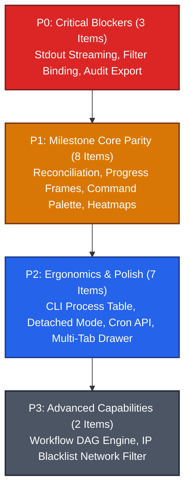

# Milestone 005: Platform Feature Completeness & Specification Parity

## Document Metadata
* **Milestone ID:** MS-005
* **Target Version:** `v1.1.0-parity`
* **Status:** ACTIVE
* **Lead Architect:** @platform-lead
* **Target Delivery Date:** 2026-12-31
* **Related ADRs:** ADR-0001, ADR-0002, ADR-0003, ADR-0004, ADR-0005, ADR-0006, ADR-0007, ADR-0008

---

## 1. Executive Summary & Objectives

Following the successful delivery and validation of the foundational architecture and MVP deliverables (Milestones MS-001 through MS-004), a comprehensive specification gap analysis was conducted across all governing architectural documents (`server-spec.md`, `worker-spec.md`, `studio-spec.md`, wire protocols, and sequence diagrams). The audit identified 20 advanced capabilities, secondary administrative workflows, and real-time streaming optimizations that were omitted, partially stubbed, or deferred during the initial MVP implementations.

**Milestone 005 (MS-005)** establishes the definitive implementation roadmap to achieve 100% specification parity, enterprise cryptographic auditability, and production hardening across all three Legatus platform tiers (`legatus-server`, `worker`, and `legatus-studio`).

### Core Mission Pillars
1. **Real-Time Observability & Streaming:** Transition from buffered batch execution to non-blocking, line-by-line guest process stdout/stderr chunk streaming (`TASK_LOG_CHUNK`), intermediate instruction counter checkpoints (`TASK_PROGRESS`), and responsive desktop UI telemetry (sparklines, node heatmaps, and a segregated multi-tab console drawer).
2. **Distributed Compute Resiliency & Protocol Parity:** Eliminate cluster task loss during network partitions through stateful in-flight session reconciliation (`reconcile_tasks`), reduce dispatch network overhead via bytecode SHA-256 deduplication caching, support POSIX detached daemonization (`legatus up -d`), and provide a tabular CLI process supervisor (`legatus tasks list`).
3. **Enterprise Governance & Security Operations:** Provide cryptographically signed, tamper-evident audit log export bundles (`POST /api/v1/admin/audit-logs/export`), automated 15-minute quarantine TTL sweepers, network IP blacklisting filters, in-place secret key rotation UI, operator account password reset dialogs, and native Windows DPAPI credential encryption.
4. **Advanced Productivity & Pipeline Orchestration:** Implement the global universal command palette (`Ctrl+K`/`Cmd+K`) for sub-second keyboard navigation across cluster resources, dynamic REST-managed runtime cron triggers, and the workflow DAG pipeline orchestration engine (`legatus.features.workflows`).

---

## 2. Scope & Subsystems Affected

* **`server/` (`legatus-server` - Java 21 LTS / Loom):**
  * `dev.legatus.server.admin`: Signed audit trail export endpoint (`/export`), dynamic runtime cron REST management API, and quarantine IP blacklist enforcement filter.
  * `dev.legatus.server.transport.lctp`: Bytecode deduplication cache check during task dispatch, in-flight task session reconciliation handler on reconnect, and `TASK_PROGRESS` LCTP frame processing.
  * `dev.legatus.server.orchestration`: Scheduled 15-minute quarantine TTL expiration sweeper and Workflow DAG pipeline orchestration engine (`legatus.features.workflows`).
* **`worker/` (`legatusd`, `legatus`, `legatus-runner` - C++20 / nng / reproc++):**
  * `worker/src/runner/process_supervisor.cpp`: Non-blocking child stdout/stderr streaming pipe loop emitting incremental `TASK_LOG_CHUNK` frames over LCTP.
  * `worker/src/daemon/lctp_client.cpp`: Live `TASK_PROGRESS` instruction counter frame emission, active task cache persistence, and `SESSION_INIT` `reconcile_tasks` handshake on reconnect.
  * `worker/src/cli/main.cpp`: Detached background daemonization flag (`-d, --daemon`), and ASCII/ANSI tabular process table for `legatus tasks list`.
* **`studio/` (`legatus-studio` - Java 21 LTS / OpenJFX 21 / AtlantaFX):**
  * `dev.legatus.studio.ui.controllers`: Universal Command Palette dialog (`Ctrl+K`/`Cmd+K`), Fleet master-detail active runners table, Secret rotation modal, Operator password reset and profile editing dialogs, 10-second countdown badge on task abort, Task Explorer status filter combo binding, and Drawer multi-tab segregation (Task Console, Cluster Events, Audit Trail).
  * `dev.legatus.studio.ui.controls`: Real-time 60-point vector sparklines and color-graded worker CPU/RAM heatmaps.
  * `dev.legatus.studio.security`: Windows native DPAPI (`CryptProtectData`) integration in `KeyStoreService`.
* **`protocols/` (Wire & API Contracts):**
  * `protocols/worker-wire.md`: Verification and conformance testing of `TASK_LOG_CHUNK`, `TASK_PROGRESS`, and `reconcile_tasks` payloads.
  * `protocols/api-endpoint.md`: Conformance testing of `POST /api/v1/admin/audit-logs/export` and cron trigger management endpoints.

---

## 3. Prioritized Deliverables & Task Matrix

In accordance with **GL-0008**, deliverables are strictly classified across four priority tiers:

---

### 3.1 P0: Critical Blockers (Release Gate)

A single open P0 task blocks production release and halts milestone validation.

- [ ] `[P0]` **Real-Time Task Stdout/Stderr Incremental Streaming:** Refactor `ProcessSupervisor::DrainAndForward` in `worker/src/runner/process_supervisor.cpp` to eliminate blocking on `reproc::drain` until process completion. Implement non-blocking asynchronous pipe reading (`reproc::read`) or streaming callback sinks to forward incremental log chunks immediately over the LCTP channel as `TASK_LOG_CHUNK` frames (bounded to 4KB per chunk or newline delimiters). Eliminates silent execution during long-running tasks and guarantees live visibility in Studio. (`task-operations.md` §4, `worker-wire.md` §4.5)
- [ ] `[P0]` **Task Explorer Status Filter ComboBox Binding:** Populate `statusFilterCombo` in `studio/src/main/java/dev/legatus/studio/ui/controllers/TaskExplorerController.java` with the canonical lifecycle filter states (`ALL`, `QUEUED`, `EXECUTING`, `COMPLETED`, `FAILED`, `ABORTED`) and bind it bidirectionally to `TasksViewModel.filterStatusProperty()`. Ensure filtering dynamically recalculates the visible `FilteredList<TaskRecord>` in the task table upon selection. (`studio-spec.md` §4.3)
- [ ] `[P0]` **Signed Cryptographic Audit Trail Export API:** Implement `POST /api/v1/admin/audit-logs/export` in `server/src/main/java/dev/legatus/server/admin/AuditLogAdminResource.java`. Support query filters (`from`, `to`, `severity`, `format=json|csv`). The export engine MUST verify the SHA-256 hash chain of all selected records, generate a canonical archive, compute an HMAC-SHA256 signature using the cluster master secret key, and return the verifiable bundle alongside cryptographic verification metadata (`total_records`, `first_sequence_id`, `last_sequence_id`, `signature`, `generated_at`). (`api-endpoint.md` §7.3, `server-spec.md` §5.3.3)

---

### 3.2 P1: High Priority (Milestone Core)

Mandatory capabilities required for full architectural specification compliance. Release tag cannot cut until all P1 items are resolved.

- [ ] `[P1]` **Live Intermediate `TASK_PROGRESS` Wire Frames:** Implement periodic `TASK_PROGRESS` frame emission in `worker/src/daemon/lctp_client.cpp` during child process execution. Emit updates every 1,000,000 instructions or 1,000ms containing `task_id`, `instructions_executed`, `current_memory_bytes`, and `checkpoint_label`. In `legatus-server`, handle `TASK_PROGRESS`, update in-memory task entity metrics, and broadcast `EVENT_TASK_PROGRESS` over LSTCP to connected Studio cockpits. (`worker-wire.md` §4.6, `worker-spec.md` §4.4)
- [ ] `[P1]` **In-Flight Task Session Reconciliation on Reconnect:** Extend `legatusd` to maintain an active registry of supervised child runner PIDs and task IDs across network disconnections. Upon socket reconnection, populate `reconcile_tasks` in the `SESSION_INIT` payload. In `server/src/main/java/dev/legatus/server/transport/lctp/LctpConnectionHandler.java`, validate reported tasks against the server database: reconcile running states, acknowledge surviving tasks, and return `discarded_task_ids` for tasks cancelled or timed out while offline, allowing the worker to terminate orphaned runners. (`worker-wire.md` §4.1)
- [ ] `[P1]` **Universal Command Palette (`Ctrl+K` / `Cmd+K`):** Implement the global search and command palette overlay (`CommandPaletteController.java` / `command_palette.fxml`) in Legatus Studio. Bind global keystrokes `Ctrl+K` (Linux/Windows) and `Cmd+K` (macOS) across all views. Provide fuzzy-search matching over active compute workers, tasks, Solix bytecode functions, navigation screens, and quick cluster commands (`Drain All Workers`, `Export Audit Trail`, `Toggle Theme`). (`studio-spec.md` §6, `04-studio.md` §6)
- [ ] `[P1]` **Cluster CPU/RAM Sparklines & Node Heatmaps:** Implement vector sparkline controls (`SparklineSkin.java`) rendering a sliding 60-point historical telemetry series for cluster CPU and RAM in `ClusterOverviewController`. In `FleetTopologyController`, replace static text metrics with color-graded SVG heatmaps (green `<50%`, amber `50-80%`, red `>80%`) updated dynamically via `TelemetryCoalescer` at 60Hz. (`studio-spec.md` §1.1 & §4.1)
- [ ] `[P1]` **Active Runner Detail Table in Fleet Topology:** Enhance the master-detail split pane in `studio/src/main/java/dev/legatus/studio/ui/controllers/FleetTopologyController.java`. When a worker node row is selected in `workersTable`, populate an embedded detail `TableView<TaskRecord>` displaying all guest tasks currently executing on that specific worker (Task ID, Function Name, Started At, Current Memory, Instruction Budget, and Abort action). (`studio-spec.md` §1.1, `04-studio.md` §3.2)
- [ ] `[P1]` **Secret Rotation & Modification UI Dialog:** Implement secret key modification and rotation dialogs in `studio/src/main/java/dev/legatus/studio/ui/controllers/SecretsController.java`. Allow operators to select an existing secret, supply a new value or description, invoke `PUT /api/v1/admin/secrets/{key}`, and receive visual confirmation with an audit trail notification. (`server-spec.md` §5.2, `api-endpoint.md` §8.2)
- [ ] `[P1]` **Operator Account Password Reset & Profile Editing Dialogs:** Add profile modification and administrative password reset modal dialogs in `studio/src/main/java/dev/legatus/studio/ui/controllers/AdminUsersController.java`. Wire to `PUT /api/v1/admin/accounts/{id}` (email/role modification) and `POST /api/v1/admin/accounts/{id}/reset-password` (temporary password generation), with appropriate validation and error handling. (`api-endpoint.md` §6.3 & §6.6)
- [ ] `[P1]` **Bytecode Deduplication Cache on Dispatch:** Implement bytecode cache negotiation in `server/src/main/java/dev/legatus/server/transport/lctp/LctpTaskDispatcher.java` controlled by `legatus.features.bytecode-cache`. Maintain a per-worker set of cached SHA-256 digests; when dispatching a task whose bytecode digest is already acknowledged by the worker, transmit `DISPATCH_TASK` containing only `bytecode_sha256` and omit the Base64 payload, reducing network transit by up to 99%. (`server-spec.md` §6.1, `worker-wire.md` §4.4)

---

### 3.3 P2: Medium Priority (Ergonomics, Automation & Polish)

Non-blocking operational ergonomics, automation daemons, and UI polish.

- [ ] `[P2]` **Detailed Process Table for `legatus tasks list`:** Extend the local IPC `NNG_PROTO_REQ0` protocol handler in `worker/src/cli/main.cpp` and `worker/src/daemon/ipc_server.cpp` to format and display an ASCII/ANSI tabular view for `legatus tasks list` showing: Task ID, OS PID, Function Name, Memory Footprint (RSS), Instructions Executed, and Elapsed Runtime. (`worker-spec.md` §4.1)
- [ ] `[P2]` **Detached Daemon Mode Flag (`legatus up -d`):** Add `-d, --daemon` command-line flag to the CLI11 parser in `worker/src/cli/main.cpp`. On POSIX platforms, fork the daemon process, decouple from the controlling terminal (`setsid`), redirect standard file descriptors to `/var/log/legatus/legatusd.log`, and write the process ID to `/var/run/legatus/legatusd.pid` (or local runtime directory). (`worker-spec.md` §4.1, `05-worker.md` §3.1)
- [ ] `[P2]` **Dynamic Runtime Cron Trigger REST Management API:** Implement REST resource endpoints (`/api/v1/admin/cron-triggers`) in `server/src/main/java/dev/legatus/server/admin/CronSchedulerResource.java`. Allow cluster operators to dynamically list, register new cron schedules, pause, resume, trigger immediate execution, and delete cron jobs at runtime without modifying `application.yml` or restarting the server. (`server-spec.md` §6.1)
- [ ] `[P2]` **Quarantine Expiration Background Sweeper:** Implement a scheduled Virtual Thread background sweeper in `server/src/main/java/dev/legatus/server/worker/WorkerEnrollmentService.java` executing every 60 seconds. Query for `PENDING_APPROVAL` enrollment records older than 15 minutes (900 seconds), transition their status to `EXPIRED`, emit a security audit log event, and invalidate pending challenge nonces. (`server-spec.md` §4.1)
- [ ] `[P2]` **10-Second Visual Countdown Timer Badge on Task Abort:** Update `studio/src/main/java/dev/legatus/studio/ui/controllers/TaskExplorerController.java` to manage a visual countdown timer upon initiating Stage 1 task abort. Transition the table badge to `ABORTING (Stage 1 Grace Period - 10s)`, decrementing every second until either the worker acknowledges task exit or the 10-second timer expires, triggering Stage 2 escalation (`SIGKILL`). (`studio-spec.md` §4.3, `04-studio.md` §4.2)
- [ ] `[P2]` **Drawer Multi-Tab Segregation:** Refactor `studio/src/main/resources/fxml/drawer.fxml` and `studio/src/main/java/dev/legatus/studio/ui/controllers/DrawerController.java` to replace the single monolithic `ListView` with an AtlantaFX `TabPane` containing three segregated tabs:
  1. `Task Output Console` (active task stdout/stderr stream with log search bar).
  2. `Cluster Event Stream` (LSTCP event broadcast ticker).
  3. `Security Audit Log` (live audit trail feed with severity pills). (`studio-spec.md` §4.1, `04-studio.md` §3.4)
- [ ] `[P2]` **Windows Native DPAPI Credential Store Integration:** Implement native Windows DPAPI (`CryptProtectData` / `CryptUnprotectData`) integration via JNA (`com.sun.jna.platform.win32.Crypt32`) in `studio/src/main/java/dev/legatus/studio/security/KeyStoreService.java`, eliminating fallback to unencrypted local storage when running on Windows hosts. (`studio-spec.md` §1.1, `04-studio.md` §7.1)

---

### 3.4 P3: Low Priority (Advanced Features & Opportunistic Hardening)

Deferrable advanced extensions and network security hardening.

- [ ] `[P3]` **Workflow DAG Pipeline Orchestration Engine:** Implement the pipeline orchestration engine in `server/src/main/java/dev/legatus/server/features/workflows/` enabled via `legatus.features.workflows=true`. Support directed acyclic graph (DAG) execution schemas, topological dependency sorting, chaining output JSON from parent tasks as input arguments into dependent child tasks, and partial failure policies (`ABORT_PIPELINE`, `CONTINUE_ON_FAILURE`). Provide REST API under `/api/v1/workflows`. (`server-spec.md` §6.1, `overview.md` §3)
- [ ] `[P3]` **Quarantine IP Blacklist Network / Firewall Enforcement:** Persist rejected worker IP addresses / CIDRs in an immutable `banned_ip_ranges` database table when operators select `[x] Blacklist IP` during quarantine attestation rejection. Enforce rejection at the WebSocket upgrade filter and HTTP servlet filter layer, returning HTTP 403 Forbidden before initiating cryptographic handshakes. (`studio-spec.md` §4.2, `server-spec.md` §4.1)

---

## 4. Definition of Done (DoD) Sign-Off Matrix

In accordance with **GL-0008 Section 2**, this milestone **CANNOT** transition to `FEATURE_COMPLETE` or `CLOSED` until all five DoD pillars are satisfied and verified:

| DoD Requirement | Target Benchmark | Verification Tool / Command | Sign-off Status |
| :--- | :--- | :--- | :--- |
| **Catch2 v3 Suite** | 100% pass across worker native unit, streaming, IPC, and reconciliation suites | `ctest --test-dir worker/build --output-on-failure` | [ ] Pending Verification |
| **JUnit 5 & TestFX Suite** | 100% pass across Spring Boot orchestrator, REST controllers, and headless Studio UI | `./server/mvnw -f server/pom.xml test` `./server/mvnw -f studio/pom.xml test` | [ ] Pending Verification |
| **Sanitizer Gate** | Zero memory leaks, zero undefined behavior warnings under Clang 18 | `ASan` / `UBSan` on worker and runner binaries | [ ] Pending Verification |
| **Living Documentation** | Wire protocols, CLI manuals, and operator guides updated to reflect all 20 deliverables | `scripts/verify-cli-docs.sh` (`GL-0010`) | [ ] Pending Verification |
| **ADR Governance** | Architectural decision records authored and accepted for DAG engine and streaming pipes | Review against `docs/dev/decisions/` (`GL-0006`) | [ ] Pending Verification |

---

## 5. Risk Assessment & Mitigation Strategies

### Risk 1: High-Throughput Log Streaming Backpressure & Memory Exhaustion
* **Description:** Guest processes producing millions of lines of stdout/stderr per second could saturate worker IPC buffers, overload the outbound LCTP WebSocket channel, or cause Out-Of-Memory (OOM) errors in the server and Studio clients.
* **Mitigation:**
  * In `ProcessSupervisor`, implement bounded 4KB chunk coalescing with rate-limiting backpressure (drop or throttle if outbound queue exceeds 16MB).
  * In `legatus-server`, forward log chunks over LSTCP only to subscribers with active `SUBSCRIBE_TASK_LOGS` tokens.
  * In `legatus-studio`, enforce the strict 10,000-line circular ring buffer (`TaskLogRingBuffer`) to prevent memory growth on the JavaFX UI thread.

### Risk 2: Split-Brain State During In-Flight Task Session Reconciliation
* **Description:** A worker experiencing a temporary network partition may attempt to reconcile tasks that the server has already reassigned to another compute node or timed out.
* **Mitigation:**
  * The server is authoritative: `LctpConnectionHandler` checks the cluster database for each reported task.
  * If a task has transitioned to `TIMED_OUT` or `RESCHEDULED`, the server returns it in `discarded_task_ids`.
  * Upon receiving `discarded_task_ids`, `legatusd` immediately issues `SIGKILL` to the orphaned child process, preventing duplicate execution and state corruption.

### Risk 3: OpenJFX Headless CI Stalls with Modal Dialogs & Command Palette
* **Description:** Complex modal overlays (Command Palette, Secret Rotation, Password Reset) and custom canvas sparklines can cause headless CI environments (Linux GitHub Actions without X11 display) to fail or hang.
* **Mitigation:**
  * Author comprehensive headless UI tests using `TestFX` with the `Monocle` glass platform (`-Dglass.platform=Monocle -Dmonocle.platform=Headless`).
  * Decouple all business logic and filtering operations into headless ViewModels (`CommandPaletteViewModel`, `SecretsViewModel`, `TasksViewModel`) tested 100% via standard JUnit 5 before binding to FXML scene graphs.

### Risk 4: Cyclic Dependencies in Workflow DAG Pipelines
* **Description:** User-defined workflow graphs submitted via the new workflow engine may contain cycles or disconnected components, leading to infinite loops or orphaned tasks.
* **Mitigation:**
  * Implement strict validation using Kahn's algorithm for topological sorting during pipeline creation (`POST /api/v1/workflows`).
  * Reject any workflow submission containing cycles with HTTP 422 Unprocessable Entity and detailed node cycle paths prior to persisting or scheduling.
