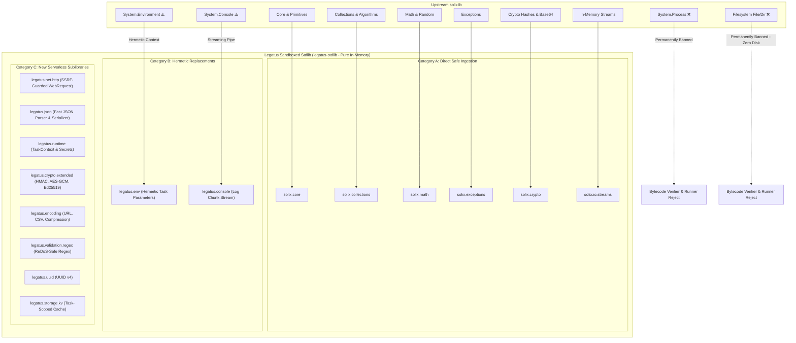
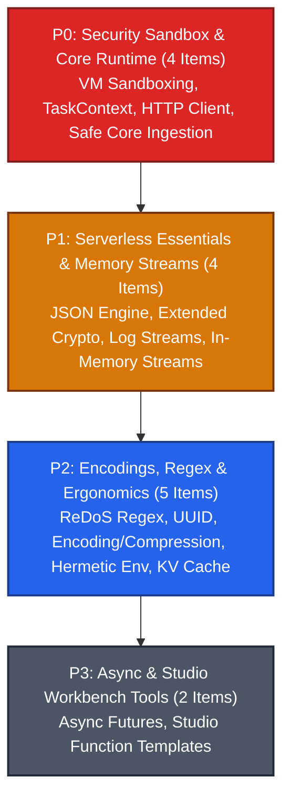

# Milestone 006: Worker Sandboxed Standard Library (Legatus Stdlib)

## Document Metadata
* **Milestone ID:** MS-006
* **Target Version:** `v1.2.0-stdlib`
* **Status:** ACTIVE
* **Lead Architect:** @runtime-lead
* **Target Delivery Date:** 2027-01-31
* **Related ADRs:** ADR-0004, ADR-0008, ADR-0009

---

## 1. Executive Summary & Objectives

The Legatus distributed platform executes untrusted, multi-tenant serverless tasks within ephemeral `legatus-runner` child processes hosting the embedded Solix Virtual Machine (`ADR-0004`). While the core execution engine enforces deterministic instruction-level metering and Automatic Reference Counting (ARC) memory reclamation, guest bytecode requires a robust, expressive, and hermetically isolated standard library to perform real-world serverless workflows (JSON parsing, HTTP egress requests, cryptographic verification, data structure manipulation, and task context introspection).

The upstream Solix standard library (`solixlib`) was originally engineered for general-purpose standalone command-line applications, exposing dangerous native capabilities such as arbitrary host process execution (`solix.system.Process.execute`), host filesystem I/O (`solix.io.filesystem.File`/`Directory`), and raw host environment variable access (`solix.system.Environment.get_env`). Allowing untrusted guest bytecode to invoke these native bindings compromises worker node integrity, enables host breakout, and violates the zero-trust cluster security model.

**Milestone 006 (MS-006)** establishes the specification, migration, sandboxing, and authoring of the **Legatus Standard Library (`legatus-stdlib`)**. Under the **Pure In-Memory Compute Sandbox Model**, this deliverable:
1. **Audits and Ingests Safe `solixlib` Sublibraries:** Directly incorporates proven, pure-memory submodules (`core`, `collections`, `math`, `exceptions`, `crypto` hashing, in-memory `streams`).
2. **Permanently Bans Host Syscalls & Filesystem Access:** Strictly prohibits both process spawning (`solix.system.Process`) and all disk filesystem I/O (`solix.io.filesystem`). **Zero disk writes are permitted.** Guest execution is strictly memory-only.
3. **Strips Host Environment Authority:** Replaces raw host OS environment variables with hermetic, task-scoped parameter injection (`legatus.env`).
4. **Implements Essential Modern Serverless Capabilities:** Authors first-class, security-hardened native libraries including an SSRF-guarded HTTP egress client (`legatus.net.http`), native high-speed JSON manipulation (`legatus.json`), task introspection & secret decryption (`legatus.runtime.TaskContext`), extended enterprise cryptography (`legatus.crypto.extended`), linear-time regular expressions (`legatus.validation.regex`), and resilient data encodings.

---

## 2. Standard Library Classification & Comprehensive Sublibrary Manifest

The standard library ecosystem for Legatus guest tasks is partitioned into three distinct tiers:
1. **Category A:** Inherited Safe `solixlib` Sublibraries (Direct Ingestion).
2. **Category B:** Quarantined & Banned Sublibraries (Hard Compiler & Runtime Rejection).
3. **Category C:** Newly Authored Serverless Compute Sublibraries (`legatus.*`).

---

### 2.1 Complete Manifest of Standard Sublibraries

| Sublibrary Namespace | Upstream Origin | Safety Status | Sandbox / Security Policy | Description & Capabilities |
| :--- | :--- | :--- | :--- | :--- |
| **`solix.core`** | `solixlib` |  **Inherited Safe** | Pure memory safety | `String`, `StringBuilder`, `Primitives`, `Optional`, `Internal`, `ICloneable`, `IComparable`, `IEquatable`, `IHashable`, `IStringable`. Core object contracts and primitive manipulation. |
| **`solix.collections`** | `solixlib` |  **Inherited Safe** | Pure memory safety | `List`, `LinkedList`, `HashMap`, `HashSet`, `TreeMap`, `TreeSet`, `Stack`, `Queue`, `Deque`, `PriorityQueue`, `CircularBuffer`, `BitSet`, `Algorithms`, `KeyValuePair`, `Interfaces`, `Collections`. High-performance generic data structures. |
| **`solix.math`** | `solixlib` |  **Inherited Safe** | Deterministic math | `Math` (trigonometry, exponentiation, logarithms, rounding, min/max) and `Random` (deterministic seeded pseudo-random number generator). |
| **`solix.time`** | `solixlib` |  **Inherited Safe** | Clock-virtualized | `DateTime`, `Duration`, `Instant`, `Stopwatch`. Calendar math and monotonic time tracking. Wall clock tied to task initialization timestamp to prevent side-channel timing attacks. |
| **`solix.crypto`** | `solixlib` |  **Inherited Safe** | Pure memory safety | `Base64`, `Hex`, `Hash` (SHA-256, SHA-512, MD5, SHA-1 digests). Cryptographic hashing and textual encoding. |
| **`solix.exceptions`** | `solixlib` |  **Inherited Safe** | Pure memory safety | Complete structured exception hierarchy (`Exception`, `RuntimeException`, `NullReferenceException`, `IndexOutOfBoundsException`, `ArgumentException`, etc.). |
| **`solix.io.streams`** | `solixlib` |  **Inherited Safe** | Memory buffer bounds | `IStream`, `MemoryStream`, `StreamReader`, `StreamWriter`, `BufferedReader`. Pure in-memory sequential byte and character stream pipelines. |
| **`solix.system.Process`** | `solixlib` | ❌ **Permanently Banned** | Hard rejection | `Process.execute`, `Process.start`, fork/exec. **Strictly banned.** Guest bytecode attempting to reference `solix.system.Process` is rejected by the server bytecode validator and worker runner. |
| **`solix.io.filesystem`** | `solixlib` | ❌ **Permanently Banned** | Zero disk I/O | `File`, `Directory`, `Path`. **Strictly banned.** No disk writing or reading is permitted. Tasks must operate entirely in memory or via stream buffers. Bytecode attempting to import `solix.io.filesystem` is rejected. |
| **`solix.system.Environment`** | `solixlib` | ⚠️ **Hermetically Replaced** | Zero host exposure | Replaced by `legatus.env.Environment`. Blocks all host OS environment variables. Exposes only task input arguments (`task.parameters`) and explicitly authorized task-scoped environment pairs. |
| **`solix.system.Console`** | `solixlib` | ⚠️ **Sandboxed Replacement** | Pipe backpressure | `Console.print`, `Console.println`. Re-routed to the task standard output pipe, emitting rate-limited `TASK_LOG_CHUNK` frames over LCTP with a per-task log volume limit. |
| **`legatus.net.http`** | *New Sublib* | ✨ **New Serverless** | SSRF & egress guardrails | `WebRequest`, `HttpClient`, `HttpGet`, `HttpPost`, `HttpPut`, `HttpDelete`, `HttpResponse`, `HttpHeaders`. Bounded HTTP/1.1 and HTTP/2 client with SSRF blocking (private IPs, loopback, cloud metadata endpoints like `169.254.169.254`), request timeouts, and max body size limits (10MB). |
| **`legatus.json`** | *New Sublib* | ✨ **New Serverless** | Memory-bounded DOM | `JsonDocument`, `JsonObject`, `JsonArray`, `JsonValue`, `JsonException`. Native high-speed JSON parser and serializer with direct binding to task arguments (`task.parameters`) and results (`task.result`). |
| **`legatus.runtime`** | *New Sublib* | ✨ **New Serverless** | Capability security | `TaskContext`, `TaskLogger`, `TaskMetrics`. Introspects active task ID, function name, allocated instruction budget, remaining instructions, intermediate checkpoint emission (`TASK_PROGRESS`), and access to decrypted cluster secrets. |
| **`legatus.crypto.extended`** | *New Sublib* | ✨ **New Serverless** | Constant-time native | `Hmac` (HMAC-SHA256, HMAC-SHA512), `AesGcm` (AES-256-GCM authenticated encryption/decryption), `Ed25519` (digital signature verification for webhooks and signed payloads). |
| **`legatus.encoding`** | *New Sublib* | ✨ **New Serverless** | Bomb-protected | `UrlEncoding` (RFC 3986), `Csv` (RFC 4180 streaming reader/writer), `Compression` (`Zlib`, `Gzip`, `Deflate`) with decompression ratio limits preventing zip bombs. |
| **`legatus.validation.regex`** | *New Sublib* | ✨ **New Serverless** | Linear-time ReDoS safe | `Regex`, `Pattern`, `Matcher`. Regular expression evaluation implemented with guaranteed linear time execution (RE2/Rust-regex semantic equivalent), eliminating catastrophic backtracking CPU denial-of-service vulnerabilities. |
| **`legatus.uuid`** | *New Sublib* | ✨ **New Serverless** | Cryptographic PRNG | `Uuid` (RFC 4122 v4 generation, parsing, byte array serialization). |
| **`legatus.storage.kv`** | *New Sublib* | ✨ **New Serverless** | Bounded cache | `EphemeralKV`, `CacheItem`. In-memory thread-safe key-value cache with TTL expiration and memory caps for task execution. |
| **`legatus.concurrency`** | *New Sublib* | ✨ **New Serverless** | Virtual Thread / Async | `Future<T>`, `Promise<T>`, `AsyncExecutor`. Lightweight asynchronous coordination primitives enabling concurrent HTTP egress requests within the worker thread pool. |

---

## 3. Scope & Subsystems Affected

* **`worker/stdlib/` (New Repository Subtree):**
  * `worker/stdlib/src/solix/`: Source files (`.slx`) for inherited safe libraries (`core`, `collections`, `math`, `time`, `crypto`, `exceptions`, `streams`).
  * `worker/stdlib/src/legatus/`: Source files (`.slx`) for new serverless libraries (`net/http`, `json`, `runtime`, `crypto/extended`, `encoding`, `regex`, `uuid`, `storage/kv`, `concurrency`).
  * `worker/stdlib/native/`: Modern C++20 native FFI implementation library (`legatus_stdlib_native`) statically linked into `legatus_runner_core`, using `libcurl` (HTTP egress), `nlohmann_json` (JSON parsing/serialization), `OpenSSL 3.0` (HMAC, AES-GCM, Ed25519, hashing), and `re2` (linear-time regex). Eliminates redundant dependencies (`simdjson`, `yyjson`, `libsodium`) and requires zero dynamic library loading from host disk at runtime.
* **`worker/runner` (`legatus-runner`):**
  * Integration of `legatus::stdlib::register_sandboxed_stdlib(solix::NativeRegistry &registry, const TaskSandboxContext &context)` called during runner context creation.
  * Complete omission and rejection of host filesystem or OS process syscalls.
  * Ingress injection of task parameters and decrypted secrets into `TaskContext`.
  * Egress network security filter enforcing SSRF rules and IP blacklists.
* **`server/` (`legatus-server`):**
  * Static bytecode verification pass during function upload (`POST /api/v1/functions/upload`): Inspects constant pool imports and rejects any bytecode referencing `solix.system.Process`, `solix.io.filesystem`, or unauthorized native symbols.
  * Secret injection protocol: Passing authorized secret key-value pairs during `DISPATCH_TASK` for retrieval via `TaskContext.getSecret(key)`.
* **`studio/` (`legatus-studio`):**
  * Function workbench template generator: Pre-populated Solix function templates with standard library imports (`import legatus.net.http.*;`, `import legatus.json.*;`, `import legatus.runtime.*;`).
  * Bytecode inspector: Displays standard library package dependencies in the bytecode workbench.

---

## 4. Prioritized Deliverables & Task Matrix

In accordance with **GL-0008**, tasks are classified across four priority tiers:

---

### 4.1 P0: Critical Blockers (Release Gate / Security Core)

A single open P0 task blocks production release and halts milestone validation.

- [ ] `[P0]` **Hermetic VM Sandbox & Host Authority Stripping (Zero Disk / Zero Syscall):** Author native registration hooks in `worker/src/runner/sandbox.cpp`. Permanently omit and reject `solix.system.Process`, `solix.io.filesystem`, and raw syscall symbols. In `legatus-server` (`BytecodeValidatorService.java`), implement an AST/constant-pool inspection pass rejecting any bytecode attempting to import or invoke `solix.system.Process` or `solix.io.filesystem`, ensuring untrusted user code cannot spawn host processes, touch the host disk, or break out of the runner. (`ADR-0004`, `ADR-0009`)
- [ ] `[P0]` **Safe `solixlib` Core & Collections Subtree Ingestion:** Ingest and compile the validated safe subset of `solixlib` into `worker/stdlib/src/solix/`: `solix.core` (`String`, `StringBuilder`, `Primitives`, `Optional`), `solix.collections` (`List`, `LinkedList`, `HashMap`, `HashSet`, `TreeMap`, `TreeSet`, `Stack`, `Queue`, `Deque`, `PriorityQueue`, `BitSet`, `Algorithms`), `solix.math` (`Math`, `Random`), and `solix.exceptions`. Guarantee 100% test pass on native ARC memory reclamation under ASan.
- [ ] `[P0]` **SSRF-Guarded HTTP Client (`legatus.net.http`):** Implement the `legatus.net.http` sublibrary (`WebRequest`, `HttpClient`, `HttpGet`, `HttpPost`, `HttpResponse`, `HttpHeaders`) in `worker/stdlib/src/legatus/net/http/` backed by native `libcurl` in C++20. Enforce strict egress security controls:
  1. Block all requests to loopback addresses (`127.0.0.0/8`, `::1`).
  2. Block RFC 1918 private IPv4 ranges (`10.0.0.0/8`, `172.16.0.0/12`, `192.168.0.0/16`) and RFC 4193 unique local IPv6 ranges (`fc00::/7`) unless explicitly permitted by worker configuration.
  3. Hard-block cloud metadata service IP endpoints (`169.254.169.254`, `fd00:ec2::254`).
  4. Enforce configurable connection timeout (default 5,000ms), read timeout (default 15,000ms), and max response payload size cap (default 10MB) to prevent runner OOM.
- [ ] `[P0]` **Task Context & Secret Introspection (`legatus.runtime`):** Implement `legatus.runtime.TaskContext` in `worker/stdlib/src/legatus/runtime/TaskContext.slx`. Expose safe runtime introspection: `TaskContext.taskId()`, `TaskContext.functionName()`, `TaskContext.instructionBudget()`, `TaskContext.instructionsConsumed()`, and `TaskContext.getSecret(String key)`. Inject decrypted task secrets from the worker's secure memory arena into the VM context at task startup, ensuring secrets are never persisted to disk or exposed to other processes.

---

### 4.2 P1: High Priority (Milestone Core Parity)

Mandatory capabilities required for full standard library usability.

- [ ] `[P1]` **High-Speed Native JSON Engine (`legatus.json`):** Author `legatus.json` (`JsonDocument`, `JsonObject`, `JsonArray`, `JsonValue`, `JsonException`) in `worker/stdlib/src/legatus/json/`. Back with modern C++20 native parser using `nlohmann_json` (integrated into `legatus_common`). Enforce recursion depth ceiling (maximum 32 nested levels) and string length limit (8MB) to prevent parser stack overflow and memory exhaustion. Provide fluent JSON query APIs (`doc.get_string("key")`, `doc.get_int("count")`, `doc.get_object("nested")`), direct serialization to Solix strings, and automatic deserialization of task invocation parameters (`task.parameters`).
- [ ] `[P1]` **Safe Console & Incremental Log Streaming:** Implement `legatus.console.Console` (and safe `solix.system.Console` compatibility wrapper). Redirect all `print` and `println` calls to the supervisor's streaming stdout pipe, emitting incremental `TASK_LOG_CHUNK` frames over LCTP. Enforce a rate limit (maximum 1,000 lines/second and 8MB total output) to protect worker and Studio buffers from spam exhaustion.
- [ ] `[P1]` **Extended Enterprise Cryptography (`legatus.crypto.extended`):** Implement `legatus.crypto.extended` providing:
  1. `Hmac`: Constant-time HMAC-SHA256 and HMAC-SHA512 generation and verification for webhook signatures.
  2. `AesGcm`: AES-256-GCM authenticated encryption and decryption for secure payload processing.
  3. `Ed25519`: Public key digital signature verification.
  Implement using OpenSSL 3.0 EVP APIs (`EVP_MAC`, `EVP_CIPHER_CTX`, `EVP_PKEY`) with zero memory leaks.
- [ ] `[P1]` **Safe Ingestion of Cryptographic Hashes & In-Memory Streams:** Copy and integrate `solix.crypto` (`Base64`, `Hex`, `Hash` with SHA-256/512/MD5) and `solix.io.streams` (`MemoryStream`, `StreamReader`, `StreamWriter`, `BufferedReader`). Verify that all buffer allocations operate entirely in-memory and respect the Solix VM memory arena boundaries.

---

### 4.3 P2: Medium Priority (Ergonomics, Encodings & Utility)

Non-blocking operational ergonomics, advanced data encodings, and developer utilities.

- [ ] `[P2]` **ReDoS-Immune Linear-Time Regular Expressions (`legatus.validation.regex`):** Implement `legatus.validation.regex` (`Regex`, `Pattern`, `Matcher`) backed by Google's `re2` library. Guarantee $O(N)$ linear-time evaluation with respect to input length, completely eliminating the risk of Regular Expression Denial of Service (ReDoS) catastrophic backtracking attacks inside worker nodes.
- [ ] `[P2]` **UUID v4 Generation & Validation (`legatus.uuid`):** Author `legatus.uuid.Uuid` supporting RFC 4122 version 4 cryptographically secure random UUID generation, UUID string parsing, validation, and conversion to/from 16-byte raw buffers.
- [ ] `[P2]` **Data Encodings & Compression (`legatus.encoding`):** Implement `legatus.encoding`:
  1. `UrlEncoding`: RFC 3986 component encoding and decoding.
  2. `Csv`: RFC 4180 streaming CSV reader and writer with quote escaping and delimiter handling.
  3. `Compression` (`Zlib`, `Gzip`, `Deflate`): In-memory stream compression and decompression with strict decompression ratio limits ($10\times$ max expansion) to prevent zip bomb denial-of-service attacks.
- [ ] `[P2]` **Hermetic Task Environment (`legatus.env`):** Author `legatus.env.Environment` to replace raw `solix.system.Environment`. Forbid access to native host OS environment variables. Provide access only to explicitly declared task environment configurations and read-only cluster system properties (`LEGATUS_CLUSTER_VERSION`, `LEGATUS_REGION`).
- [ ] `[P2]` **Task-Scoped Ephemeral KV Cache (`legatus.storage.kv`):** Author `legatus.storage.kv.EphemeralKV` providing an in-memory key-value cache with per-item TTL expiration, LRU eviction, and a maximum memory footprint of 16MB per task.

---

### 4.4 P3: Low Priority (Advanced Capabilities & Developer Tooling)

Deferrable productivity enhancements and developer tooling.

- [ ] `[P3]` **Lightweight Async Coordination Primitives (`legatus.concurrency`):** Author `legatus.concurrency.Future<T>` and `AsyncExecutor` allowing guest Solix tasks to fire multiple asynchronous HTTP egress requests concurrently and join results via `Future.all()` or `Future.any()` without blocking the primary instruction loop.
- [ ] `[P3]` **Studio Bytecode Workbench Standard Library Integration:** Update `legatus-studio` (`FunctionsViewModel.java` and `FunctionsController.java`) to provide pre-built function templates showcasing standard library imports (`import legatus.net.http.*;`, `import legatus.json.*;`, `import legatus.runtime.*;`), and display standard library linkage metadata in the bytecode inspection workbench.

---

## 5. Definition of Done (DoD) Sign-Off Matrix

In accordance with **GL-0008 Section 2**, this milestone **CANNOT** transition to `FEATURE_COMPLETE` or `CLOSED` until all five DoD pillars are satisfied and verified:

| DoD Requirement | Target Benchmark | Verification Tool / Command | Sign-off Status |
| :--- | :--- | :--- | :--- |
| **Catch2 v3 Suite** | 100% pass across all native stdlib bindings, sandboxing assertions, and HTTP egress suites | `ctest --test-dir worker/build -R stdlib --output-on-failure` | [ ] Pending Verification |
| **Solix Stdlib Test Suite** | 100% pass across all `.slx` guest unit tests for core, collections, json, and net | `worker/build/legatus-runner --test stdlib` | [ ] Pending Verification |
| **Sanitizer & Memory Gate** | Zero memory leaks, zero undefined behavior across all native C++20 FFI modules | `ASan` / `UBSan` under Clang 18 | [ ] Pending Verification |
| **Security Penetration Gate** | Automated exploit verification asserting complete blocking of process spawn, SSRF egress, and filesystem access | `worker/tests/security/test_sandbox_penetration.cpp` | [ ] Pending Verification |
| **Living Documentation** | Complete API specification for all `solix.*` and `legatus.*` modules (`docs/specs/stdlib-spec.md`) | Review against `GL-0010` | [ ] Pending Verification |
| **ADR Governance** | ADR-0009 accepted for Sandboxed Standard Library Architecture & Capability Model | Review against `docs/dev/decisions/` (`GL-0006`) | [ ] Pending Verification |

---

## 6. Risk Assessment & Mitigation Strategies

### Risk 1: Server-Side Request Forgery (SSRF) via `legatus.net.http`
* **Description:** Malicious guest bytecode executing on a worker in a cloud environment (e.g. AWS, GCP) could issue HTTP requests to internal cloud metadata endpoints (`169.254.169.254`) or private cluster services (`10.0.0.0/8`), exfiltrating instance IAM credentials or pivoting across internal networks.
* **Mitigation:**
  * Implement mandatory DNS resolution validation prior to connection: if the resolved IP belongs to loopback, private RFC 1918, link-local, or cloud metadata ranges, the request is aborted immediately with `SecurityException("Egress to restricted IP blocked by policy")`.
  * Forbid disabling SSL certificate verification by default.

### Risk 2: Decompression Bomb & Parsing Memory Exhaustion
* **Description:** Malicious inputs submitted to `legatus.encoding` (e.g. gzip) or `legatus.json` could expand to gigabytes in memory, triggering host Linux OOM killer and killing `legatusd`.
* **Mitigation:**
  * Enforce strict streaming expansion ratio limits (maximum $10\times$ expansion or 16MB maximum uncompressed payload size).
  * Enforce maximum JSON document recursion depth (default 32 levels) and maximum JSON string length.

### Risk 3: ReDoS Denial-of-Service via Catastrophic Regular Expression Backtracking
* **Description:** Untrusted regex patterns evaluated against repetitive strings could cause the runner thread to enter exponential CPU backtracking loops.
* **Mitigation:**
  * Adopt Google's `re2` DFA/NFA engine, which mathematically guarantees linear-time $O(N)$ execution with respect to input length and rejects constructs requiring backtracking (e.g. backreferences).
