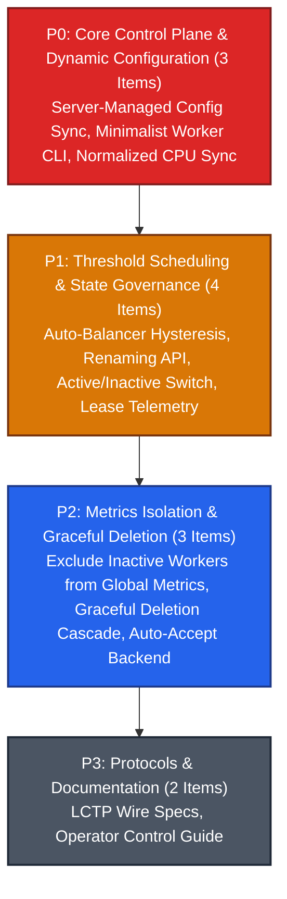

# Milestone 007: Server-Centric Worker Control Plane, Dynamic Configuration & Threshold Auto-Balancing

## Document Metadata
* **Milestone ID:** MS-007
* **Target Version:** `v1.3.0-control-plane`
* **Status:** ACTIVE
* **Lead Architect:** @control-plane-lead
* **Target Delivery Date:** 2027-02-15
* **Related ADRs:** ADR-0003, ADR-0005, ADR-0007, ADR-0008, ADR-0010

---

## 1. Executive Summary & Objectives

Prior iterations of the Legatus architecture decentralized runtime configuration into local static TOML files on worker nodes (`/etc/legatus/worker.toml`), requiring manual local intervention or daemon restarts to alter worker parameters. Furthermore, worker compute nodes operated as autonomous dispatch recipients without server-enforced resource headroom, leading to cluster imbalances where heavily loaded workers received tasks until thread exhaustion occurred.

**Milestone 007 (MS-007)** inverts the control hierarchy, establishing a **Server-Centric Worker Control Plane**. In this architecture:
1. **Minimal Worker CLI Footprint:** The worker CLI (`legatus`) is stripped down to minimal commands: `up`, `down`, and `--server <url>`. Compute daemons cache exclusively their cryptographic authentication credentials and unique node UUID.
2. **Server-Managed Dynamic Configuration Sync:** All operational configuration lives centrally on `legatus-server`. Upon connection, the daemon pulls its configuration profile (`CONFIG_SYNC`) and applies runtime modifications pushed on the fly (`CONFIG_UPDATE`) without process restarts. If the server is temporarily unreachable on startup, the worker enters an exponential backoff retry loop rather than failing immediately.
3. **Threshold-Based Scheduling & Auto-Balancing with Hysteresis:** Operators configure per-worker or cluster-wide soft thresholds: Target CPU (%), Target RAM (%), and Maximum Concurrent Functions. The server auto-balancer routes tasks away from saturated nodes using Exponential Moving Average (EMA) smoothing and $\pm 5\%$ hysteresis dampening to prevent oscillation, issuing telemetry warning flags if thresholds must be breached, and signaling queue saturation error badges when request queueing becomes unavoidable.
4. **Accurate Live Telemetry & Safe Lifecycle Governance:** Worker daemons calculate and report accurate, normalized multi-core CPU percentage $[0.0, 100.0]\%$ and RAM load, report remaining lease durations, support remote suspension/resumption (`ACTIVE` vs `INACTIVE`), exclude disabled workers from global cluster aggregates, and implement a graceful 4-step revocation/deletion cascade protecting in-flight tasks.

---

## 2. Scope & Subsystems Affected

* **`server/` (`legatus-server` - Java 21 LTS / Loom):**
  * `dev.legatus.server.worker`: Worker configuration persistence (`WorkerConfigEntity`), friendly name repository, active/inactive state lifecycle, and lease remaining countdown calculation.
  * `dev.legatus.server.orchestration.balancer`: Threshold-aware task scheduler enforcing Target CPU %, Target RAM %, and Max Concurrent Functions limits with EMA smoothing and $\pm 5\%$ hysteresis; threshold-breach warning generator; queue saturation error flag generator.
  * `dev.legatus.server.metrics`: Aggregate cluster metrics engine excluding disabled/inactive workers from global CPU and RAM calculations.
  * `dev.legatus.server.admin`: Worker renaming REST API (`PUT /api/v1/admin/workers/{id}/name`), dynamic threshold update API (`PUT /api/v1/admin/workers/{id}/thresholds`), active/inactive toggle API (`POST /api/v1/admin/workers/{id}/toggle-active`), and graceful 4-step delete/revoke API (`DELETE /api/v1/admin/workers/{id}`).
  * `dev.legatus.server.transport.lctp`: Protocol handlers for `CONFIG_SYNC_REQ` / `CONFIG_SYNC_RESP` and `CONFIG_UPDATE_PUSH`.
* **`worker/` (`legatusd` & `legatus` CLI - C++20):**
  * `worker/src/cli/main.cpp`: Stripped down CLI surface. CLI commands restricted strictly to `legatus up [--server <url>]`, `legatus down`, and `legatus status`. Local static worker config file dependency removed; local storage restricted to `auth.token` and `worker_id`.
  * `worker/src/daemon/config_manager.cpp`: In-memory configuration receiver applying pushed configuration updates dynamically (concurrency caps, log levels, heartbeat intervals). Implements non-blocking startup retry loop with exponential jittered backoff ($1\text{s} \to 2\text{s} \dots \text{max } 30\text{s}$) when the server is offline.
  * `worker/src/daemon/telemetry_collector.cpp`: Cross-platform OS CPU utilization sampling (reading `/proc/stat` on Linux, `GetSystemTimes` on Windows, `host_processor_info` on macOS) computing true smoothed multi-core normalized utilization percentages in $[0.0, 100.0]\%$.
  * `worker/src/daemon/lctp_client.cpp`: State synchronization for `ACTIVE` / `INACTIVE` execution modes, pausing local dispatch when set to inactive.
* **`protocols/` (`worker-wire.md` & `api-endpoint.md`):**
  * Wire specifications for `CONFIG_SYNC` and `CONFIG_UPDATE` frames.
  * Telemetry schema updates carrying normalized CPU percentage, RAM load, active tasks count, and lease expiration timestamps.

---

## 3. Prioritized Deliverables & Task Matrix

In accordance with **GL-0008**, tasks are classified across four priority tiers:

---

### 3.1 P0: Critical Blockers (Release Gate / Architecture Core)

- [ ] `[P0]` **Server-Centric Dynamic Worker Configuration Sync with Exponential Retry:** Relocate all worker configuration schemas from local TOML files to `legatus-server`'s encrypted database (`worker_configurations` table). Upon successful LCTP socket authentication, the worker transmits `CONFIG_SYNC_REQ` and receives its authoritative runtime profile. If the server is temporarily unreachable upon worker boot, `legatusd` MUST NOT exit fatally; it enters a non-blocking `WAITING_FOR_CONFIG` loop with exponential jittered backoff ($1\text{s} \to 2\text{s} \to 4\text{s} \dots \text{max } 30\text{s}$) until the server responds. In `worker/src/daemon/config_manager.cpp`, listen for live `CONFIG_UPDATE_PUSH` frames over LCTP and dynamically apply concurrency limits, telemetry intervals, and memory caps on the fly without restarting `legatusd`. (`worker-wire.md` §3.4)
- [ ] `[P0]` **Minimalist Worker CLI Refactor:** Strip `worker/src/cli/main.cpp` of all local configuration parameters. Restrict CLI commands to `legatus up [-s, --server <url>]`, `legatus down`, and `legatus status`. The worker caches only its local cryptographic identity (`worker_id.key`) and authentication lease token (`lease.jwt`) in secure storage (`/var/lib/legatus/` or user home). All other runtime parameters are resolved dynamically from the server.
- [ ] `[P0]` **Cross-Platform Multi-Core Normalized CPU & RAM Telemetry Sampling:** Overhaul `TelemetryCollector` in `worker/src/daemon/telemetry_collector.cpp`. Replace raw CPU cycle counts with true smoothed multi-core normalized utilization percentage calculation:
  $$\text{cpu\_usage\_pct} = \frac{\Delta \text{BusyTicks}}{\Delta \text{TotalTicks}} \times 100.0$$
  Divided across all logical cores so the value is universally bounded in $[0.0, 100.0]\%$ on Linux (`/proc/stat`), Windows (`GetSystemTimes`), and macOS (`host_processor_info`). Transmit RAM as used and total bytes. Eliminate telemetry drift between worker and server displays.

---

### 3.2 P1: High Priority (Milestone Core Parity)

- [ ] `[P1]` **Threshold-Based Task Scheduling with Hysteresis & Anti-Flapping:** Implement threshold-aware task dispatch in `server/src/main/java/dev/legatus/server/orchestration/balancer/ThresholdScheduler.java`. Maintain three configurable thresholds per worker: Target CPU % (e.g. 75%), Target RAM % (e.g. 80%), and Maximum Concurrent Functions (e.g. 16). Apply an Exponential Moving Average (EMA, $\alpha=0.3$) over 3 consecutive telemetry ticks and enforce $\pm 5\%$ hysteresis to prevent rapid scheduler oscillation. The scheduler prioritizes workers operating below thresholds. If all workers exceed thresholds, the scheduler flags a `THRESHOLD_BREACH_WARNING` in cluster telemetry. If total cluster capacity is exhausted, tasks enter the wait queue and the server emits a `CLUSTER_QUEUE_SATURATED_ERROR` badge (queueing is strictly the absolute last resort).
- [ ] `[P1]` **Worker Friendly Name & Metadata Mutation API:** Implement `PUT /api/v1/admin/workers/{id}/name` in `WorkerAdminResource.java`. Allow operators to assign human-readable friendly names (e.g., `edge-worker-alpha-01`, `gpu-compute-us-east`) to worker compute nodes, stored in the server database and broadcast over LSTCP in `EVENT_FLEET_STATE`.
- [ ] `[P1]` **Worker Suspension & Active/Inactive State Switch:** Replace the legacy "drain" model with a clean `ACTIVE` / `INACTIVE` state switch. Implement `POST /api/v1/admin/workers/{id}/toggle-active`. When deactivated:
  1. The server stops routing new task dispatches to the worker.
  2. The server pushes an `EXECUTION_SUSPEND` frame over LCTP.
  3. The worker allows in-flight tasks to terminate gracefully while refusing new task requests.
  4. The worker remains connected, reporting heartbeat telemetry and remaining lease time.
- [ ] `[P1]` **Live Lease Duration & Auto-Renewal Governance:** Add `lease_expires_at` (epoch timestamp) and `auto_renew_lease` (boolean) to the worker entity and telemetry heartbeat. Expose remaining lease duration in seconds via LSTCP telemetry frames, and provide `POST /api/v1/admin/workers/{id}/lease/auto-renew` to toggle automatic lease renewal on the server.

---

### 3.3 P2: Medium Priority (Metrics Isolation & Graceful Lifecycle)

- [ ] `[P2]` **Cluster Metric Isolation for Inactive & Disabled Workers:** Update `ClusterMetricsService.java` in `legatus-server`. Inactive (`INACTIVE`), suspended, or disconnected workers MUST be completely excluded from the calculation of global cluster CPU utilization percentage and cluster RAM consumption metrics, preventing idle or decommissioned hardware from skewing cluster health statistics.
- [ ] `[P2]` **Graceful 4-Step Worker Revocation & Deletion Cascade:** Refactor `DELETE /api/v1/admin/workers/{id}` to prevent orphaning in-flight guest tasks:
  1. Transition worker state to `DECOMMISSIONING`; halt all incoming task dispatches immediately.
  2. Send `SIGTERM` / abort to in-flight tasks with a 5-second grace period.
  3. If child tasks do not terminate within 5 seconds, issue `SIGKILL` and mark tasks as `ABORTED (Worker Decommissioned)`.
  4. Revoke cryptographic lease, disconnect LCTP socket, purge database records, and emit an audit event (`WORKER_DECOMMISSIONED`).
- [ ] `[P2]` **Dynamic Quarantine Auto-Accept Engine:** Implement an automated worker approval mode in `WorkerEnrollmentService.java` controlled by a cluster setting `legatus.quarantine.auto-accept=true|false`. When active, incoming worker attestation requests from unquarantined IP ranges are approved immediately without operator intervention, assigning the worker's unique UUID as its initial friendly name. Expose `POST /api/v1/admin/enrollment/auto-accept` (restricted to `ROLE_ADMIN`).

---

### 3.4 P3: Low Priority (Protocols & Documentation)

- [ ] `[P3]` **Wire Specification Conformance:** Update `docs/specs/protocols/worker-wire.md` and `studio-wire.md` with normative schemas for `CONFIG_SYNC_REQ`, `CONFIG_SYNC_RESP`, `CONFIG_UPDATE_PUSH`, and the revised telemetry metrics payload.
- [ ] `[P3]` **Living Operator Control Guide:** Update `docs/guides/05-worker.md` and `docs/guides/02-server.md` detailing the server-centric control architecture, minimal CLI flags, and threshold balancing configuration.

---

## 4. Definition of Done (DoD) Sign-Off Matrix

| DoD Requirement | Target Benchmark | Verification Tool / Command | Sign-off Status |
| :--- | :--- | :--- | :--- |
| **Catch2 v3 Suite** | 100% pass on worker config manager, telemetry sampling, and LCTP frames | `ctest --test-dir worker/build -R config --output-on-failure` | [ ] Pending Verification |
| **JUnit 5 Suite** | 100% pass across threshold scheduler, config sync, and metric isolation | `./server/mvnw -f server/pom.xml test` | [ ] Pending Verification |
| **Sanitizer Gate** | Zero memory leaks under ASan/UBSan during dynamic config updates | Clang 18 `-fsanitize=address,undefined` | [ ] Pending Verification |
| **Protocol Verification** | Deterministic round-trip of `CONFIG_SYNC` and on-the-fly `CONFIG_UPDATE` | Integration test suite `test_config_sync_e2e` | [ ] Pending Verification |
| **ADR Governance** | ADR-0010 accepted for Server-Centric Worker Control Plane | Review against `docs/dev/decisions/` (`GL-0006`) | [ ] Pending Verification |

---

## 5. Risk Assessment & Mitigation Strategies

### Risk 1: Worker Disconnection During Dynamic Configuration Update Push
* **Description:** A network glitch during a `CONFIG_UPDATE` push could leave the worker and server in an out-of-sync configuration state.
* **Mitigation:**
  * Implement configuration revision numbering (`config_version` integer).
  * Worker ACKs each configuration update with its applied version.
  * On every heartbeat, the server checks the worker's reported `config_version`; if stale, the server immediately triggers a resynchronization.

### Risk 2: Thundering Herd on Auto-Balancer Threshold Saturation
* **Description:** When all workers simultaneously exceed their CPU/RAM thresholds during a sudden compute spike, the auto-balancer could thrash or rapidly oscillate between queueing and over-dispatching.
* **Mitigation:**
  * Implement a 5-second hysteresis dampening window on threshold breach warnings.
  * Dispatch excess tasks evenly across the least-saturated nodes up to a hard ceiling before enforcing queueing.
