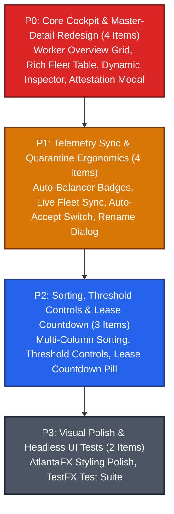

# Milestone 008: Studio Cockpit UI Overhaul — Cluster Overview, Fleet Topology & Quarantine Attestation

## Document Metadata
* **Milestone ID:** MS-008
* **Target Version:** `v1.4.0-cockpit-fleet`
* **Status:** ACTIVE
* **Lead Architect:** @studio-lead
* **Target Delivery Date:** 2027-02-28
* **Related ADRs:** ADR-0002, ADR-0003, ADR-0005, ADR-0010

---

## 1. Executive Summary & Objectives

User feedback on the initial MVP desktop interface revealed significant ergonomics gaps: the cluster overview was overly generic, lacking per-node visibility; worker fleet tables lacked crucial operational metrics (uptime, IP address, true CPU percentage, lease remaining); the worker node inspector occupied UI space even when nothing was selected; and the quarantine attestation workflow lacked naming workflows and automation options.

**Milestone 008 (MS-008)** delivers a comprehensive, modern dark-mode redesign of the primary Legatus Studio monitoring and fleet management surfaces (`Cluster Overview`, `Worker Fleet Topology`, and `Quarantine Queue`). Built on JavaFX 21 LTS and AtlantaFX `PrimerDark`, this milestone transforms Studio into a reactive, high-density operations cockpit where every cell and inspector updates live over WebSockets (LSTCP) without requiring manual refresh clicks.

### Core Objectives
1. **Cluster Overview & Worker Grid:** Author a dedicated "Worker Overview" card grid beneath cluster gauges where each worker displays an individual cell showing live CPU %, RAM load, active running task count, and operational state.
2. **Auto-Balancer & Queue Saturation Indicators:** Surface warning badges when the server auto-balancer breaches configured thresholds to handle compute spikes, and display an error badge when the cluster is saturated and forced to queue requests.
3. **Rich, Sortable Fleet Topology Table:** Expand the fleet table to display Worker Name, IP, Uptime Duration, accurate synced CPU %, RAM load, Active Tasks, Lease Remaining countdown, and an Active/Inactive toggle switch, supporting sorting across all columns.
4. **Context-Aware Worker Node Inspector:** Keep the inspector hidden when no node is selected; provide inline worker renaming, threshold adjustment sliders (CPU, RAM, Max Functions), active/inactive suspension toggles, auto-lease renewal toggles, and a unified "Revoke & Delete" action.
5. **Streamlined Quarantine Queue & Attestation:** Provide an Admin-only "Auto-Accept" toggle switch, detailed quarantine tables (Hostname, IP, Timestamp, Fingerprint), hidden attestation cards when unselected, and a naming prompt upon manual worker approval.

---

## 2. Scope & Subsystems Affected

* **`studio/src/main/resources/fxml/`:**
  * `overview.fxml`: Redesigned layout with cluster summary gauges at top and the multi-column `Worker Overview` card flow grid below.
  * `fleet_topology.fxml`: Redesigned master-detail layout with rich sortable `workersTable` and conditionally visible `workerInspectorPane`.
  * `quarantine.fxml`: Redesigned quarantine queue with admin-only Auto-Accept toggle, enhanced table columns, and conditionally visible attestation inspector.
* **`studio/src/main/java/dev/legatus/studio/ui/controllers/`:**
  * `ClusterOverviewController.java`: Implementation of dynamic worker card factory, live card updates, and auto-balancer warning/queue-error badges.
  * `FleetTopologyController.java`: Table column bindings, multi-column sorting, master-detail visibility toggle, inline renaming, threshold sliders, active switch, and merged delete modal.
  * `QuarantineController.java`: Auto-Accept toggle binding, selection-driven attestation card visibility, and friendly name approval dialog.
* **`studio/src/main/java/dev/legatus/studio/ui/viewmodels/`:**
  * `ClusterOverviewViewModel.java`, `FleetViewModel.java`, `QuarantineViewModel.java`: Reactive observable properties backed by LSTCP telemetry frames.
* **`studio/src/main/java/dev/legatus/studio/services/`:**
  * `WorkerService.java`: Client integration for worker renaming, threshold modification, active/inactive toggling, auto-lease renewal, and atomic revocation/deletion.

---

## 3. Prioritized Deliverables & Task Matrix

In accordance with **GL-0008**, deliverables are classified across four priority tiers:

---

### 3.1 P0: Critical Blockers (Release Gate / Core UI)

- [ ] `[P0]` **Cluster Overview: Individual Worker Grid Cards:** Author a responsive card grid (`FlowPane` / `TilePane`) under the Cluster Overview gauges in `overview.fxml`. Each connected worker receives an individual cell displaying:
  1. Worker Friendly Name and Hostname.
  2. IP address and connection status dot.
  3. Real-time CPU percentage progress bar and label (`%.1f%%`).
  4. Real-time RAM utilization bar (`X.X / Y.Y GB`).
  5. Active running tasks count badge (`N running`).
  6. Health state pill (`ACTIVE`, `SUSPENDED`, `DEGRADED`).
  Cards must update smoothly at 60Hz via `TelemetryCoalescer` without UI flickering.
- [ ] `[P0]` **Worker Fleet Table Overhaul:** Redesign `workersTable` in `fleet_topology.fxml` with rich operational columns:
  - `Worker Name` (Friendly Name + Hostname)
  - `IP Address`
  - `Uptime` (Formatted elapsed time since connection, e.g. `2d 4h 12m`)
  - `CPU Load` (Synced percentage bar + text label)
  - `RAM Load` (Used / Total GB + percentage)
  - `Active Tasks` (Count of actively executing guest functions)
  - `Lease Remaining` (Live decrementing countdown timer, e.g. `14m 22s`)
  - `Active State` (Interactive inline ToggleSwitch to Suspend / Resume activity)
- [ ] `[P0]` **Context-Aware Master-Detail Worker Node Inspector:** In `fleet_topology.fxml` and `FleetTopologyController.java`, bind the right-hand inspector pane's visibility and managed properties directly to `workersTable.getSelectionModel().selectedItemProperty().isNotNull()`. When no worker row is selected, the inspector pane is completely hidden. When a worker is selected, display:
  1. Inline editable Worker Name with **[Save Name]** button.
  2. Active/Inactive ToggleSwitch (calling `toggle-active` API).
  3. Auto-Lease Renewal ToggleSwitch.
  4. Live CPU, RAM, and active child runner list.
  5. Unified **[Revoke & Delete Worker]** button triggering a modal confirmation dialog.
- [ ] `[P0]` **Quarantine Queue Attestation Card Redesign:** In `quarantine.fxml` and `QuarantineController.java`:
  1. Bind the attestation detail card's visibility strictly to selection: hide completely if no quarantine request is selected.
  2. When an operator clicks **[Approve & Issue Lease]**, display a modal prompt dialog: *"Assign Friendly Worker Name"* (pre-populated with suggested hostname).
  3. Transmit the selected name alongside the approval request to `legatus-server`.

---

### 3.2 P1: High Priority (Milestone Core Parity)

- [ ] `[P1]` **Auto-Balancer Warning & Queue Saturation Badges:** Add persistent telemetry alert badges to the top ribbon and cluster overview:
  1. `Auto-Balancer Threshold Breach Warning` (amber warning icon): Displayed when the scheduler is forced to dispatch above configured worker thresholds to satisfy demand. Hovering displays which workers are operating above threshold limits.
  2. `Cluster Queue Saturated Error` (red alert icon): Displayed when cluster capacity is exhausted and incoming tasks are forced into the wait queue (queueing as the absolute last resort).
- [ ] `[P1]` **Quarantine Admin Auto-Accept Toggle Switch:** Add an `Auto-Accept Workers` toggle switch to the top of the Quarantine view in `quarantine.fxml`, bound to `legatus.quarantine.auto-accept`. Restrict visibility and interaction strictly to users possessing `ROLE_ADMIN`. When active, display a persistent notification banner: *"Auto-Accept Active: Incoming workers are automatically attested and named by UUID."*
- [ ] `[P1]` **Live WebSocket Synchronization for Fleet & Quarantine:** Wire `FleetTopologyController` and `QuarantineController` directly to LSTCP WebSocket event streams (`EVENT_FLEET_STATE`, `EVENT_WORKER_TELEMETRY`, `EVENT_ENROLLMENT_REQUESTED`). Ensure worker additions, disconnections, metric ticks, and quarantine entries appear and disappear dynamically in the UI without requiring manual refresh clicks.
- [ ] `[P1]` **Quarantine Table Rich Information Columns:** Redesign `quarantineTable` in `quarantine.fxml` with comprehensive columns: Hostname, IP Address, Connection Attempt Timestamp, CPU/Memory Specifications, and Ed25519 SHA-256 Fingerprint.

---

### 3.3 P2: Medium Priority (Ergonomics & Controls)

- [ ] `[P2]` **Multi-Column Fleet Table Sorting:** Enable multi-column sorting across all columns in `workersTable` (Sort by Name, IP, Uptime, CPU Load, RAM, Active Tasks, and Lease Remaining) backed by `SortedList<WorkerNode>` preserving selection across telemetry updates.
- [ ] `[P2]` **Per-Worker Threshold Configuration Sliders:** Add threshold controls to the worker node inspector: Target CPU % slider (50%–95%), Target RAM % slider (50%–95%), and Maximum Concurrent Functions spinner (1–64). Changes are saved dynamically via `PUT /api/v1/admin/workers/{id}/thresholds`.
- [ ] `[P2]` **Lease Time Remaining Visual Pill:** In the fleet table and inspector, render the lease remaining time as a color-coded badge: Green (`> 10m`), Amber (`2m – 10m`), Red (`< 2m`). If Auto-Renewal is active, display an auto-renew icon indicator.

---

### 3.4 P3: Low Priority (Visual Polish & Testing)

- [ ] `[P3]` **AtlantaFX Theme Tuning & Card Styling:** Style the worker overview cards with subtle dark-surface elevation (`card` class), smooth border transitions on hover, and high-contrast typography in both `PrimerDark` and `NordDark` themes.
- [ ] `[P3]` **Headless TestFX Test Suite:** Author headless automated UI test cases verifying: inspector hiding on null selection, auto-accept toggle state permissions, and worker renaming dialog interactions.

---

## 4. Definition of Done (DoD) Sign-Off Matrix

| DoD Requirement | Target Benchmark | Verification Tool / Command | Sign-off Status |
| :--- | :--- | :--- | :--- |
| **JUnit 5 & TestFX Suite** | 100% pass across all headless UI controller tests | `./server/mvnw -f studio/pom.xml test` | [ ] Pending Verification |
| **Modular Java 21 Build** | Clean javac compilation with zero module warnings | `./server/mvnw -f studio/pom.xml compile` | [ ] Pending Verification |
| **Telemetry 60Hz Gate** | Zero JavaFX Application Thread lag during simulated 100-worker telemetry storms | Headless telemetry stress benchmark | [ ] Pending Verification |
| **Documentation Gate** | `docs/guides/04-studio.md` updated with screenshots and operator walkthroughs | Review against `GL-0010` | [ ] Pending Verification |

---

## 5. Risk Assessment & Mitigation Strategies

### Risk 1: JavaFX Scene Graph Performance Degradation with Many Worker Cards
* **Description:** In clusters with 50+ workers, rendering individual card components with active progress bars and labels on every telemetry tick could cause JavaFX Application Thread frame drops.
* **Mitigation:**
  * Adopt virtualized card containers or bind card property updates to the 60Hz `TelemetryCoalescer` ring buffer.
  * Update card label text only when rounded integer percentages change, eliminating redundant layout passes.

### Risk 2: Lost Selection During Live Table Sorting & Telemetry Ingestion
* **Description:** As incoming WebSocket telemetry updates worker rows, sorting models can reset table selection, causing the node inspector to collapse abruptly while an operator is typing.
* **Mitigation:**
  * Preserve selected worker UUID across table refreshes using a persistent selection model listener.
  * In-place update existing `WorkerNode` property objects rather than re-creating domain items on every telemetry frame.
