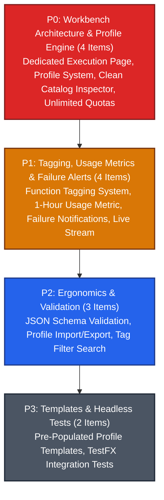

# Milestone 009: Studio Function Catalog & Dedicated Execution Workbench with Execution Profiles

## Document Metadata
* **Milestone ID:** MS-009
* **Target Version:** `v1.5.0-workbench-profiles`
* **Status:** ACTIVE
* **Lead Architect:** @studio-lead
* **Target Delivery Date:** 2027-03-15
* **Related ADRs:** ADR-0002, ADR-0004, ADR-0008, ADR-0010

---

## 1. Executive Summary & Objectives

In the initial Studio MVP, the Functions view combined bytecode catalog management, function metadata, parameter entry, execution budgeting, and live execution triggers into a single congested layout. This conflation made recurring task runs frustrating—forcing operators to manually re-type complex argument JSON, re-set instruction budgets, and re-select memory limits on every single invocation. Furthermore, operators had no visibility into invocation frequency metrics, no tagging system to categorize functions, and no mechanism to be notified if an asynchronous function run failed.

**Milestone 009 (MS-009)** resolves this architectural conflation by cleanly separating **Function Catalog Management** from **Function Execution**:
1. **Reworked Function Catalog (`Functions` View):** The catalog inspector is stripped of execution inputs and dedicated exclusively to function identity: Name, Description, Tagging system, Creation Timestamp, and a rolling 1-hour invocation frequency metric (`invocations_last_hour`).
2. **Brand New Dedicated Execution Workbench (`Execute` View):** Introduces a dedicated, purpose-built execution studio view in the left navigation rail exclusively for launching, testing, and monitoring function invocations.
3. **Persistent Execution Profile System:** Operators can save, recall, update, and delete named execution profiles (e.g. `Nightly-Batch-Fast`, `Stress-Test-Unlimited`, `Debug-Verbose`), eliminating repetitive manual configuration.
4. **Flexible Budgeting & Unlimited Quota Controls:** Supports both instruction budgets and wall-clock execution time limits, with explicit toggles for **Unlimited Instruction Budget** and **Unlimited Time Limit**.
5. **Failure Notification Alerts:** Adds a `Notify on Failure` execution parameter that triggers a desktop toast notification and audio chime if a dispatched task fails or exceeds quotas.
6. **Live Reactive Telemetry:** Task progress and stdout logs stream directly into the execution workbench over WebSockets in real time.

---

## 2. Scope & Subsystems Affected

* **`server/` (`legatus-server` - Java 21 LTS / Loom):**
  * `dev.legatus.server.function`: Extended `BytecodeEntity` schema adding `tags` (JSON array of strings) and `invocations_last_hour` rolling counter. Function metadata mutation endpoint (`PUT /api/v1/functions/{id}/metadata`).
  * `dev.legatus.server.execution.profiles`: Profile persistence repository and REST API (`/api/v1/execution-profiles`) allowing operators to store named execution configurations.
  * `dev.legatus.server.orchestration`: Support for `unlimited_instructions=true` and `unlimited_time=true` in task dispatch requests (`POST /api/v1/tasks/dispatch`).
* **`studio/src/main/resources/fxml/`:**
  * `functions.fxml`: Redesigned catalog view with tags chip list, creation timestamp, 1-hour usage metric, and metadata-only inspector (all execution arguments removed).
  * `execute_workbench.fxml`: New full-screen execution workbench FXML featuring profile selector, argument editor, quota controls, failure notification toggle, and live task monitor.
* **`studio/src/main/java/dev/legatus/studio/ui/controllers/`:**
  * `FunctionsController.java`: Tag management, metadata editing, and navigation link to the execution workbench.
  * `ExecuteWorkbenchController.java`: New controller managing execution profiles, parameter serialization, unlimited budget toggles, dispatch submission via HTTP, and live WebSocket streaming.
* **`studio/src/main/java/dev/legatus/studio/ui/viewmodels/`:**
  * `FunctionsViewModel.java`: Tag collection and invocation metrics.
  * `ExecuteWorkbenchViewModel.java`: Observable profile management and execution states.

---

## 3. Prioritized Deliverables & Task Matrix

In accordance with **GL-0008**, deliverables are classified across four priority tiers:

---

### 3.1 P0: Critical Blockers (Release Gate / Architecture Core)

- [ ] `[P0]` **Brand New Dedicated Function Execution Workbench (`Execute` Page):** Add a dedicated navigation rail item and full-screen view (`execute_workbench.fxml` / `ExecuteWorkbenchController.java`). The view provides:
  1. Function selector dropdown bound to registered bytecode functions.
  2. Execution Profile management bar (`[Select Profile]`, `[Save As New]`, `[Save]`, `[Delete]`).
  3. JSON arguments editor with syntax validation.
  4. Quota control panel with instruction budget and wall-clock time limit inputs.
  5. One-click **[Execute Function]** button (submitting via HTTP REST).
  6. Real-time live execution console tab updating over WebSockets.
- [ ] `[P0]` **Persistent Execution Profile System:** Author the execution profile model and persistence service (`ProfileService.java` / `dev.legatus.server.execution.profiles`). Profiles store:
  - `profile_name` (e.g. `Production-Daily-Run`)
  - `function_id`
  - `arguments_json`
  - `instruction_budget` & `unlimited_instructions` flag
  - `time_limit_ms` & `unlimited_time` flag
  - `notify_on_failure` boolean
  Profiles persist on the server and synchronize across Studio clients via WebSockets.
- [ ] `[P0]` **Function Catalog Metadata Inspector Refactor:** Overhaul `functions.fxml` and `FunctionsController.java`. Completely strip all execution parameter inputs, memory inputs, and instruction budget controls from the Functions view. Dedicate the catalog inspector strictly to function metadata:
  - Function Name and Bytecode SHA-256 Digest
  - Description textarea
  - Tagging chip container
  - Created At timestamp
  - Usage frequency metric: "Invocations in Last Hour"
  - Quick action: **[Open in Execution Workbench]** button.
- [ ] `[P0]` **Flexible Quota Controls with Unlimited Toggles:** In both `ExecuteWorkbenchController` and `legatus-server`:
  1. Add an `Unlimited Instruction Budget` checkbox next to the instruction budget input. When checked, the numeric budget field is disabled and the task executes with no instruction ceiling ($I_{\text{budget}} = \infty$).
  2. Add an `Unlimited Time Limit` checkbox next to the time limit input. When checked, the wall-clock timeout is disabled.
  3. Server orchestrator and worker runner accept `0` or negative values as sentinel values representing unlimited execution.

---

### 3.2 P1: High Priority (Milestone Core Parity)

- [ ] `[P1]` **Function Tagging System:** Implement tag management in `legatus-server` (`BytecodeEntity.tags`) and Studio (`FunctionsController.java`). Operators can add arbitrary tags (e.g., `analytics`, `etl`, `finance`, `v2`) via an interactive tag input field. Display tags as colorful AtlantaFX chips in both the function table and the inspector, supporting multi-tag search filtering.
- [ ] `[P1]` **Rolling 1-Hour Usage Frequency Metric:** Implement an in-memory sliding-window counter in `legatus-server` (`TaskExecutionTracker.java`) tracking task executions per function over the preceding 60 minutes. Expose `invocations_last_hour` in the function DTO and display it as an active metric badge in the Studio function catalog list and inspector.
- [ ] `[P1]` **Failure Notification Alert Parameter (`notify_on_failure`):** Add a `Notify if Function Failed` toggle switch to the execution workbench. When enabled on task submission:
  1. If the task exits with non-zero exit code, times out, or throws an unhandled exception, `legatus-server` broadcasts `EVENT_TASK_FAILED_ALERT` over LSTCP.
  2. Legatus Studio catches the event, displays an urgent desktop error notification banner/toast with the task failure reason, and highlights the failed task in the ledger.
- [ ] `[P1]` **Live WebSocket Progress & Stdout Streaming in Workbench:** Wire the execution workbench's output panel directly to the task's WebSocket log stream. As the task executes, show live intermediate instruction progress meter ticks and incremental `TASK_LOG_CHUNK` lines without leaving the execution page.

---

### 3.3 P2: Medium Priority (Ergonomics & Validation)

- [ ] `[P2]` **JSON Schema & Syntax Validation in Argument Editor:** Provide real-time JSON syntax checking and formatting (**[Format JSON]** button) in the workbench argument editor, highlighting syntax errors before dispatch.
- [ ] `[P2]` **Profile Export & Import:** Enable operators to export and import execution profiles as JSON files for sharing across environments or version control.
- [ ] `[P2]` **Tag-Based Filter in Function Catalog:** Add a tag filter multi-select dropdown in `functions.fxml` allowing operators to instantly filter the function catalog by one or more selected tags.

---

### 3.4 P3: Low Priority (Templates & Testing)

- [ ] `[P3]` **Pre-Populated Execution Profile Templates:** Seed the execution workbench with standard profile templates (`Default`, `Fast Test`, `Unbounded Batch`) upon initial cluster connection.
- [ ] `[P3]` **Headless TestFX Workbench Test Suite:** Author headless automated UI test cases verifying: profile saving and recall, unlimited budget toggle states, and failure notification triggers.

---

## 4. Definition of Done (DoD) Sign-Off Matrix

| DoD Requirement | Target Benchmark | Verification Tool / Command | Sign-off Status |
| :--- | :--- | :--- | :--- |
| **JUnit 5 Suite** | 100% pass across profile persistence, tagging, and usage metrics | `./server/mvnw -f server/pom.xml test` | [ ] Pending Verification |
| **TestFX Suite** | 100% pass across execution workbench and profile selector tests | `./server/mvnw -f studio/pom.xml test` | [ ] Pending Verification |
| **Modular Java 21 Build** | Clean javac compilation with zero module warnings | `./server/mvnw -f studio/pom.xml compile` | [ ] Pending Verification |
| **Documentation Gate** | `docs/guides/04-studio.md` updated with Execution Workbench & Profile guide | Review against `GL-0010` | [ ] Pending Verification |

---

## 5. Risk Assessment & Mitigation Strategies

### Risk 1: Unlimited Instruction Budget Causing Runaway Worker Threads
* **Description:** An infinite loop in guest bytecode executed with `unlimited_instructions=true` and `unlimited_time=true` could monopolize a worker core permanently.
* **Mitigation:**
  * Even when quotas are unlimited, the operator retains immediate manual abort capability via the Two-Stage **[Abort Task]** button.
  * Require `ROLE_ADMIN` or `ROLE_OPERATOR` privilege to dispatch tasks with unlimited parameters.

### Risk 2: Profile Name Collisions across Concurrent Operators
* **Description:** Two operators connected to the same cluster might simultaneously attempt to create or modify an execution profile with the same name.
* **Mitigation:**
  * Enforce unique constraint on `(function_id, profile_name)` in the database.
  * Implement optimistic locking (`version` field) on profile entities, rejecting stale overwrite attempts with HTTP 409 Conflict.
