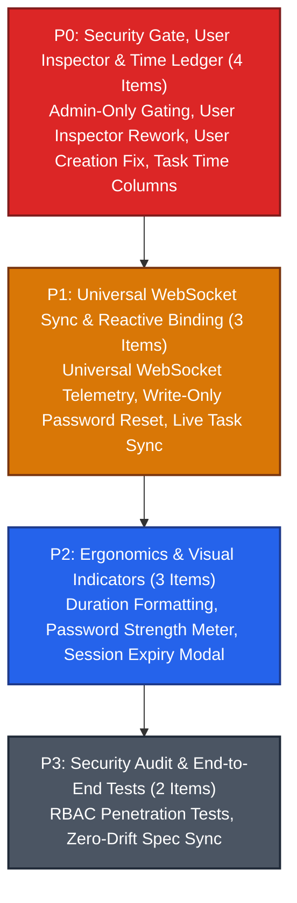

# Milestone 010: Task Time Ledger, User Administration Security Overhaul & Universal WebSocket Sync

## Document Metadata
* **Milestone ID:** MS-010
* **Target Version:** `v1.6.0-security-sync`
* **Status:** ACTIVE
* **Lead Architect:** @security-architect
* **Target Delivery Date:** 2027-03-31
* **Related ADRs:** ADR-0001, ADR-0002, ADR-0003, ADR-0005, ADR-0010

---

## 1. Executive Summary & Objectives

The operational integrity of a distributed compute cluster relies upon two critical foundations: clear, time-based task auditing and strict role-based access control (RBAC). In the initial Studio MVP, the task ledger prioritized raw instruction counts over wall-clock execution metrics (start time, end time, elapsed duration), making latency analysis cumbersome. Concurrently, the user administration panel suffered from account creation defects, lacked granular inspector editing controls, and did not properly enforce admin-only view gating. Finally, several data tables still required manual interaction to refresh state.

**Milestone 010 (MS-010)** resolves these defects and completes the Studio cockpit overhaul:
1. **Time-Based Task Explorer Ledger:** Replaces the raw instruction count column in `task_explorer.fxml` with actionable execution time metrics: **Execution Duration** (elapsed run time), **Start Time** (time task began), and **End Time** (time task concluded), complemented by status badges, worker node names, and function names.
2. **User Administration Security Panel Overhaul:** Completely fixes account creation and user persistence. Implements strict client-side and server-side RBAC gating: **only users possessing `ROLE_ADMIN` can view or make changes in the User Admin panel**.
3. **Comprehensive Master-Detail User Inspector:** Conceals the inspector when no user is selected; provides interactive controls for:
   - Account Activation/Deactivation ToggleSwitch (Enabled vs. Disabled).
   - Role Selection ToggleSwitch (Normal Operator `ROLE_OPERATOR` vs. Cluster Admin `ROLE_ADMIN`).
   - Username editing.
   - Email address editing.
   - Write-only Password Reset (setting new passwords; reading stored passwords is mathematically and architecturally impossible).
4. **Universal WebSocket Reactive Synchronization Invariant:** Formally asserts and verifies that **every single list, table, card grid, and inspector across all Studio views** (Overview, Fleet, Quarantine, Functions, Workbench, Tasks, Audit, Users) updates dynamically and reactively over WebSockets (LSTCP) without manual polling or refresh buttons. HTTP REST requests are reserved exclusively for explicit user-initiated mutations (submitting a task, saving a profile, creating an account).

---

## 2. Scope & Subsystems Affected

* **`server/` (`legatus-server` - Java 21 LTS / Loom):**
  * `dev.legatus.server.admin.AdminUserResource`: User creation bugfix, RBAC permission enforcement (`@PreAuthorize("hasRole('ADMIN')")`), username/email mutation endpoint (`PUT /api/v1/admin/accounts/{id}`), role assignment endpoint (`PUT /api/v1/admin/accounts/{id}/role`), and write-only password reset endpoint (`POST /api/v1/admin/accounts/{id}/reset-password`).
  * `dev.legatus.server.orchestration.task`: Persistence and serialization of wall-clock timestamps: `started_at` (epoch ms), `ended_at` (epoch ms), and computed `execution_duration_ms`.
  * `dev.legatus.server.transport.lstcp`: Broadcast of `EVENT_USER_STATE_CHANGED` and `EVENT_TASK_TIMESTAMPS_UPDATED` frames over LSTCP WebSocket.
* **`studio/src/main/resources/fxml/`:**
  * `task_explorer.fxml`: Redesigned task ledger table with Execution Duration, Start Time, and End Time columns.
  * `admin_users.fxml`: Redesigned user management table and context-aware master-detail inspector (hidden when no user is selected) with toggle switches for status and role.
* **`studio/src/main/java/dev/legatus/studio/ui/controllers/`:**
  * `TaskExplorerController.java`: Table column bindings for duration, start time, end time, and live WebSocket update binding.
  * `AdminUsersController.java`: Admin-only view protection, user creation dialog, account activation toggle, role toggle, username/email editing, and write-only password reset modal.
  * `NavigationController.java`: Conditional visibility/disablement of the "Admin Users" navigation item based on current operator JWT roles.
* **`studio/src/main/java/dev/legatus/studio/transport/`:**
  * `LstcpWebSocketClient.java`: Comprehensive event routing ensuring every domain model updates reactively on WebSocket frames.

---

## 3. Prioritized Deliverables & Task Matrix

In accordance with **GL-0008**, deliverables are classified across four priority tiers:

---

### 3.1 P0: Critical Blockers (Release Gate / Security Core)

- [ ] `[P0]` **Strict Admin-Only RBAC Gating for User Management:** Enforce role-based access control for User Administration across both server and client:
  1. In `AdminUserResource.java`, secure all account management endpoints with `@PreAuthorize("hasRole('ADMIN')")`. Requests from non-admin tokens return HTTP 403 Forbidden.
  2. In `NavigationController.java`, inspect the authenticated operator's JWT claims. If `ROLE_ADMIN` is not present, hide the "User Administration" navigation tab completely.
  3. In `AdminUsersController.java`, if an unprivileged session somehow navigates to the view, display a full-screen "Access Denied - Administrator Role Required" lock screen.
- [ ] `[P0]` **Context-Aware Master-Detail User Inspector Rework:** In `admin_users.fxml` and `AdminUsersController.java`:
  1. Bind the user inspector pane's visibility and managed properties directly to `usersTable.getSelectionModel().selectedItemProperty().isNotNull()`. When no user row is selected, the inspector is completely hidden.
  2. When a user is selected, display:
     - Editable Username field with **[Save]** button.
     - Editable Email Address field with validation and **[Save]** button.
     - Account Status ToggleSwitch: `Active` (green) vs `Disabled / Suspended` (red).
     - Role Permission ToggleSwitch: `Normal Operator` (`ROLE_OPERATOR`) vs `Cluster Administrator` (`ROLE_ADMIN`).
     - Dedicated **[Reset Password]** action button opening a write-only password dialog.
- [ ] `[P0]` **User Account Creation Bugfix & Validation:** Resolve the account creation failure in `AdminUserResource.java` and `UserManagementService.java`. Ensure `POST /api/v1/admin/accounts` validates uniqueness of username and email, hashes passwords using Argon2id/BCrypt, persists the account to the database, emits an audit log event (`ACCOUNT_CREATED`), and immediately returns the created entity with HTTP 201 Created.
- [ ] `[P0]` **Task Explorer: Execution Duration, Start Time & End Time Ledger:** Overhaul the primary table in `task_explorer.fxml`:
  1. Remove the raw "Instruction Count" column from the main table view.
  2. Add `Execution Duration` column displaying formatted run time (e.g. `124ms`, `3.42s`, `1m 15s`).
  3. Add `Start Time` column displaying formatted timestamp (`HH:mm:ss.SSS` or `YYYY-MM-DD HH:mm:ss`).
  4. Add `End Time` column displaying completion timestamp (`--` if still running).
  5. Include Worker Name, Function Name, Profile Name, and colored Status Pills (`QUEUED`, `EXECUTING`, `COMPLETED`, `FAILED`, `ABORTED`).

---

### 3.2 P1: High Priority (Milestone Core Parity)

- [ ] `[P1]` **Write-Only Password Reset Modal Dialog:** Implement a dedicated "Set New Password" modal dialog in Studio. Operators can supply a new password and confirmation. Passwords are sent exclusively via `POST /api/v1/admin/accounts/{id}/reset-password`. Plaintext passwords are never returned by the server, never cached in memory, and never displayed in the UI.
- [ ] `[P1]` **Universal WebSocket Reactive Synchronization Invariant:** Audit and refactor all Studio view controllers (`ClusterOverviewController`, `FleetTopologyController`, `QuarantineController`, `FunctionsController`, `ExecuteWorkbenchController`, `TaskExplorerController`, `AdminUsersController`, `DrawerController`). Assert that:
  1. Every list, table, and inspector subscribes to LSTCP WebSocket frames and updates reactively without manual refresh buttons.
  2. Modifying state (e.g. creating a user, dispatching a task, renaming a worker) updates all connected Studio clients instantaneously via WebSocket broadcast.
- [ ] `[P1]` **Live Task Lifecycle & Duration Streaming:** Update `TaskExplorerController` to increment running task durations live on every 60Hz telemetry tick while tasks remain in `EXECUTING` state, transitioning seamlessly to the finalized duration upon receiving `EVENT_TASK_LIFECYCLE` (`COMPLETED` or `FAILED`).

---

### 3.3 P2: Medium Priority (Ergonomics & Visual Polish)

- [ ] `[P2]` **Duration Time Formatting Utilities:** Author reusable high-precision time formatting utilities (`TimeFormatUtils.java`) supporting adaptive scaling: milliseconds (`< 1s`), seconds with decimal (`1s – 60s`), and minutes/seconds (`> 60s`).
- [ ] `[P2]` **Password Strength Meter & Validation:** In the password reset dialog, provide a real-time password complexity bar checking length (min 12 characters), mixed case, digits, and special symbols.
- [ ] `[P2]` **Session Timeout & Re-Authentication Notification:** When an operator's JWT token expires during active administration, display a non-destructive session re-authentication modal dialog allowing the operator to enter their password and resume without losing uncommitted view state.

---

### 3.4 P3: Low Priority (Security Testing & Verification)

- [ ] `[P3]` **RBAC Security Penetration & Exploit Test Suite:** Author automated security tests in `server/src/test/java/dev/legatus/server/security/RbacSecurityTest.java` verifying that: normal operators cannot create users, cannot reset passwords, cannot access quarantine auto-accept, and cannot mutate server-level configurations.
- [ ] `[P3]` **Living Documentation Zero-Drift Synchronization:** Update `docs/specs/studio-spec.md` and `docs/guides/04-studio.md` to reflect the time ledger columns, admin user panel workflows, and WebSocket reactive architecture.

---

## 4. Definition of Done (DoD) Sign-Off Matrix

| DoD Requirement | Target Benchmark | Verification Tool / Command | Sign-off Status |
| :--- | :--- | :--- | :--- |
| **JUnit 5 Suite** | 100% pass across RBAC security, account creation, and task timestamps | `./server/mvnw -f server/pom.xml test` | [ ] Pending Verification |
| **TestFX Suite** | 100% pass across admin users controller, task ledger, and password dialogs | `./server/mvnw -f studio/pom.xml test` | [ ] Pending Verification |
| **RBAC Security Gate** | Zero unauthorized access across all admin REST endpoints | Automated JUnit 5 security test suite | [ ] Pending Verification |
| **WebSocket Sync Gate** | 100% automated update verification on all Studio tables under LSTCP events | Headless event injection verification | [ ] Pending Verification |
| **Documentation Gate** | `docs/guides/04-studio.md` updated with User Management and Task Explorer guides | Review against `GL-0010` | [ ] Pending Verification |

---

## 5. Risk Assessment & Mitigation Strategies

### Risk 1: Accidental Self-Lockout of Admin Accounts
* **Description:** An administrator might inadvertently toggle their own account to `Disabled` or change their own role to `ROLE_OPERATOR`, locking themselves out of the cluster administration console.
* **Mitigation:**
  * In `AdminUserResource.java`, inspect the target user ID against the authenticated principal ID.
  * Disallow disabling or demoting the currently authenticated user with HTTP 400 Bad Request: *"Cannot modify status or demote the currently logged-in administrator account."*
  * Enforce that the cluster must always retain at least one active administrator account.

### Risk 2: High Task Volume Flooding WebSocket Channels
* **Description:** In high-throughput clusters executing thousands of ephemeral tasks per second, streaming individual task start/end timestamps could overwhelm client WebSocket buffers.
* **Mitigation:**
  * Batch `EVENT_TASK_LIFECYCLE` events into 100ms interval bundles on the server.
  * In Studio, apply `TelemetryCoalescer` ring buffering to merge task updates before updating the `ObservableList<TaskRecord>` on the JavaFX Application Thread.
