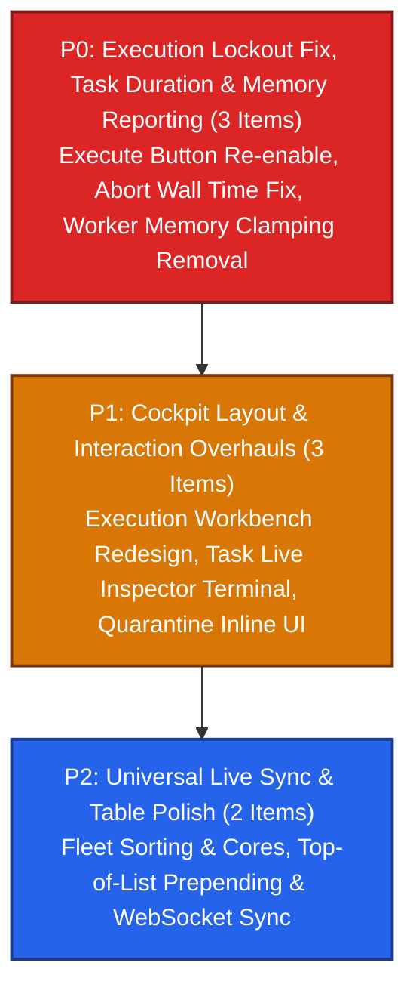

# Milestone 011: Cockpit UX, Live Sync, and Runtime Telemetry Overhaul

## Document Metadata
* **Milestone ID:** MS-011
* **Target Version:** `v1.7.0-cockpit-sync`
* **Status:** CLOSED
* **Lead Architect:** @runtime-architect & @ux-lead
* **Target Delivery Date:** 2027-04-15
* **Related ADRs:** ADR-0001, ADR-0002, ADR-0003, ADR-0005, ADR-0008, ADR-0010

---

## 1. Executive Summary & Objectives

Real-world operator testing revealed key ergonomic friction points, telemetry anomalies, and state synchronization gaps across the Legatus runtime and Studio desktop cockpit:
1. **Dynamic Memory & Telemetry Fidelity:** Memory reporting on the cluster telemetry ribbon and worker status was clamped to artificial static constants (`2.0 / 4.0 GB`) and failed to fluctuate or reflect actual host physical memory (e.g. 16 GB).
2. **Worker Fleet Table Live Updates & Sorting:** The worker fleet table did not update CPU, RAM, active tasks, or uptime reactively from worker heartbeats. Cores were missing from the table, clicking column headers failed to sort, and the lease remaining countdown did not decrement.
3. **Quarantine Experience & Inline Attestation:** The attestation flow presented an intrusive fullscreen `TextInputDialog` prompt for worker renaming. The layout required streamlining with inline friendly name configuration.
4. **Functions Workbench Modernization:** The manual "Refresh" button was redundant with WebSocket live sync, "1h Invocations" was erratic, and the metadata inspector required splitting into dedicated side-by-side Create and Inspect panels.
5. **Execution Profiles & Repeated Execution:** The Execution Workbench locked out further executions after a single dispatch due to an unreleased button disable state. Furthermore, Execution Profiles were disjointed from target functions rather than binding the target `function_id`, config, and arguments into a unified, reusable execution template. The workbench layout required redesign with a profiles master list and separate Create and Inspect & Execute panels.
6. **Task Explorer & Live Inspector Fidelity:** Running tasks reported inaccurate durations, aborted tasks erroneously reset their duration to 0ms, and already-terminated tasks permitted redundant abort attempts. The Task Live Inspector required duration/instruction progress meters (hidden when unlimited) and embedded live STDOUT/STDERR streaming.
7. **Universal WebSocket Sync & Top-of-List Invariant:** All lists (workers, quarantine, functions, profiles, tasks) must synchronize over LSTCP WebSockets and prepend newly created items at the top (index 0).

---

## 2. Subsystems Affected

* **`worker/` (`legatusd` & `common` - C++20):**
  * `worker/src/common/telemetry_collector.cpp`: Physical RAM detection on Linux via `/proc/meminfo` and `/proc/stat`.
  * `worker/src/daemon/worker_config.cpp`: Dynamic system RAM initialization in `default_for_system()` using `sysconf(_SC_PHYS_PAGES)`.
  * `worker/src/daemon/lctp_client.cpp`: Elimination of artificial memory clamping; transmission of actual host memory in `HEARTBEAT` frames.
* **`server/` (`legatus-server` - Java 21 LTS):**
  * `dev.legatus.server.service.ClusterMetricsService`: Aggregate memory computation from active worker telemetry.
  * `dev.legatus.server.web.websocket.lstcp.StudioStreamBroadcaster`: Live broadcast of per-worker metric ticks and cluster metric ticks over LSTCP.
  * `dev.legatus.server.web.websocket.lctp.LctpWorkerWebSocketHandler`: Heartbeat processing updating active task execution wall time and host telemetry.
  * `dev.legatus.server.service.TaskGatewayService`: Preservation of wall clock duration on task abort.
* **`studio/` (`legatus-studio` - JavaFX 21):**
  * `com.legatus.studio.service.TelemetryService`: Real-time updates for worker CPU, RAM, active tasks, uptime, and lease; prepending new items at index 0.
  * `com.legatus.studio.controllers.FleetTopologyController` & `fleet_topology.fxml`: Core count column, comparator binding for table header sorting, live lease countdown.
  * `com.legatus.studio.controllers.QuarantineAttestationController` & `quarantine_attestation.fxml`: Inline friendly name field, removal of popup dialog, sleek card styling.
  * `com.legatus.studio.controllers.FunctionsWorkbenchController` & `functions_workbench.fxml`: Removal of refresh button and 1h invocations column; dedicated Create and Inspect panels.
  * `com.legatus.studio.controllers.ExecuteWorkbenchController` & `execute_workbench.fxml`: Unified ExecutionProfile binding `function_id`, profiles master list, Create and Inspect/Execute panels, execution button re-enablement.
  * `com.legatus.studio.controllers.TaskExplorerController` & `task_explorer.fxml`: Live duration calculation, duration and instruction progress bars, abort button guard, embedded STDOUT/STDERR console.

---

## 3. Prioritized Deliverables & Task Matrix

### 3.1 P0: Critical Blockers & Telemetry Fidelity
- [x] `[P0]` **Worker Memory Clamping Removal & System RAM Detection:** Remove `/ 2` artificial clamping in `lctp_client.cpp`, enable dynamic host physical RAM detection in `worker_config.cpp`, and accurately broadcast fluctuating memory in `ClusterMetricsService` and `StudioStreamBroadcaster`.
- [x] `[P0]` **Execute Workbench Lockout Resolution:** Guarantee `executeButton` re-enables immediately upon dispatch confirmation or error, enabling repeated execution runs without requiring UI reloads.
- [x] `[P0]` **Task Duration & Abort Wall Time Integrity:** Compute live duration for `EXECUTING` tasks from `started_at`, record true elapsed wall time on task abort (`TaskGatewayService`), and disable the [Abort Task] button for inactive/terminated tasks.

### 3.2 P1: Cockpit Layout & Interaction Overhauls
- [x] `[P1]` **Unified Execution Profile Architecture & Workbench Redesign:** Link `function_id` inside `ExecutionProfile`. Redesign `execute_workbench.fxml` into a side-by-side layout: profiles master list, Create Profile panel, and Inspect & Execute panel.
- [x] `[P1]` **Task Live Inspector Overhaul with Terminal Console:** Add duration progress bar (hidden when unlimited), instruction progress bar (hidden when unlimited), and embedded STDOUT/STDERR log console in `task_explorer.fxml`.
- [x] `[P1]` **Quarantine Inline Attestation:** Replace intrusive `TextInputDialog` with an inline `friendlyNameField` inside the Attestation Card and streamline the visual card design.

### 3.3 P2: Universal Live Sync & Table Polish
- [x] `[P2]` **Fleet Table Cores Column, Sorting & Live Countdown:** Add Cores column to `workersTable`, bind `sortedWorkers.comparatorProperty()` to table comparator for interactive header sorting, and decrement lease remaining time live.
- [x] `[P2]` **Functions Workbench Panel Split & Refresh Removal:** Remove refresh button and 1h invocations column; implement dedicated Create Function and Inspect Function panels with reactive WebSocket sync.
- [x] `[P2]` **Universal Top-of-List Prepending:** Enforce that all reactive additions to observable lists across Studio prepend at index 0.

---

## 4. Verification & Testing Strategy

1. **Unit & Integration Tests:**
   - Worker telemetry unit tests verifying physical memory capture and non-clamped heartbeat payload.
   - Server task abort test verifying non-zero `wallTimeMs` and correct audit records.
   - Studio controller and ViewModel tests covering table sorting, profile creation with `function_id`, and duration progress logic.
2. **End-to-End Runtime Validation:**
   - Run `legatus-server`, `legatusd`, and `legatus-studio`.
   - Verify fluctuating host RAM on the telemetry ribbon (e.g. `X.X / 16.0 GB`).
   - Confirm repeated execution runs in the redesigned Execution Workbench.
   - Verify live duration counter and embedded STDOUT/STDERR stream in Task Explorer.
