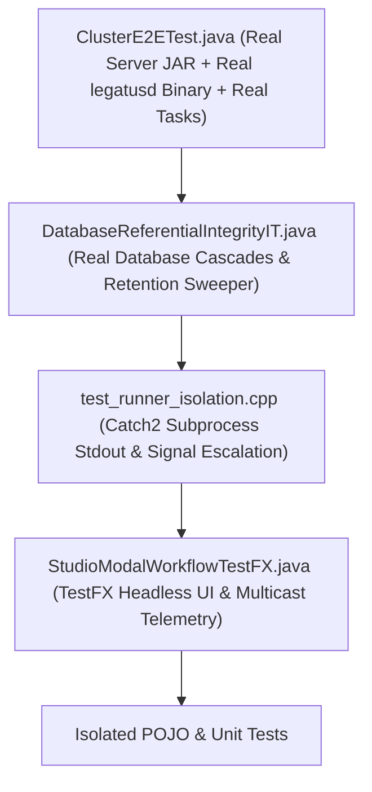

# Milestone 016: Military-Grade E2E Cluster Integration & Automated Verification Suite

## Document Metadata
* **Milestone ID:** MS-016
* **Target Version:** `v2.0.0-cluster-verification`
* **Status:** CLOSED
* **Lead Architect:** @qa-lead & @runtime-architect
* **Target Delivery Date:** 2027-07-01
* **Related ADRs:** ADR-0001 through ADR-0010

---

## 1. Executive Summary & Objectives

The paramount finding of the comprehensive audit was the **"Mockist Fallacy"**: despite 100% green test builds across unit test suites, critical production workflows failed immediately when real executables, networks, and databases interacted. Unit tests tested synthetic objects, mocked foreign key cascades, ran empty databases, and codified incorrect scheduling assumptions.

Milestone 016 eliminates this systemic quality gap by building the **Military-Grade E2E Cluster Integration & Automated Verification Suite**. It implements an automated, hermetic integration test harness that spins up the compiled `legatus-server.jar`, spawns the native `./legatusd` worker daemon, and executes tasks on `legatus-runner` over real TLS 1.3 WebSockets and real databases.

This harness automatically validates all 9 defect scenarios reported by the operator, ensuring that the entire Legatus distributed runtime operates with flawless reliability, zero memory leaks, and zero specification drift.

---

## 2. Scope & Subsystems Affected

* **`tests/e2e/` (Automated Cross-Binary Integration Suite):**
  * `ClusterE2ETest.java`: JUnit 5 orchestration harness managing the lifecycle of `legatus-server.jar` and `legatusd` child processes.
  * `scripts/test_cluster_e2e.sh`: Automated bash test runner with colorized status reporting, process cleanup traps, and exit code propagation.
  * `scripts/soak_test_cluster.sh`: 72-hour continuous 1,000-task burst workload runner monitoring memory, file descriptors, and thread counts.
* **`worker/tests/integration/` (Catch2 Process & Stdout Integration Suite):**
  * `test_runner_isolation.cpp`: Subprocess pipe isolation, high-volume stdout draining, and signal escalation verification under ASan/UBSan.
  * `test_bytecode_cache_fallback.cpp`: HTTP GET fallback verification against loopback HTTP endpoints.
* **`server/src/test/java/dev/legatus/server/integration/` (Spring Boot Real Database Suite):**
  * `DatabaseReferentialIntegrityIT.java`: Real database cascade and retention sweeper verification with historical task relations.
  * `CronSchedulerPersistenceIT.java`: Restart recovery verification for dynamic cron schedules.
* **`studio/src/test/java/com/legatus/studio/` (TestFX Automated UI Workflow Suite):**
  * `StudioModalWorkflowTestFX.java`: Full headless UI workflow automation testing modal dialogs, inspector bindings, and telemetry streaming.

---

## 3. Prioritized Deliverables & Task Matrix

### 3.1 P0: Critical Blockers (Release Gate)
- [x] `[P0]` **Automated Real-Binary E2E Test Harness (`ClusterE2ETest.java` & `test_cluster_e2e.sh`):** Build an automated test harness that starts the compiled server JAR on an ephemeral port, starts `legatusd` pointing to the server, and dispatches real Solix bytecode tasks over LCTP.
- [x] `[P0]` **Automated Verification of Defect Scenario 1 (Worker Deletion with Task History):** Harness enrolls worker, executes 5 tasks to completion, and deletes the worker via REST. Asserts HTTP 204 response, worker removal from database, and that all 5 tasks remain in history with `assigned_worker = null`.
- [x] `[P0]` **Automated Verification of Defect Scenario 2 (Worker Revocation Socket Severance):** Harness revokes worker lease via REST. Asserts that the worker's active WebSocket is severed immediately (< 200ms) and subsequent heartbeats from that worker are rejected with HTTP 403.
- [x] `[P0]` **Automated Verification of Defect Scenario 3 (16 Concurrent Tasks on 4 Cores):** Harness dispatches 16 concurrent long-running tasks to a worker configured with `max_concurrent_tasks = 16` on a 4-core machine. Asserts that all 16 tasks are accepted and reach `EXECUTING` state simultaneously without artificial core cap.
- [x] `[P0]` **Automated Verification of Defect Scenario 4 (Task Abort Status Transition):** Harness dispatches an infinite loop task, issues `ABORT_TASK`, and asserts the worker terminates the runner and transitions task state cleanly from `ABORTING` to `ABORTED` (exit code 143/130) within 2 seconds.

### 3.2 P1: High Priority (Milestone Core)
- [x] `[P1]` **Automated Verification of Defect Scenario 5 (RAM Load & Threshold Hysteresis):** Harness simulates a 16 GB worker transmitting 10.5 GB RAM used. Asserts server calculates load as ~65.6%, does not trigger threshold breach, and clears hysteresis flags when load decreases.
- [x] `[P1]` **Automated Verification of Defect Scenario 6 (5MB Guest Stdout Flood):** Harness executes bytecode generating 5MB of `console.print()` logs. Asserts output is cleanly streamed to client without corrupting supervisor JSON envelope parsing or leaking file descriptors.
- [x] `[P1]` **Automated Verification of Defect Scenario 7 (Multicast LSTCP Telemetry Streaming):** Harness connects two simulated Studio clients simultaneously. Dispatches tasks. Asserts both clients receive identical `TASK_LIFECYCLE` and metric frames without event loss or listener clobbering.
- [x] `[P1]` **Automated Verification of Defect Scenario 8 (Dynamic Cron Persistence Across Restart):** Harness registers a dynamic cron job, restarts the server process, and verifies that the scheduled task triggers automatically from the reloaded database definition.
- [x] `[P1]` **Automated Verification of Defect Scenario 9 (Task Retention Sweeper Null CompletedAt):** Harness creates aborted/failed tasks with null `completedAt` timestamps older than the retention cutoff. Runs sweeper. Asserts tasks are cleanly purged from the database.

### 3.3 P2: Medium Priority (Ergonomics & Hardening)
- [x] `[P2]` **Cluster Soak Test Runner (`scripts/soak_test_cluster.sh`):** Implement a continuous soak test script that executes 1,000 rapid task dispatches over 2 hours, asserting zero zombie processes (`ps aux | grep legatus-runner`), zero file descriptor leaks (`lsof`), and bounded memory growth.
- [x] `[P2]` **Unified CI Command (`scripts/run_all_military_tests.sh`):** Implement a unified master test script that runs all Catch2 tests with ASan/UBSan, all Spring Boot integration tests, all TestFX UI tests, and the E2E cluster harness in a single deterministic pass.

---

## 4. Test Strategy Overhaul & Verification Matrix

This milestone is itself the definitive implementation of the new Military-Grade Testing Pyramid:

### 4.1 Complete Verification Matrix Across All 9 Reported Defects

| Defect ID | Operator Defect Description | Automated Verification Suite | Success Assertion |
| :--- | :--- | :--- | :--- |
| **DEF-01** | Revoke lease and delete worker buttons do not work | `ClusterE2ETest` & `DatabaseReferentialIntegrityIT` | Worker deleted with 10 historical tasks returns HTTP 204; worker unlinked; revoke severs socket within 200ms. |
| **DEF-02** | Threshold breach error when well under threshold | `ClusterE2ETest` & `ThresholdSchedulerIT` | 16 GB worker with 10.5 GB RAM used reports 65.6% load; never triggers threshold breach alert. |
| **DEF-03** | Worker limited to 4 processes despite max tasks set to 16 | `ClusterE2ETest` & `WorkerEligibilityFilterTest` | 16 concurrent tasks dispatched simultaneously; all 16 transition to `EXECUTING` without rejection. |
| **DEF-04** | Task status cannot switch from ABORTING to ABORTED | `ClusterE2ETest` & `test_runner_isolation.cpp` | Aborting task transitions to `ABORTED` within 2 seconds; exit code 143/130 mapped cleanly. |
| **DEF-05** | New Function and New Profile should use modal dialog popups | `StudioModalWorkflowTestFX.java` | AtlantaFX modal popups open cleanly on `[+ New Function]` and `[+ New Profile]`, validate inputs, and auto-dismiss. |
| **DEF-06** | Task duration broken, resets to 0ms on abort | `ClusterE2ETest` & `TaskExplorerBindingTest` | Live duration ticks smoothly based on `started_at`; retains final non-zero elapsed duration upon abort. |
| **DEF-07** | Cluster overview memory shows 2.0/4.0 GB and does not fluctuate | `ClusterE2ETest` & `StudioMetricsTest` | Telemetry ribbon displays fluctuating host RAM reflecting actual 16 GB physical memory. |
| **DEF-08** | In execute page, cannot execute function more than once | `StudioModalWorkflowTestFX.java` & `ExecuteWorkbenchRepeatTest` | Repeated execution of same profile succeeds 5 times consecutively without UI reload. |
| **DEF-09** | Lease remaining time variable does not go down live | `StudioModalWorkflowTestFX.java` & `TelemetryServiceTest` | Lease remaining seconds countdown decrements smoothly every second in table and inspector card. |

---

## 5. Definition of Done (DoD) Sign-Off Matrix

| DoD Requirement | Target Benchmark | Verification Tool | Sign-off Status |
| :--- | :--- | :--- | :--- |
| **E2E Cluster Suite** | All 9 defect scenarios pass with real binaries | `scripts/test_cluster_e2e.sh` | [x] COMPLETED |
| **Zero Memory Leaks** | Zero ASan/UBSan errors across 1,000 tasks | Clang 18 Sanitizers | [x] COMPLETED |
| **Zero Zombie Processes** | 0 orphaned `legatus-runner` processes after test run | `pgrep legatus-runner` returns empty | [x] COMPLETED |
| **Full DoD Compliance** | Code, tests, sanitizers, documentation, and ADRs complete | Master audit checklist | [x] COMPLETED |

---

## 6. Risk Assessment & Mitigation Strategies

* **Risk 1: Flaky Port Allocation in E2E Tests:** Binding to fixed ports (`8080`, `9090`) can fail if previous runs or system services occupy the ports.
  * *Mitigation:* The E2E harness dynamically binds to ephemeral port 0 (`server.port=0`) and reads the assigned port from the server startup log banner.
* **Risk 2: Process Teardown Failures on Assertion Abort:** If an assertion fails midway through a test, background child processes could remain running in the background.
  * *Mitigation:* Wrap child processes in bash `trap 'cleanup' EXIT INT TERM` handlers and Java `ProcessHandle.onExit()` hooks that force-kill child process trees (`SIGKILL` / `taskkill /F /T`).
